> **代码有做更新，大家记得下载下新的**
> 
> **完整可运行代码：**
> 
> 通过网盘分享的文件：EvoAgent.zip
> 
> 链接: https://pan.baidu.com/s/13RlM4k6qxanloAjiaPtWtg 提取码: LRU1
> 
> **评测数据：**
> 
> 通过网盘分享的文件：pr_diff.jsonl
> 
> 链接: https://pan.baidu.com/s/1P8y2eCsl6secFxrWxM17Vg 提取码: KMP9

> - **对于代码和文档有任何问题大家可以随时小红书私聊我**
> 
> - **代码会一直更新迭代，大家使用过程中遇到任何问题，都可以直接反馈我我就会修改**
> 
> - **同时欢迎大家多多向我反馈意见，主包看到就一定会有反馈**

自进化项目反馈（项目是8月初才上的，目前只有1个多月的时间，后续大家的反馈会继续在这里更新）

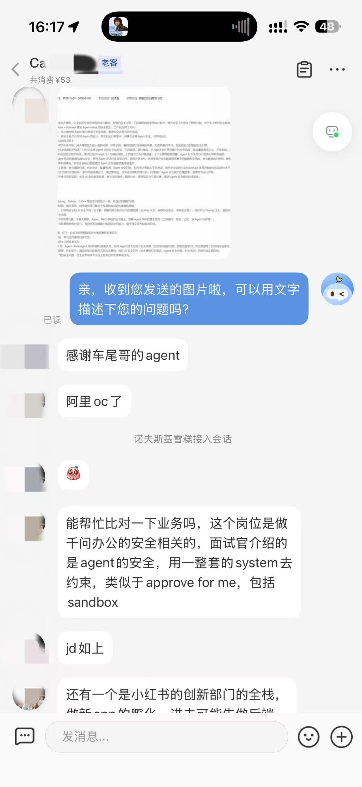

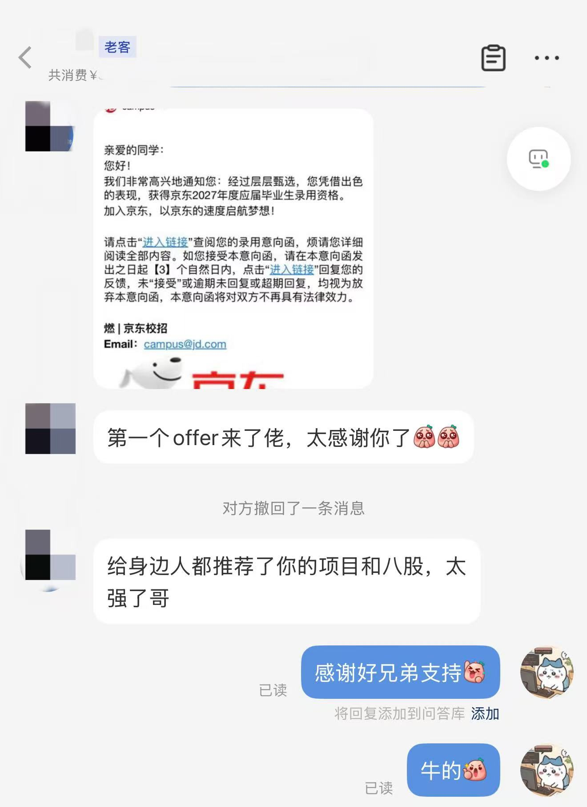


# 一、🍠项目简介

EvoAgent 是一个面向研发过程 Pull Request 的自进化Harness风险治理与安全修复 Agent。它接收 PR Diff，分析本次变更可能引入的安全、可靠性、正确性和回归风险，复核问题证据，并对部分规则生成保守修复。整个过程不是一次模型调用，而是一条可以恢复、重试、追踪和评测的 Agent 执行链路。

> 项目采用自研Agent runtime，Runtime 负责节点调度、执行预算、超时、重试、任务取消、Checkpoint、断点续跑和 Run Trace。任务中途失败后，可以从最近完成的节点恢复，不需要重新执行整个 PR 审查流程
> 
> 除了diff审查，项目还实现了 PR Webhook、评论 Upsert、独立修复分支、Redis Streams 消费、Worker 租约、ACK、失败重试和死信队列。
> 
> 基于 100 个受控 PR Diff 的 Evaluation Harness。评测按照仓库划分 Validation 和 Holdout，通过文件路径、行号区间和 CWE 类型进行一对一匹配，用来验证风险检测效果，也用于判断新的 Prompt 或 Skill 版本

> 自进化演进会通过 Validation、Holdout 和非回归门禁

多Agent协作由主-子Agent架构组成：

- Lead：负责拆解任务、把审查目标委派给 Worker、检查 Worker 结果、发起返工并完成最终综合。

- Security：检查输入边界、权限控制、敏感数据和危险调用链。

- Reliability：检查状态变化、异常处理、并发、资源生命周期、兼容性和相关测试。

- Critic：在隐藏候选来源身份后进行独立质疑，寻找错误位置、缺少前置条件、证据不足和严重度不合理等问题。

Worker 之间不直接通信，所有任务分派、返工和最终决定都经过 Lead。

```Java
Lead 主 Agent
  ├─ 委派 Security Worker
  ├─ 委派 Reliability Worker
  ├─ 评估结果并要求返工
  ├─ 委派 Critic Worker 盲审
  └─ 综合最终 findings
```

主-子agent模式怎么协作

```Plain Text
Lead Agent ReAct
   │
   ├─ delegate(Security)
   ├─ delegate(Reliability)
   │          并行执行
   ▼
收集 WorkerResult
   │
   ├─ 证据不足 → request_revision(Security)
   ├─ 结论冲突 → delegate(Critic)
   ├─ 需要反证 → delegate(Critic)
   └─ 发现新风险 → 创建新的子任务
   │
   ▼
Lead 综合、去重、调整严重度
   │
   ▼
FindingGate
```

从 Agent 不直接互相通信：

```Plain Text
Security ──结果/问题──→ Lead
Reliability ─结果/问题→ Lead
Critic ──裁决/反证────→ Lead
```

同时，每个Agent仍然是React，其中包含2层循环

外层：Lead 调度循环

```Plain Text
Lead 读取任务状态
   │
   ├─ delegate
   ├─ request_revision
   ├─ invoke_critic
   ├─ cancel_task
   ├─ accept_finding
   └─ final
```

内层：每个 Agent 的工具 ReAct

```Plain Text
Agent
  → tool
  → observation
  → tool
  → observation
  → report/final
```

整体结构：

```Plain Text
Lead Agent Loop
    │
    ├─ Security BoundedRole ReAct
    ├─ Reliability BoundedRole ReAct
    └─ Critic BoundedRole ReAct
```

Lead 本身也可以是 BoundedRole，但它除了工具动作，还需要支持调度动作。

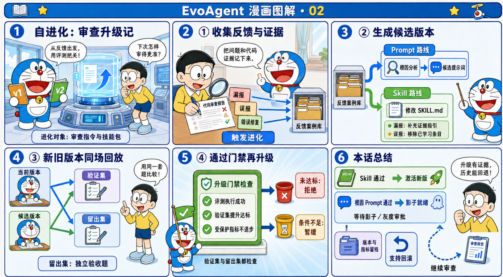

# 二、🥝简历写法（后续会写多套简历写法，解决大家撞项目的顾虑～）

项目简历描述1：

**EvoAgent：自进化Agent Runtime Harness的PR研发治理智能体**

> **技术栈：** Python、Harness Engineering、Multi-Agent、Self-Evolution、Skill、PostgreSQL、Docker、Prometheus

项目简介：

> 面向 Pull Request 风险治理与安全修复场景，自研可持久化可恢复的 Agent Runtime Harness。完成风险发现、证据复核、补丁生成、结果验证、离线评测、反馈学习和版本回滚能力，实现风险治理端到端闭环

项目亮点：

1. **Agent Runtime Harness，**统一管理任务状态、执行预算、节点重试、**持久化 Checkpoint**、任务取消、**断点续跑及 Run Trace**。

1. **Agent 自进化**，Prompt 与 Agent Skill双轨独立进化链。将误报、漏报、坏修复及执行异常回流为**失败案例**，自动** Prompt和Skills 候选生成，三层门禁自动激活**，同时提供内容指纹去重、版本血缘追踪、历史回放和一键回滚

1. **多 Agent 协作**，设计 Lead/Worker/Critic的主从Agent 协作架构。Lead动态委派、Worker 并行ReAct循环评估和返工。Critic 独立质疑

1. **Agent端到端评测**，建设基于** 100 个受控PR Diff 样本的端到端 Evaluation Harness**，按仓库划分 Validation/Holdout。PR  Review准确率达 92.5%。多 Agent 风险检测** F1 从 81.9% 提升至 92.5%**，**高风险召回率从 84.2% 提升至 94.7%。**

1. **Agent Loop与可观测Trace**，有界 Agent Loop，同时记录节点状态、Agent 消息、重试、Checkpoint和门禁结果，支持执行链路回放、失败归因、评测复现和断点恢复。

1. **上下文压缩与Memory管理**，按风险 Hunk、历史 Observation 和 Token 预算生成有限上下文， Working、Episodic、Semantic、Procedural 四层记忆。支持租户及仓库级检索隔离、任务归档和过期清理

项目简历描述2：

**面向Pull Request研发治理的自进化Multi-Agent Harness系统**

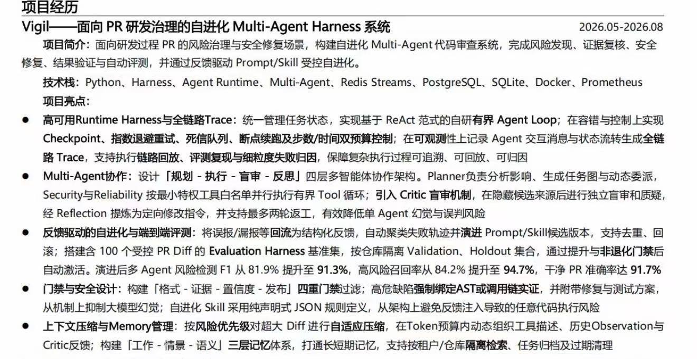

---

# 三、🍠前置知识

### 1. Pull Request 和 unified diff

Pull Request 是代码托管平台上的变更评审单。EvoAgent 不拉取整个仓库做全量扫描，核心输入是一段 unified diff。

一个最小 diff 长这样：

```Diff
--- a/app.py
+++ b/app.py
@@ -1 +1,2 @@
-safe_call()
+password = "secret-value"
+eval(user_input)
```

几个符号的含义：

> - --- 表示旧文件。
> 
> - +++ 表示新文件。
> 
> - @@ -1 +1,2 @@ 是 hunk 头，记录旧文件和新文件的起始位置。
> 
> - - 开头是删除行。
> 
> - + 开头是新增行。
> 
> - 其他行是上下文。

> EvoAgent 只把新增行交给规则审查。这样可以把结论限定在"本次 PR 引入的问题"，不会把仓库原本就存在的旧问题全翻出来。

### 2.Lead/Worker 主-子agent协作

Lead 是整个会话的控制者。它先产生 Delegation，随后接收 Worker 报告，必要时发出 Revision Request。Security 和 Correctness/Reliability 可以并行执行，但互不直接通信。Critic 看到的是去除来源身份后的候选 Finding，用于减少对某个角色的先验偏好。最终发布索引仍由 Lead 给出，再经过确定性 Finding Gate。

### 3.Webhook 和 HMAC-SHA256

Webhook 是 GitHub 主动调用 EvoAgent 的 HTTP 地址。PR 创建、重新打开或推送新提交时，GitHub 把事件 payload 发到：

```Plain Text
POST /webhooks/github
```

只判断请求头来自 GitHub 不够，因为请求头可以伪造。项目用 Webhook Secret 对原始请求体计算 HMAC-SHA256：

```Plain Text
expected = "sha256=" + HMAC_SHA256(secret, raw_body)
```

然后用常量时间比较 hmac.compare_digest() 对比 GitHub 发来的 X-Hub-Signature-256。常量时间比较可以减少普通字符串逐字节比较带来的时序侧信道。

### 4. 同步任务和异步任务

同步审查：

```Plain Text
POST /v1/reviews
```

HTTP 请求会等到审查完成，再返回报告。它适合本地调试和短 diff。

异步审查：

```Plain Text
POST /v1/reviews?async=true
```

服务先创建 PENDING 任务，然后把 payload 交给线程池或 Redis，立即返回任务 ID。调用方之后查询：

```Plain Text
GET /v1/tasks/{task_id}
```

GitHub Webhook 默认走异步链路，因为 Webhook 不适合一直等待 LLM 或多个 Reviewer 完成。

### 5. Agent Loop与Runtime

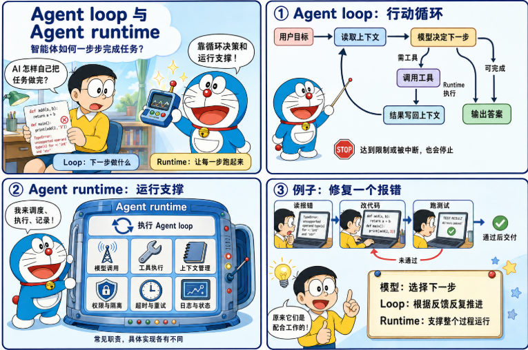

- AgentRuntime：执行 planning、executing、reviewing ，负责 checkpoint、节点重试、取消和总体预算。

- BoundedRole：执行每个 LLM 角色的 tool/final 循环，默认最多 4 步，并检查该角色的 Token 和时间预算。

### 6.Checkpoint与幂等

Checkpoint 用来恢复计算状态，幂等用来避免外部副作用重复发生

- 外层 checkpoint 保存Runtime 的输出。

- 内层 checkpoint 保存 Lead 会话的委派、Worker、返工、Critic 和最终决定。

- Webhook Delivery ID 与请求体 SHA-256 用于识别重复事件。

- GitHub 评论使用隐藏 Marker 执行 Upsert，避免每次重试都创建新评论。

### 7. Scanner、Agent 与 Gate

| **类型** | **是否调用模型** | **当前职责** |
| --- | --- | --- |
| Scanner | 否 | 通过正则、声明式规则、AST 或静态检查产生事实和候选 Finding |
| LLM Agent | 是 | 根据目标自主选择工具或结束，完成委派、审查、质疑与综合 |
| Gate | 否 | 检查格式、位置、证据、置信度和发布资格 |

### 8. OpenAI 兼容接口

OpenAI 兼容接口通常指和 Chat Completions 请求结构接近的 HTTP API。EvoAgent 调用：

```Plain Text
{base_url}/chat/completions
```

请求里包含 model、messages、temperature 和 response_format。项目不依赖官方 OpenAI SDK，而是用 Python 标准库 urllib.request 发请求。

这样做的好处是依赖少，也能接 DeepSeek、OpenRouter 或其他兼容服务。代价是重试、连接池、流式解析、错误分类和观测都要自己补。

### 9. Precision、Recall 和 F1

评测不能只看"模型说得像不像"。EvoAgent 使用位置级的客观指标。

```Plain Text
Precision = TP / (TP + FP)
Recall    = TP / (TP + FN)
F1        = 2 * Precision * Recall / (Precision + Recall)
```

TP 是正确命中的问题，FP 是误报，FN 是漏报。

举个例子。验证集有 4 个真实问题，模型报了 5 个，其中 3 个正确：

```Plain Text
TP = 3
FP = 2
FN = 1
Precision = 3 / 5 = 0.6
Recall = 3 / 4 = 0.75
F1 ≈ 0.6667
```

只看 Recall 容易鼓励模型多报问题，只看 Precision 又可能让模型过于保守。F1 用来平衡两者。

### 10. Validation 和 holdout

Validation 用来判断候选提示词是否比基线更好。Holdout 是隐藏回归集，用来检查候选有没有针对公开验证样本过拟合。

### 11. SQLite、PostgreSQL 和 Redis

> 1. SQLite 是单文件数据库，适合本地运行和测试。EvoAgent 默认把数据写到 evoagent.db。
> 
> 1. PostgreSQL 适合多进程或多实例共享数据。设置 EVOAGENT_DATABASE_URL 后，服务会选择 PostgresTaskStore。
> 
> 1. Redis 在这里不是数据库主存储，而是异步任务队列适配。Worker 用 BRPOP 等待任务。

### 12. GitHub PAT

PAT 是用户或机器人账号的访问令牌。配置 EVOAGENT_GITHUB_TOKEN 后，GitHub API 请求使用这个 token。

### 13.Harness Engineering

**harness本来有安全带、马具、约束装置的意思。不要只让 Agent 自由发挥，而是给它一套运行框架。 **

**如果说 Prompt Engineering 是写好指令，Context Engineering 是管理信息，Harness Engineering 就是设计执行系统。**

> 流程：

人类设定目标与边界 → Agent 生成计划与代码、动作 → 机器执行 → 环境反馈 → Agent 修正 → 最终交付。

> 工程师角色变化：

不再只是直接写代码，而是设计 Agent 的运行环境、工具权限、反馈机制、失败恢复和验证流程。

举个🌰：比如一个写代码 Agent，不应该只是让模型说我来改。它需要能读文件、能搜索代码、能编辑文件、能跑测试、能看到报错、能根据报错修复、能避免删除用户代码、能向用户报告改了什么，这整套执行轨道就是 Harness。

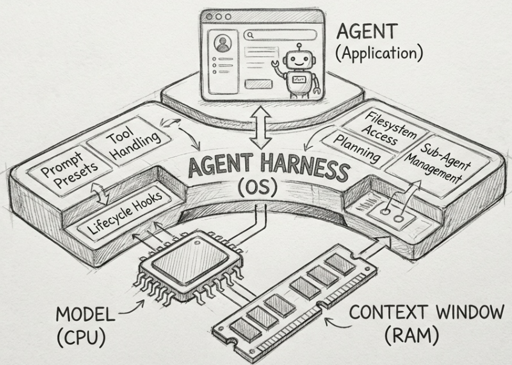

### 14.自进化

自进化 Agent 是指能够从执行结果中提取经验，并把这些经验持久化为可复用资产的 Agent。下一次遇到相似任务时，它使用更新后的 Prompt、Memory、Skill、Policy，必要时也可以使用经过训练的新模型。

这里的"进化"通常是工程意义上的持续改进，并不等于 Agent 可以任意重写自己的代码或模型参数。

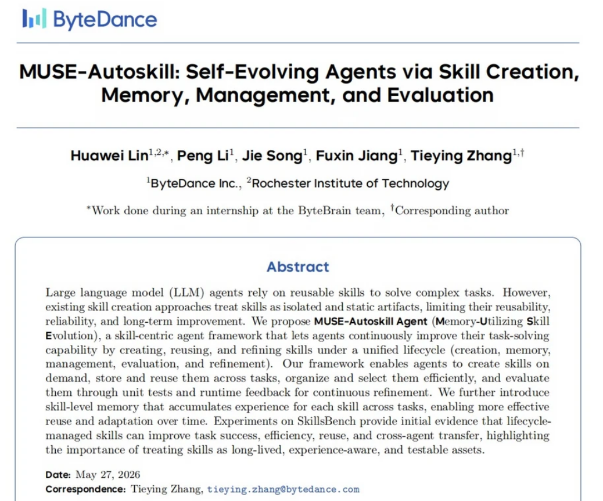

---

# 四、🥝项目背景

**这里给没有pull request过的同学讲一下场景**

> 在开源项目或企业代码仓库中，维护者需要对贡献者提交的 Pull Request 进行代码审查。随着 PR 数量增加，人工审查面临响应慢、审查标准不一致和重复检查成本高等问题。
> 
> 让agent可以自动分析 PR 代码变更，执行检查生成Pull Request的代码审查结果，从而完成自动化首轮审查，减少维护者的重复工作

### github PR 审查通常有几个现实问题

第一，直接让单个大模型读取完整 PR，容易出现行号错误、风格类误报和缺少测试建议的泛泛结论，模型输出也需要本地规则和证据复核兜底。

第二，不同 Reviewer 的关注点不一样。有人更关注注入，有人更关注异常处理，有人只看业务逻辑。没有统一输出格式时，结果很难沉淀。

第三，审查工具如果只给一句结论，后续很难回答"谁发现的、依据是什么、当时用了哪个提示词、为什么这个版本被激活"。

第四，审查和修复如果直接写用户分支，风险很高。自动修复必须限制规则范围，并写到独立分支。

### EvoAgent 解决什么

> EvoAgent 把这几个问题拆开处理：

- DiffParser 只提取新增行，保证位置范围可控。

- 多agent协作+返工

- 可控Agent loop

- Harness 保存每一步状态和消息。

- GitHub Webhook 把 PR 事件接进审查链路。

- 反馈案例进入提示词回放评测，不接受调用方自己给的回归分数。

---

# **五、🌽****项目运行**

## **1. 环境要求**

项目可以直接docker一键运行。如果是windows系统且不想搞WSL、docker项目使用 Python 3.11。进入包含 requirements.txt 的项目目录后安装依赖：

```PowerShell
python -m pip install -r requirements.txt
```

## **2. 配置管理员与登录密钥**

推荐先启用认证并创建本地管理员：

```PowerShell
$bytes = New-Object byte[] 32
[Security.Cryptography.RandomNumberGenerator]::Create().GetBytes($bytes)
$env:EVOAGENT_AUTH_REQUIRED = 'true'
$env:EVOAGENT_AUTH_SECRET = [Convert]::ToBase64String($bytes)
$env:EVOAGENT_BOOTSTRAP_ADMIN_USERNAME = 'admin'
$env:EVOAGENT_BOOTSTRAP_ADMIN_PASSWORD = '<至少 10 个字符的强密码>'
```

EVOAGENT_AUTH_SECRET 在启用认证时至少需要 32 字节。Bootstrap 管理员只在用户名不存在时创建，重启不会覆盖已有用户密码。

当前角色是

- admin：read、review、fix、manage、audit。

- maintainer：read、review、fix。

- auditor：read、audit。

## **3. 配置模型**

### **DeepSeek 官方兼容端点**

```PowerShell
$env:EVOAGENT_LLM_PROVIDER = 'deepseek'
$env:EVOAGENT_DEEPSEEK_API_KEY = '<API Key>'
```

### **OpenRouter 免费路由**

```PowerShell
$env:EVOAGENT_LLM_PROVIDER = 'openrouter-free'
$env:EVOAGENT_OPENROUTER_API_KEY = '<API Key>'
```

也可以使用 openrouter-deepseek-free。免费模型的名称和可用性由供应商决定，必要时通过 EVOAGENT_LLM_MODEL 显式覆盖。

### **自定义 OpenAI Chat Completions 兼容端点**

```PowerShell
$env:EVOAGENT_LLM_PROVIDER = 'custom'
$env:EVOAGENT_LLM_BASE_URL = 'https://example.com/v1'
$env:EVOAGENT_LLM_API_KEY = '<token>'
$env:EVOAGENT_LLM_MODEL = '<model-name>'
```

项目会自动读取根目录 .env 和 evoagent/.env，真实进程环境变量优先。不要把密钥提交到仓库。

## **4. 启动服务**

```PowerShell
python -m evoagent
```

默认监听 127.0.0.1:8080。浏览器打开

```Plain Text
http://127.0.0.1:8080/
```

健康检查不要求 Bearer Token：

```PowerShell
Invoke-RestMethod http://127.0.0.1:8080/health
```

返回结果会包含队列后端、模型 Provider/Model、当前 agentic 模式和组件分类。

## **5. 登录并提交同步审查**

```PowerShell
$session = Invoke-RestMethod -Method Post `
  -Uri http://127.0.0.1:8080/v1/auth/login `
  -ContentType 'application/json' `
  -Body (@{
    username = 'admin'
    password = '<你的管理员密码>'
  } | ConvertTo-Json)

$headers = @{ Authorization = "Bearer $($session.access_token)" }

Invoke-RestMethod -Method Post `
  -Uri http://127.0.0.1:8080/v1/reviews `
  -Headers $headers `
  -ContentType 'application/json' `
  -Body (@{
    repository = 'demo/api'
    pull_request = 12
    mode = 'agentic'
    diff = "diff --git a/app.py b/app.py`n--- a/app.py`n+++ b/app.py`n@@ -1,0 +1,1 @@`n+eval(user_input)"
  } | ConvertTo-Json)
```

如果服务主机已有该仓库的 checkout，可以额外传入绝对路径 `repository_root`。这会开放完整仓库搜索、符号、测试、AST、Git 和静态检查工具。该路径必须是服务主机上已经存在的绝对目录。

## **6. 异步审查与查询**

把地址改为：

```Plain Text
POST /v1/reviews?async=true
```

服务返回 `202`、任务 ID 和队列后端。之后查询：

```PowerShell
Invoke-RestMethod -Headers $headers http://127.0.0.1:8080/v1/tasks/<task-id>
Invoke-WebRequest -Headers $headers http://127.0.0.1:8080/v1/tasks/<task-id>/repor
```

取消和恢复接口分别是：

```Plain Text
POST /v1/tasks/{task_id}/cancel
POST /v1/tasks/{task_id}/resume
```

取消是协作式取消，在 Runtime 节点边界检查；恢复会重新入队，并从持久化 checkpoint 继续。

## **7. 参数**

> - EVOAGENT_MAX_DIFF_BYTES：Diff 最大字节数，默认 1 MiB。
> 
> - EVOAGENT_MAX_STEPS：外层 Runtime 最大节点尝试步数，默认 8。
> 
> - EVOAGENT_TIMEOUT_SECONDS：外层 Runtime 和模型 HTTP 的默认时间边界，默认 120 秒。
> 
> - EVOAGENT_AGENT_TOKEN_BUDGET：单角色默认 Token 预算，默认 8000。
> 
> - EVOAGENT_AGENT_TIME_BUDGET_SECONDS：单角色默认时间预算，默认 60 秒。
> 
> - EVOAGENT_ENABLED_AGENTS：默认 lead,security,correctness-reliability,critic。
> 
> - EVOAGENT_REPAIR_TEST_COMMAND：自动修复必须使用的仓库测试命令；未配置时只给修复建议。

前端界面：

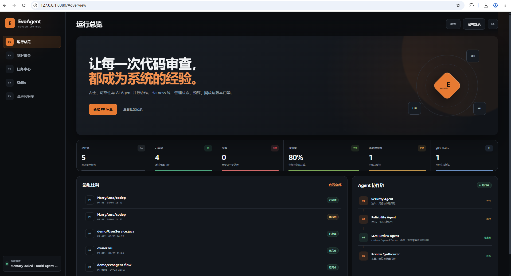

> EvoAgent支持两种使用方式：

1. 手动审查

进入左侧“发起审查”，填写：

- 仓库名称：可以随意填写，例如 `local/test`

- PR编号：可以留空

- Diff：粘贴标准的 Git Diff 内容

然后提交，EvoAgent会直接运行本地规则、Qwen 和多 Agent 审查。结果保存在“任务中心”，不会发送到 GitHub。

标准 Diff 示例：

```Plain Text
--- a/example.py
+++ b/example.py
@@ -1,2 +1,3 @@
 def hello():
+    print("debug")
     return "hello"
```

1. GitHub自动审查

GitHub Webhook 负责自动取得 PR Diff、创建任务并把评论写回 PR。它只是自动化入口，不是 EvoAgent运行所必需的。

因此，如果只是本地测试自进化、多 Agent、评测和审查效果，可以暂时关闭 Cloudflare，也不需要 GitHub Token、Webhook 。只需保留 Qwen 的环境变量，然后启动：

```Plain Text
python -m evoagent
```

# 六、🥛Github Pull Request连接说明

这个是代码仓库的diff能自动评测的基础，非常重要

连接github，使PR的diff可以上传到EvoAgent审查并将评论写回github

对于 GitHub Webhook 来说，必须有一个 GitHub 能访问的公网地址，但不一定要购买服务器或域名。可以用“HTTPS 隧道”把公网请求转发到本机：

```Java
GitHub
  ↓ HTTPS
临时公网地址
  ↓ 隧道
http://127.0.0.1:8080/webhooks/github
```

1、下载 cloudflared

使用Cloudflare Quick Tunnel，下载链接：[Releases · cloudflare/cloudflared](https://github.com/cloudflare/cloudflared/releases)，下载cloudflared-windows-amd64.exe。

下载好后检查

```Plain Text
cloudflared --version
```

新开一个PowerShell 窗口启动EvoAgent，设置 Qwen 和 GitHub 配置：

```Shell
cd D:\AgentProject
#配置大家有apikey的大模型
$env:EVOAGENT_LLM_PROVIDER = "custom"
$env:EVOAGENT_LLM_BASE_URL = ""
$env:EVOAGENT_LLM_API_KEY = "Qwen的Key"
$env:EVOAGENT_LLM_MODEL = "qwen3.7-max"

$env:EVOAGENT_GITHUB_WEBHOOK_SECRET = "自己设置一个足够长的随机字符串"
$env:EVOAGENT_GITHUB_TOKEN = "GitHub Fine-grained Token"
$env:EVOAGENT_AUTO_POST_REVIEW = "true"

python -m evoagent
```

做完启动EvoAgent后，确认 EvoAgent 正在另一个 PowerShell 窗口运行：

```Plain Text
Invoke-RestMethod http://127.0.0.1:8080/health
```

如果能返回 JSON，再启动隧道：

```Plain Text
cloudflared tunnel --url http://127.0.0.1:8080
```

成功后会出现类似日志

```Java
Your quick Tunnel has been created!
https://novel-rob-sociology-tan.trycloudflare.com
```

https://novel-rob-sociology-tan.trycloudflare.com类似这个需要填入github的webhook中

在 GitHub 仓库中进入：

```Plain Text
Settings → Webhooks → Add webhook
```

填写：

```Plain Text
Payload URL:
https://novel-rob-sociology-tan.trycloudflare.com/webhooks/github

Content type:
application/json

Secret:
与你启动 EvoAgent 时配置的 EVOAGENT_GITHUB_WEBHOOK_SECRET 完全相同
```

事件选择：

```Plain Text
Let me select individual events
→ Pull requests
```

如果还没配置 GitHub 环境变量，需要先停止并重新启动 EvoAgent：

```Plain Text
$env:EVOAGENT_GITHUB_WEBHOOK_SECRET = "自己设置的Webhook密钥"
$env:EVOAGENT_GITHUB_TOKEN = "GitHub Fine-grained Token"
$env:EVOAGENT_AUTO_POST_REVIEW = "true"

python -m evoagent
```

注意：这个随机网址下次重新启动 cloudflared 时会改变，需要同步修改 GitHub Webhook。

> **GitHub Webhook Secret、登录 Secret、PAT、LLM API Key 应分别配置，不能混用**

GitHub Fine-grained Token 是给 EvoAgent 调用 GitHub API 的“专用密码”，不是 GitHub登录密码，也不是 Qwen API Key。

EvoAgent用它来：

- 读取 PR 的代码差异。

- 把审查报告写到 PR 评论区。

- 仅访问你指定的仓库，权限比传统 Token 更可控。

GitHub Fine-grained Token创建方法：

1. 打开 [GitHub 新建 Fine-grained Token](https://github.com/settings/personal-access-tokens/new)。

1. 填写：
  - Token name：EvoAgent
  - Expiration：建议 30 或 90 天
  - Resource owner：HarryAnse
  - Repository access：选择 Only select repositories
  - 选择仓库：codep

1. 在 Repository permissions 中设置：
  - Contents → Read-only
  - Pull requests → Read and write
  - Issues → Read and write

1. 点击最下面的 Generate token。

1. 复制生成的、通常以 github_pat_ 开头的字符串。

然后在启动 EvoAgent 的 PowerShell 中执行：

```Plain Text
$env:EVOAGENT_GITHUB_TOKEN = "这里粘贴github_pat_开头的Token"
$env:EVOAGENT_AUTO_POST_REVIEW = "true"

python -m evoagent
```

在 GitHub 创建测试 PR

不能只向默认分支直接推送，因为当前监听的是 pull_request 事件。

最简单的 GitHub 网页测试方式：

1. 在目标仓库创建分支：

```Plain Text
evoagent-webhook-test
```

1. 在这个分支创建文件 webhook_test.py：

```Plain Text
def webhook_test():
    print("EvoAgent webhook test")
```

1. Commit changes。

1. 点击 Compare & pull request。

1. 创建 PR，但不要合并。

新增的 print() 会被本地可靠性 Agent 检测，方便确认审查确实执行了。

查看 Webhook 是否送达

进入 GitHub：

```Plain Text
Settings → Webhooks → 你的 Webhook → Recent Deliveries
```

找到 pull_request.opened：

- 绿色、HTTP 202：EvoAgent 已接收。

- 401：GitHub Secret 与 EVOAGENT_GITHUB_WEBHOOK_SECRET 不一致。

- 503：启动 EvoAgent 时没有设置 Webhook Secret。

- 500：通常是 GitHub Token、仓库权限或下载 Diff 失败。

查看审查结果

查看以下位置：

- EvoAgent：http://127.0.0.1:8080

- Dashboard 的任务中心

- 启动 EvoAgent 的 PowerShell 日志

- GitHub PR 评论区

如果配置了：

```Plain Text
$env:EVOAGENT_AUTO_POST_REVIEW = "true"
```

并且 GitHub Token 有权限，审查报告会自动发到 PR 评论区。

成功界面，个人信息已打码

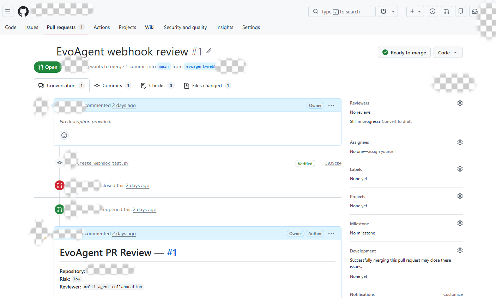

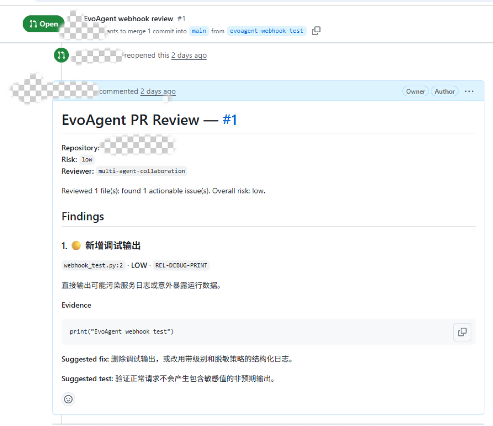

# **七、🎨项目流程**

## **1. 整体链路**

```Plain Text
API / GitHub Webhook
  → 鉴权、租户与仓库授权、大小校验
  → 创建任务并保存原始 Diff payload
  → 同步执行或提交 Memory/Redis Streams 队列
  → ReviewHarness
  → 成功/失败/取消落库
  → 可选评论 Upsert、反馈、自进化或修复 Draft PR
```

## **2. Planning**

parse_unified_diff() 解析文件列表和新增行。如果没有有效文件或新增行，任务失败并记录 execution_error 失败案例。

Planning 的输出会写入节点 checkpoint：

```JSON
{
  "files": ["app.py"],
  "added_lines": [
    {"path": "app.py", "line": 12, "content": "eval(user_input)"}
  ]
}
```

## **3. Lead 委派**

Lead 收到 Diff、变更文件、可用 Worker 和 Scanner 结果，生成最多 12 个 Delegation：

```JSON
{
  "assignment_id": "security-auth",
  "worker": "security",
  "objective": "检查认证与输入边界",
  "files": ["app.py"],
  "risk_domains": ["authorization"],
  "required_evidence": ["changed-line evidence"]
}
```

如果 Lead 没有覆盖已启用 Worker，系统会为缺失 Worker 补一个默认任务，避免模型意外跳过整个风险域。

## **4. Worker 并发与返工**

> Security 和 Correctness/Reliability 的待执行 Assignment 使用线程池并发运行。每个 Worker 使用独立工具权限和 BoundedRole 循环。

Worker 失败不会立即抛出整个会话，而是以 status=failed 写入会话。Lead 评估所有 Worker 结果后，可以发出返工请求；最多进行两轮返工。返工仍交给原 Worker，并携带 Lead 指导和需要补充的证据。

当前实现没有旧版 Planner 的替补 Agent/Assignment handoff 机制。某个 Worker 失败后，Lead 可以基于剩余结果继续综合，但不会自动切换到另一个同职责 Agent。

## **5. Critic 与最终综合**

如果启用了 Critic 且存在候选 Finding，系统会删除候选的来源身份，只保留事实字段交给 Critic。Critic 不能创建新 Finding，只能逐条给出接受/拒绝、异议、置信度调整和支持证据。

Lead 最后返回要发布的候选索引和可选置信度调整。Lead 的结果并不是最终输出，还要经过 Finding Gate。

## **6. Finding Gate**

Gate 依次检查：

> - 格式：位置必须是新增行，规则、标题和解释不能为空。
> 
> - 证据：需要精确代码、工具证据或调用链；High/Critical 必须有强工具证据或调用链。
> 
> - 置信度：默认不低于 0.55。
> 
> - 发布资格：High/Critical 必须包含修复和测试建议。

被拒绝项及原因会进入报告的 execution.rejected_findings，不会作为正式 Finding 发布。

## **7. Reviewing 与报告**

Reviewing 根据最终 Finding 计算整体风险，组合协作摘要、运行模式、组件清单、模型/工具调用、Token、成本、延迟、Gate 结果和仓库上下文状态，生成同一份 ReviewReport。JSON API、管理台和 Markdown 报告都基于它。

---

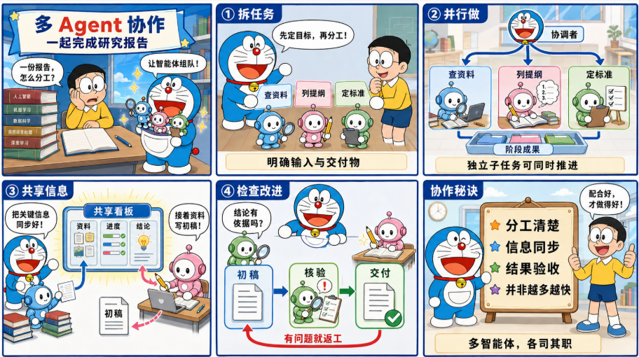

# 八、🥛多Agent协作

## 1. 总览

只支持 agentic模式。一次完整审查由四种 LLM 角色参与：

|  | **是否默认启用** | **主要职责** |
| --- | --- | --- |
| Lead | 是，且为必需角色 | 拆解任务、委派、评估 Worker、发起返工、确定最终发布索引 |
| Security | 是 | 检查输入、权限、敏感数据和危险调用链 |
| Correctness/Reliability | 是 | 检查状态、异常、并发、资源生命周期、兼容性和测试 |
| Critic | 是 | 对已有候选做去来源审查，寻找反例、错误位置和证据缺口 |

默认协作链路如下：

```Plain Text
flowchart TD
    A["统一 Diff"] --> B["确定性 Scanner"]
    B --> C["Lead 委派"]
    C --> D1["Security Worker"]
    C --> D2["Correctness/Reliability Worker"]
    D1 --> E["Lead 评估"]
    D2 --> E
    E -->|"需要补证据"| F["原 Worker 返工"]
    F --> E
    E -->|"评估结束"| G["Critic 去来源审查"]
    G --> H["Lead 最终综合"]
    H --> I["Finding Gate"]
    I --> J["ReviewReport"]
```

## 2. 为什么采用主-子agent协作

代码审查同时包含任务拆解、风险域分析、证据核对和发布判断。如果把这些责任交给同一次模型调用，系统很难回答几个实际问题：某类风险是否被覆盖，结论来自哪个角色，失败发生在哪个阶段，恢复时应该从哪里继续。

当前实现选择了层级式主从结构。Lead 持有控制流，两类领域 Worker 负责发现问题，Critic 负责独立质疑，Gate 负责机器可判定的最后检查。这种结构的直接收益是责任和状态都比较清楚

- 每个 Assignment 有明确的 Worker、目标、文件范围和证据要求。

- 每个角色只能使用分配给自己的工具。

- 每次模型调用、工具调用和角色事件都进入同一份 Execution Ledger。

- Lead 会话在关键边界保存 checkpoint，进程重启后可以跳过已完成阶段。

- 最终 Finding 必须通过新增行、证据、置信度和发布资格检查。

## 3. 相关模块及职责

多 Agent 逻辑没有分散在大量抽象框架中，主要集中在以下文件：

| **文件** | **职责** |
| --- | --- |
| [evoagent/agentic_core.py](../evoagent/agentic_core.py) | 角色 Prompt、权限表、BoundedRole、Lead 会话、并发 Worker、返工、Critic 和最终综合 |
| [evoagent/runtime.py](../evoagent/runtime.py) | 外层节点 Runtime、步骤和墙钟预算、节点重试、取消检查、Tool Registry |
| [evoagent/harness.py](../evoagent/harness.py) | 业务状态机、Planning/Executing/Reviewing 三节点、报告组装和外层 checkpoint |
| [evoagent/repository_tools.py](../evoagent/repository_tools.py) | Diff、仓库、符号、AST、Git、Scanner 和测试工具 |
| [evoagent/gates.py](../evoagent/gates.py) | Finding 格式、证据、置信度和发布门禁 |
| [evoagent/telemetry.py](../evoagent/telemetry.py) | 模型调用、工具调用、成本、延迟和 Agent Trace |
| [evoagent/service.py](../evoagent/service.py) | 模型、Scanner、活动 Prompt、角色配置与 ModeRouter 的装配 |
| [evoagent/models.py](../evoagent/models.py) | Finding、ReviewReport、Severity 和组件分类 |

外层 Runtime 和内层 Agent 循环是两套不同的控制结构：

```Plain Text
ReviewHarness
  AgentRuntime
    planning
    executing
      ModeRouterReviewer
        Lead/Worker/Critic session
          BoundedRole tool/final loop
    reviewing
```

AgentRuntime 不负责模型思考过程。它只运行三个业务节点。真正的模型循环位于 BoundedRole，每个角色在循环中选择调用一个工具，或者返回当前阶段要求的 final JSON

## 4. 一次审查如何进入多 Agent 会话

### 4.1 服务入口

同步接口 POST /v1/reviews 和异步接口 POST /v1/reviews?async=true 最终都进入 ReviewService._run_review()。两者使用同一个 Harness，区别只在于当前 HTTP 请求直接执行，还是由进程内队列或 Redis Streams Worker 取出任务后执行。

创建任务前，Service 会检查：

> - repository 和 Diff 是否有效。
> 
> - Diff 是否超过 EVOAGENT_MAX_DIFF_BYTES，默认上限为 1 MiB。
> 
> - mode 是否为 agentic。
> 
> - 模型是否已经配置。没有模型时请求直接失败，不会降级为本地规则审查。
> 
> - repository_root 是否为已存在的绝对目录。
> 
> - enabled_agents 是否只包含允许的四个角色名。
> 
> - 当前租户是否有权访问目标仓库。

原始 Diff 会单独写入任务 payload，供异步执行和恢复使用。

### 4.2 Harness 外层状态机

ReviewHarness 使用以下业务状态：

```Plain Text
PENDING -> PLANNING -> EXECUTING -> REVIEWING -> SUCCESS
```

任何非终态都可以进入 FAILED 或 CANCELLED。三个 Runtime 节点的工作分别是：

| 节点 | 输入 | 输出 |
| --- | --- | --- |
| planning | 原始 unified diff | 文件列表和新增行列表 |
| executing | Diff、ParsedDiff、任务和仓库上下文 | 通过多 Agent 会话及 Gate 的 Finding |
| reviewing | Finding 和协作汇总 | ReviewReport |

多 Agent 协作发生在 executing 节点内部。ModeRouterReviewer.review_with_context() 会读取任务配置，创建 Execution Ledger 和 RepositoryToolSuite，然后进入 _agentic()。

## 5. Lead 的职责和权限

Lead 是 agentic 模式的必需角色。enabled_agents 中没有 Lead 时，_agentic() 会抛出 ValueError。

Lead 会在一次审查中被多次激活，但每次激活使用相同角色 Prompt 和不同阶段上下文：

| 阶段 | 作用 | 主要输入 | 主要输出 |
| --- | --- | --- | --- |
| delegate | 拆解审查任务 | Diff、变更文件、可用 Worker、Scanner Finding | Delegation 列表 |
| assess-workers | 检查 Worker 结果 | Assignment、Worker 结果、当前候选、返工轮次 | Revision Request、Critic 目标 |
| finalize | 决定发布哪些候选 | Critic 意见、Worker 结果、候选 Finding | 接受索引、置信度调整、综合说明 |

Lead 的工具权限故意较窄：

- list_repository

- search_diff

- read_project_controls

- locate_tests

Lead 没有 read_file、symbol、ast_analyze、git_context 或执行 Scanner/测试的权限。它负责调度和综合，深入取证交给 Worker 与 Critic。

###  Delegation 协议

Lead 在 delegate 阶段返回如下结构：

```JSON
{
  "action": "final",
  "delegations": [
    {
      "assignment_id": "security-auth-flow",
      "worker": "security",
      "objective": "检查新增认证入口是否绕过权限校验",
      "files": ["app.py", "auth.py"],
      "risk_domains": ["authorization", "untrusted-input"],
      "required_evidence": ["changed-line evidence", "call-chain evidence"]
    }
  ],
  "risk_level": "high",
  "reasoning_summary": "认证入口和权限判断同时发生了变化"
}
```

模型输出不会直接进入线程池。系统先做确定性规范化：

> - 忽略非对象条目。
> 
> - 忽略指向未启用 Worker 的任务。
> 
> - 自动生成缺失的 Assignment ID。
> 
> - 丢弃重复 ID。
> 
> - Assignment ID 最长 100 个字符。
> 
> - objective 最长 2000 个字符。
> 
> - files 最多 100 个，每项最多 500 个字符。
> 
> - risk_domains 和 required_evidence 各最多 20 项。
> 
> - 整个会话最多保留 12 个 Assignment。

如果 Lead 漏掉了某个已启用的领域 Worker，系统会补一个默认 Assignment。Security 的默认目标覆盖安全、权限、输入和敏感数据，Correctness/Reliability 的默认目标覆盖正确性、失败处理、并发、资源和兼容性。默认 Assignment 要求提供 changed-line evidence。

补默认任务解决的是风险域完全漏派问题，不保证文件拆分一定合理，也不检查多个 Assignment 是否有重复工作

## 6. Worker 如何执行 Assignment

### 6.1 并发模型

所有尚未完成的初始 Assignment 会进入 ThreadPoolExecutor。线程池大小等于 pending Assignment 数量，至少为 1。由于 Delegation 最多 12 个，因此单批最多创建 12 个 Worker 任务。

这里的 "Worker" 是逻辑角色，不是常驻进程。每个 Assignment 都会新建一个 BoundedRole，然后在线程池中运行。一个 Security 角色可以收到多个 Assignment，这些 Assignment 也可以并发执行。

并发只发生在同一批 pending Assignment 之间。Lead 委派、Lead 评估、Critic 和 Lead Final 仍按顺序执行。

### 6.2 Security Worker

Security 关注以下问题：

- 不可信输入如何进入程序。

- 认证与授权边界是否被绕过。

- 敏感数据是否进入日志、响应或持久化介质。

- 危险 API 是否可以被外部输入影响。

- 跨函数、跨文件调用链是否支持高风险结论。

Prompt 要求它只报告本次变更新增的可操作缺陷，不把代码风格或旧问题写成 Finding。Critical 和 High 结论需要强工具证据或具体调用链。

### 6.3 Correctness/Reliability Worker

Correctness/Reliability 关注：

- 状态迁移是否完整。

- 异常是否被吞掉或错误转换。

- 并发访问、锁和共享状态是否安全。

- 文件、连接、线程和子进程等资源是否正确释放。

- 行为是否破坏兼容性。

- 相关测试是否覆盖变化后的路径。

该角色也只能报告本次变更引入的问题。它与 Security 使用相同的 Finding 结构，但系统 Prompt 不同，工具权限也多了测试定位能力。

### 6.4 Worker Final 协议

Worker 返回的 Finding 结构如下：

```JSON
{
  "action": "final",
  "findings": [
    {
      "rule_id": "SEC-AUTH-BYPASS",
      "severity": "high",
      "title": "新增入口绕过权限校验",
      "explanation": "请求参数在权限检查前进入敏感操作。",
      "path": "app.py",
      "line": 42,
      "evidence": "run_admin_action(request.args['name'])",
      "evidence_ids": ["symbol:1a2b3c4d"],
      "call_chain": [
        {"path": "app.py", "line": 42, "symbol": "run_admin_action"}
      ],
      "fix": "在调用敏感操作前执行授权检查。",
      "test": "加入未授权用户调用该入口并收到拒绝响应的测试。",
      "confidence": 0.91
    }
  ]
}
```

系统解析 Worker 结果时会继续收紧数据：

- path 和 line 必须命中 ParsedDiff 的新增行，否则直接丢弃。

- severity 只能是 critical、high、medium 或 low，非法值按 medium 处理。

- confidence 无法解析时使用 0.7，并限制在 0 到 1。

- rule_id、title、explanation、evidence、fix 和 test 都有长度上限。

- call_chain 只保留对象条目，最多 20 项。

- evidence_ids 只能引用当前角色本次工具 Observation 中真实存在的 ID。

- Finding 的 source 由系统写成 Worker 角色名，而不是信任模型自报来源。

因此，模型返回合法 JSON 只是第一层要求。位置、枚举、长度和证据引用还要经过代码处理。

## 7. BoundedRole 的 tool/final 循环

Lead、两个领域 Worker 和 Critic 都通过 BoundedRole.run() 执行。默认每次角色激活最多 4 步。

一轮循环的实际顺序是：

```Plain Text
检查当前激活的时间和 Token 消耗
  -> 组装受管理上下文
  -> 调用 JsonChatClient.complete_json()
  -> action=tool 时校验并执行一个工具
  -> 把工具结果加入 observations
  -> 进入下一步

或

  -> action=final 时结束当前角色激活
```

发给模型的 managed context 包含：

```JSON
{
  "task": "当前阶段的 JSON 字符串",
  "available_tools": [],
  "observations": [],
  "remaining_token_budget": 8000,
  "remaining_time_seconds": 60
}
```

角色每一步只能选择一个工具。工具成功或失败都会形成 Observation，模型可以在下一步修正参数或换一个取证方向。如果 action 既不是 tool 也不是 final，当前角色直接失败。执行满 4 步仍未返回 final，也会抛出 RuntimeBudgetExceeded。

### 7.1 Token 预算的实际含义

默认 EVOAGENT_AGENT_TOKEN_BUDGET=8000。BoundedRole 根据 Execution Ledger 中该角色新增的输入和输出 Token 判断当前激活已经使用多少预算。

这不是整个任务的统一 8000 Token 上限。Lead 每次 delegate、assess-workers 和 finalize 都会创建新的 BoundedRole，每个 Assignment 也会创建新的 Worker 激活。结构化进化配置还可以按角色修改预算，但代码会把值限制在 256 到默认预算 4 倍之间。

Token 数依赖模型供应商响应中的 usage。如果供应商不返回 usage，系统按 0 记录，不会自行估算，此时 Token 预算无法形成可靠约束。

同一角色的并发 Assignment 共用一个按角色名统计的 Ledger。它不是严格的独立配额系统，也不是会话级全局成本上限。

### 7.2 时间预算的实际含义

默认 EVOAGENT_AGENT_TIME_BUDGET_SECONDS=60。时间只在每轮模型调用开始前检查。正在进行的 HTTP 请求由 JsonChatClient 自己的 socket timeout 控制，工具或测试命令由各自的 timeout 控制。

所以角色时间预算是协作式检查，不会在精确的第 60 秒强制杀掉线程。外层 `EVOAGENT_TIMEOUT_SECONDS` 也只在 Runtime 节点尝试开始前检查，不能中断正在运行的 executing 节点。

## 8. 角色工具权限

工具权限在 ROLE_PERMISSIONS 中写死，RepositoryToolSuite 会按角色创建独立 Tool Registry。模型看不到未授权工具，也无法通过填写工具名绕过注册表。

| **工具** | **Lead** | **Security** | **Correctness/Reliability** | **Critic** | **作用** |
| --- | --- | --- | --- | --- | --- |
| **list_repository** | 是 | 否 | 否 | 否 | 列出仓库文件 |
| **search_repository** | 否 | 是 | 是 | 是 | 全仓库文本搜索 |
| **search_diff** | 是 | 是 | 是 | 是 | 搜索统一 Diff |
| **read_file** | 否 | 是 | 是 | 是 | 读取最多 500 行的文件片段 |
| **changed_line** | 否 | 是 | 是 | 是 | 读取指定新增行 |
| **symbol** | 否 | 是 | 是 | 是 | 查找 Python 符号、调用者和被调用者 |
| **locate_tests** | 是 | 否 | 是 | 是 | 按路径或符号寻找测试 |
| **read_project_controls** | 是 | 是 | 是 | 否 | 读取依赖、配置和权限文件 |
| **ast_analyze** | 否 | 是 | 是 | 是 | 解析 Python AST |
| **git_context** | 否 | 是 | 是 | 是 | 获取 Git log 和附近 blame |
| **run_scanners** | 否 | 是 | 是 | 是 | 用固定参数运行已安装的静态分析器 |
| **run_repository_checks** | 否 | 是 | 是 | 是 | 在临时副本编译或运行管理员配置的测试 |

### 8.1 Tool Registry 校验

每个工具都声明名称、说明、参数定义和 Handler。调用前会检查：

- 参数必须是对象。

- 必填字段必须存在。

- 不允许未声明字段。

- 顶层 string、integer、number、boolean、object 和 array 类型。

- 数字的 minimum 和 maximum。

这是一套轻量的 JSON Schema 风格校验，不是完整 JSON Schema 实现。工具异常会被 `BoundedRole` 捕获，并作为失败 Observation 返回给当前角色。

### 8.2仓库上下文是否可用

请求没有提供 `repository_root` 时，系统仍可分析 Diff，并使用 `search_diff` 和 `changed_line` 等工具。全文搜索、文件读取、符号、AST、Git 和仓库测试需要本机存在 checkout。

`repository_root` 必须是已存在的绝对目录。文件工具会把相对路径解析到该根目录下，并拒绝逃逸路径。仓库遍历会跳过 `.git`、`node_modules`、构建目录和虚拟环境，单文件超过 2 MB 时也不会进入可搜索列表。

### 8.3 执行型工具的边界

`run_scanners` 只运行代码内固定的 Semgrep、Bandit、ESLint、mypy 和 pyright 命令。没有安装的工具会记录为 unavailable。它使用受限环境变量，但在原仓库目录执行。

`run_repository_checks` 会先复制仓库到临时目录。compile 模式执行 Python `compileall`；tests 模式只执行管理员通过配置提供的测试命令。结果明确记录 `network_disabled: false`，因此临时副本和受限环境不能被描述成无网络安全沙箱。

## 9. Lead 评估与返工

初始 Worker 全部结束后，Lead 进入 `assess-workers` 阶段。输入包括：

- 原始 Diff。

- 所有 Delegation。

- Worker 成功或失败结果。

- 当前合并后的候选 Finding。

- 当前返工轮次。

- 剩余返工轮次。

Lead 可以返回空的 revision_requests，也可以要求某个 Assignment 返工：

```JSON
{
  "action": "final",
  "revision_requests": [
    {
      "assignment_id": "security-auth-flow",
      "worker": "security",
      "guidance": "补充入口到敏感操作之间的调用链，并核对权限检查顺序。",
      "required_evidence": ["symbol evidence", "changed-line evidence"]
    }
  ],
  "critic_objective": "重点检查权限前置条件和证据位置。",
  "reasoning_summary": "当前结论缺少跨函数证据。"
}
```

返工请求同样会被规范化：

- Assignment ID 必须来自原 Delegation。

- Worker 必须与原 Assignment 一致，不能把 Security 任务转给 Correctness/Reliability。

- guidance 不能为空，最长 2000 个字符。

- 同一轮同一 Assignment 只保留一个请求。

- required_evidence 最多 20 项。

最多进行两轮返工。每次返工仍创建新的 `BoundedRole`，携带原 Assignment、Lead feedback 和新的证据要求。返工结果会替换该 Assignment 在 `worker_results` 中的当前结果，旧结果保存在 `revision_results` 中用于协作摘要。

Lead 总共最多进行三次 assess-workers：初始 Worker 后一次，第一轮返工后一次，第二轮返工后一次。如果第二轮评估仍提出返工，系统不会继续执行，并把 stop_reason 记为 `revision-budget-exhausted`。

Worker 首次执行失败时，结果会以 `status=failed` 写入会话，而不是直接让整个 executing 节点失败。Lead 可以基于剩余结果继续，也可以对失败 Assignment 发起返工。系统没有自动替补 Worker，也不会把任务转交给另一个同职责实例。

## 10. Critic 的去来源审查

Lead 评估结束后，系统合并 Scanner Finding 和最新 Worker Finding。如果启用了 Critic 且候选不为空，Critic 会执行一次独立的 `BoundedRole`。

传给 Critic 的候选保留：

- finding_index

- rule_id

- severity

- title 和 explanation

- path 和 line

- evidence 和 evidence_refs

- call_chain

- fix 和 test

- confidence

系统会去掉 Finding 的 `source` 字段，因此 Critic 不直接知道候选来自本地规则、动态 Scanner 还是某个 Worker。不过 `rule_id` 仍然保留，有些命名可能间接暴露来源。所以这里的 "盲审" 是去 source 身份，不是密码学意义上的完全匿名。

Critic 只能对已有索引返回 Decision，不能创建新 Finding：

```JSON
{
  "action": "final",
  "decisions": [
    {
      "finding_index": 0,
      "accepted": false,
      "objections": ["调用链没有证明该参数可以被外部用户控制"],
      "confidence_adjustment": -0.25,
      "supporting_evidence_ids": ["symbol:9f8e7d6c"]
    }
  ]
}
```

系统会把 confidence_adjustment 限制后的结果写回 Finding，并解析 Critic 自己调用工具得到的 supporting evidence。Critic 没有对某个索引给出明确 Decision 时，该项会记录为未接受，并附上默认异议。

有一个实现细节很重要：`_apply_critic()` 不会立刻从候选数组删除 Critic 反对的项。它保留候选和 Decision，交给 Lead Final 一并判断。这样做保留了 Lead 的最终业务裁决权，也意味着不能把 Critic 的 `accepted=false` 理解成已经完成机器过滤。

如果未启用 Critic，或者当前没有候选，系统不会调用 Critic。它会为现有候选生成默认接受 Decision，然后继续进入 Lead Final。

## 11. Lead Final 如何选择结果

Lead 的 `finalize` 阶段接收：

- 当前候选 Finding 及其索引。

- Critic Decisions。

- 最新 Worker Results。

- 要求显式处理 Critic 异议并优先使用新增行工具证据的指令。

Lead 返回：

```JSON
{
  "action": "final",
  "accepted_finding_indices": [0, 2],
  "confidence_adjustments": [
    {"finding_index": 2, "adjustment": -0.1}
  ],
  "resolution_summary": "保留有调用链和精确位置支持的两项。"
}
```

代码只接受合法范围内的数字索引，并按索引顺序输出 Finding。置信度调整后仍限制在 0 到 1。Lead Final 不能修改 path、line、severity、explanation、fix 或 test，也不能凭空创建一个新 Finding。

如果 Lead Final 没有返回 accepted_finding_indices 字段，系统会退回到 Critic 明确接受的索引。若字段存在但值为空列表，则最终候选为空。

Lead Final 完成后，会话状态变为 completed，stop_reason 默认为 lead-final，内层 checkpoint 状态也写成 completed。

## 12. Finding Gate 是最终机器边界

Lead 接受的 Finding 还要通过 `FindingGate`。Gate 依次检查四类条件。

### 12.1 格式 Gate

以下任一条件不满足就拒绝：

- path 和 line 必须指向 PR 新增行。

- rule_id 不能为空。

- title 不能为空。

- explanation 不能为空。

### 12.2 证据 Gate

普通 Finding 至少满足一项：

- evidence 是新增行内容中的精确子串。

- 存在带 evidence_id 和 tool 的工具证据。

- 存在 call_chain。

Critical 或 High 还必须有强证据工具引用或 call_chain。只有自然语言解释和普通精确行引用并不足以发布高风险结论。

### 12.3 置信度 Gate

默认最低置信度为 0.55。Critic 和 Lead 的调整都会在这个检查之前生效。

### 12.4 发布 Gate

Critical 或 High 必须同时给出 fix 和 test 建议。缺少任意一个都会被拒

Gate 不再调用模型。每个被拒绝项及原因进入 `rejected_findings`，通过项才进入 ReviewReport 的正式 findings。

## 13. 会话状态和两级 checkpoint

EvoAgent 使用两级恢复结构。

### 13.1 外层 checkpoint

AgentRuntime 为以下节点保存结果：

- planning

- executing

- reviewing

状态为 completed 的节点在恢复时直接读入共享 state，不再执行 Handler。

### 13.2 内层 Lead 会话 checkpoint

`agentic-lead-session` 保存 executing 内部的细粒度状态：

```JSON
{
  "protocol": "lead-workers-v1",
  "session": {
    "phase": "workers-completed",
    "scanner_complete": true,
    "scanner_findings": [],
    "scanner_components": [],
    "delegations": [],
    "worker_results": {},
    "lead_assessments": [],
    "revision_results": {},
    "critic_decisions": [],
    "critic_candidates": [],
    "lead_final": {},
    "accepted_findings": []
  },
  "execution": {}
}
```

实际写入还会包含阶段需要的其他字段。协议版本必须是 lead-workers-v1，版本不匹配时系统不会恢复旧会话，避免把旧格式注入当前流程。

内层 checkpoint 的保存时机包括：

- Scanner 完成后。

- Lead Delegation 规范化后。

- 每个 Worker future 完成后。

- 每次 Lead Assessment 后。

- 每轮返工结果写回后。

- Critic 完成后。

- Lead Final 和 accepted findings 确定后。

每个 Worker 结果完成后会立即单独保存。因此，进程在两个 Worker 之间崩溃时，恢复只会重新提交尚未出现在 worker_results 中的 run ID。

Execution Ledger 也保存在内层 checkpoint 中。恢复会重建模型调用、工具调用和 Agent Trace，避免最终报告只统计重启后的部分。

测试 test_completed_session_resumes_without_repeating_agent_calls 验证了完整会话恢复后不会再次调用模型，同时仍能返回原 Finding 和调用统计。

## 14. 失败、重试和取消

不同失败发生在不同层，处理方式也不同。

| 失败位置 | 当前处理 |
| --- | --- |
| Worker 模型、协议、工具循环或预算失败 | 转成 status=failed 的 Worker Result，Lead 继续评估 |
| Lead 失败 | executing 抛错，交给外层节点重试 |
| Critic 失败 | executing 抛错，交给外层节点重试 |
| Finding Gate 拒绝 | 记录 rejected finding，不视为任务异常 |
| planning 输入无有效新增行 | ValueError，任务失败且默认不重试 |
| 外层步骤或墙钟预算耗尽 | RuntimeBudgetExceeded，任务失败且默认不重试 |
| 普通 executing 异常 | Harness 默认允许节点重试 2 次，总尝试最多 3 次 |

外层重试不会简单地从头调用所有角色。executing 再次进入时会读取最新的 `agentic-lead-session`，已经持久化的 Scanner、Delegation、Worker、返工或 Critic 阶段会被跳过。

取消同样是协作式的。API 先设置 cancel request，Runtime 在下一次节点尝试前检查。它不会立即终止正在运行的模型 HTTP 请求、Python 线程、Scanner 或测试子进程。

## 15. Execution Ledger 与报告

每次审查创建一份线程安全的 Execution Ledger。它记录三类信息。

### 15.1 模型调用

每条模型调用包括：

- role

- provider

- model

- input_tokens 和 output_tokens

- cost_usd

- duration_ms

- ok 和 error

成本优先使用供应商返回的 usage.cost。如果没有该字段，就使用 EVOAGENT_LLM_INPUT_COST_PER_MILLION 和 EVOAGENT_LLM_OUTPUT_COST_PER_MILLION 计算。价格没有配置时成本为 0，系统不会猜测供应商价格。

### 15.2 工具调用

每条工具调用包括角色、工具名、参数、成功状态、耗时、结果摘要和错误。结果摘要会截断，完整工具输出主要通过当前角色 Observation 在本轮上下文中使用。

### 15.3 Agent Trace

Trace 按角色保存事件，例如：

- started

- autonomous_decision

- tool_observation

- finished

- budget_exhausted

- lead_activated

- lead_completed

- assignment_created

- worker_reported

- revision_completed

最终 ReviewReport 的 collaboration 部分包含角色、Lead 三阶段决定、Assignment、Worker 结果、返工结果、Critic Decisions、候选数量、接受数量和 stop_reason。execution 部分包含 Ledger、Gate 统计、被拒绝 Finding 和仓库上下文可用状态。

## 16. 默认调用次数如何计算

在默认四角色、两个领域 Worker、无返工且存在候选的情况下，模型调用最少通常是 6 次：

| 调用 | 次数 |
| --- | --- |
| Lead delegate | 1 |
| Security Worker | 1 |
| Correctness/Reliability Worker | 1 |
| Lead assess-workers | 1 |
| Critic | 1 |
| Lead finalize | 1 |
| 合计 | 6 |

仓库测试对这一拓扑有明确断言。实际调用数会因以下情况增加：

- Lead 创建多个 Assignment。

- 任一角色先调用工具，再返回 final。

- Lead 发起一轮或两轮返工。

- 某个角色在一次激活中使用多步工具循环。

没有候选时 Critic 不会调用。禁用 Critic 后，默认最小拓扑少一次 Critic 调用。评测模块正是用 multi-llm-no-critic 和 full-agentic 两个 Arm 比较 Critic 的实际收益，不能仅凭架构直觉认定 Critic 一定改善结果。

## 17. 一个完整示例

假设 Diff 新增一行：

```Diff
+eval(user_input)
```

默认执行可能经过以下步骤。这里说明控制流，不假设真实模型一定返回相同文本。

1. Planning 解析出 `app.py:1` 是新增行。

1. 本地规则命中 `SEC-EVAL`，生成 Critical 候选。

1. 单行 Python AST 解析识别到 Call，给候选附加 `diff-ast-analyze` 强证据。

1. Lead 收到 Diff、Scanner 候选和两个可用领域 Worker，创建 Security 与 Correctness/Reliability Assignment。

1. 两个 Worker 并发运行。Security 可以用 `changed_line`、`ast_analyze` 或 `symbol` 取证；Correctness/Reliability 检查异常和行为影响。

1. Lead 评估 Worker 报告。如果证据不足，可以要求 Security 补充调用链。

1. 返工后的 Security 结果替换该 Assignment 的当前结果，旧结果进入 revision_results。

1. Scanner 与 Worker 候选按路径、行号和 rule_id 去重并排序。

1. Critic 在没有 source 字段的情况下检查位置、前置条件、严重度和证据。

1. Lead 结合 Critic 意见选择发布索引。

1. Finding Gate 再检查新增行、强证据、0.55 置信度以及 fix/test。

1. 通过项进入 ReviewReport，协作过程和调用账本随报告保存。

这个例子也说明确定性规则和 LLM 不是互相替代的两条模式。Scanner 先给出候选，LLM 角色继续做委派、补证据、质疑和选择，Gate 再做确定性发布检查。

## 18. 源码阅读路线

建议按实际调用方向阅读：

1. [evoagent/service.py](../evoagent/service.py)：看 ModeRouter 如何组装，以及角色和 Prompt 从哪里来。

1. [evoagent/harness.py](../evoagent/harness.py)：看一次任务如何进入 executing。

1. [evoagent/agentic_core.py](../evoagent/agentic_core.py)：先读四个 Prompt 和权限表，再读 BoundedRole，最后顺着 _agentic() 看完整会话。

1. [evoagent/repository_tools.py](../evoagent/repository_tools.py)：核对每个工具返回什么证据，哪些工具真的隔离执行。

1. [evoagent/gates.py](../evoagent/gates.py)：确认 Lead 之后还有哪些确定性拒绝条件。

1. [evoagent/telemetry.py](../evoagent/telemetry.py)：理解报告中的调用数、Token、成本和 Trace 从哪里来。

1. [tests/test_lead_worker_collaboration.py](../tests/test_lead_worker_collaboration.py)：用一个包含返工和恢复的最小案例核对理解。

阅读时要始终区分三类组件：LLM Agent 负责自主选择工具和结构化判断，Scanner 负责产生确定性候选或事实，Gate 负责决定一个候选是否具备发布资格。当前多 Agent 协作的控制权属于 Lead，但最终结果同时受 ParsedDiff 位置约束和 Finding Gate 约束。

# **九、⭐Agent Runtime**

## **1. Runtime 的实际职责**

当前 evoagent/runtime.py 包含两个基础设施组件：

- AgentRuntime：执行命名业务节点，处理 checkpoint、步骤/时间预算、节点重试、取消和 Span。

- ToolRegistry：注册工具并校验调用参数。

## **2. 执行预算**

max_steps 统计实际开始的节点尝试，包括重试；timeout_seconds 使用单调时钟计算整个 Runtime 执行时间。预算和取消在每次节点尝试开始前检查。

因此它是协作式预算，不是强制中断：如果节点处理函数内部长期阻塞，Runtime 不会在精确的第 120 秒杀死线程。模型 HTTP、动态 Skill、仓库检查和修复测试分别使用自己的超时机制。

## **3. 节点重试**

普通异常会保存 failed checkpoint，并按节点配置重试。以下异常默认不可重试：

- ValueError：输入或协议确定无效。

- RuntimeCancelled：任务被取消。

- RuntimeBudgetExceeded：预算已经耗尽。

ReviewHarness 默认 node_retries=2，所以普通节点异常最多尝试 3 次。重试次数会延续失败 checkpoint 中的 attempt 编号。

## **4. Checkpoint 恢复**

执行开始时一次性读取该任务全部 checkpoint。状态为 completed 的节点不会再次运行，而是把保存的节点输出合并到 state。失败节点会从下一次 attempt 开始。

Checkpoint 由应用自己的 SQLite/PostgreSQL Store 管理，没有绑定第三方工作流框架的专用格式，便于数据库审计和 Worker 重启恢复。

## **5. 取消**

API 只设置任务的 cancel request。Runtime 在下一个节点尝试开始前读取 store.is_cancelled(task_id)，随后抛出 RuntimeCancelled，Harness 再把业务状态写成 CANCELLED。

这意味着取消不是对正在执行的模型请求、子进程或测试命令的立即强杀。

## **6. Tool Registry**

每个 AgentTool 有名称、说明、参数 Schema 和 Handler。当前校验支持：

- 必填字段。

- 禁止未声明字段。

- string、integer、number、boolean、object、array 顶层类型。

- number/integer 的 minimum 与 maximum。

它是面向当前工具协议的轻量 Schema 校验器，不是完整 JSON Schema 实现。工具内部异常由 BoundedRole 捕获并转换为失败 Observation。

## **7. Runtime Event 与可观测性边界**

AgentRuntime.execute() 支持 event_sink，可产生 started、completed、failed、checkpoint restored、cancelled 和 budget exhausted 等事件；ReviewHarness 当前主要通过业务 TraceEvent、checkpoint 和 OpenTelemetry Span 持久化/观测执行，未把所有 RuntimeEvent 直接写入任务 Trace。

因此文档中不能声称每个底层 RuntimeEvent 都已经出现在 API Trace 中。

# **十、🥝Agent Loop**

## **1. 当前循环实现**

循环由 `agentic_core.BoundedRole` 实现，服务于 Lead、Security、Correctness/Reliability、Critic 四种角色。

每个角色拥有：

- 固定系统 Prompt 与可选的已激活 Prompt Overlay。

- 角色专属 Tool Registry。

- Token 预算。

- 时间预算。

- 默认最多 4 步。

- 统一 Execution Ledger。

## **2. 一轮循环**

```Plain Text
检查时间与 Token 预算
  → 组装 task、工具目录、历史 Observations、剩余预算
  → 调用 JsonChatClient.complete_json()
  → action=tool：校验并执行工具，追加 Observation
  → action=final：返回结构化结果
  → 达到 4 步仍未 final：抛出 RuntimeBudgetExceeded
```

## **3. Managed Context**

每轮发送给模型的对象包含：

```JSON
{
  "task": "角色任务上下文",
  "available_tools": [],
  "observations": [],
  "remaining_token_budget": 8000,
  "remaining_time_seconds": 60
}
```

当前没有独立 `ContextManager`，也没有按风险给 Hunk 排序、压缩旧 Observation 或记录压缩 SHA-256 的主链实现。Lead/Worker/Critic 的 task 上下文会直接包含 Diff 和阶段数据。对于大型 Diff，主要保护仍是 API 的最大字节数，而不是语义压缩。

这也是当前实现的重要扩展点：未来可以在不改变角色协议的前提下，在构造 `user_context` 前加入 Hunk 选择与上下文预算器。

## **4. Tool 动作**

```JSON
{
  "action": "tool",
  "tool": "symbol",
  "arguments": {"name": "authorize"},
  "reason": "需要确认调用关系"
}
```

未知工具、缺少参数、额外参数、类型错误、越界参数和 Handler 异常都会变成：

```JSON
{
  "step": 1,
  "tool": "symbol",
  "ok": false,
  "error": "..."
}
```

模型可以在下一轮修正。非法 `action` 不属于工具失败，会直接终止该角色。

## **5. Final 动作不是统一结构**

不同角色的 final Schema 不同：

- Lead/delegate：返回 Delegations。

- Lead/assess-workers：返回 Revision Requests 和 Critic Objective。

- Security、Correctness/Reliability：返回 Findings。

- Critic：返回逐条 Decision，不能新增 Finding。

- Lead/finalize：返回接受的 Finding 索引和置信度调整。

Worker Finding 必须落在 ParsedDiff 的新增行集合中。严重度、置信度、文本长度、证据引用和调用链会被规范化；格式正确仍不代表可发布，后面还有 Lead、Critic 与 Finding Gate。

## **6. Token 统计**

循环使用 Execution Ledger 中该角色的模型调用输入/输出 Token 之和判断预算。Token 来自供应商响应的 usage；如果响应没有 Token 字段，当前客户端按 0 记录，并不会自行估算。成本来自供应商返回的 cost 或配置的每百万 Token 单价，未配置时为 0，不会猜测价格。也因此，供应商不返回 usage 时 Token 预算无法形成可靠的实际消耗约束，这是当前边界。

## **7. 时间与失败边界**

BoundedRole 在每一轮开始前检查时间。一次正在进行的 HTTP 请求依赖 `JsonChatClient` 的 socket timeout；一次正在执行的工具依赖工具自身的超时。角色失败后，Worker 分支会把错误记录为 failed 结果，Lead 可以继续；Lead 或 Critic 自身失败会向上抛出并由外层 Harness 节点重试。

## **8. 工具证据**

仓库工具返回的事实可以携带 `evidence_id`。Worker 通过 `evidence_ids` 引用这些 Observation。High/Critical Finding 若没有 AST、Scanner、符号、Git、测试等强证据，也没有具体调用链，会被 Finding Gate 拒绝。

---

# 十一、🍫Harness 详解

## 1. 项目里的 Harness 指什么

EvoAgent 里有三个带 Harness 的，它们解决的问题不同。

|  | 文件 | 用途 |
| --- | --- | --- |
| ReviewHarness | [evoagent/harness.py](../../evoagent/harness.py) | 执行一次真实的 PR 审查，管理业务状态、节点预算、重试、checkpoint、取消、恢复和报告落库 |
| EndToEndEvaluationHarness | [evoagent/evaluation_harness.py](../../evoagent/evaluation_harness.py) | 回放带人工真值的样本，计算 Precision、Recall、F1、修复通过率等离线指标 |
| ProductionEvaluationHarness | [evoagent/evaluation_v2.py](../../evoagent/evaluation_v2.py) | 在基础评测上增加模型调用、Token、成本、延迟、精确位置和证据统计 |

 ReviewHarness它是线上任务的业务编排层。后两者属于评测系统，不负责维护线上任务的 PENDING、EXECUTING 等状态。

ReviewHarness 不负责亲自完成代码审查。真正产出候选 Finding 的是 Reviewer。当前主链中的 Reviewer 是 ModeRouterReviewer，它内部包含Lead、Worker、Critic 和 Finding Gate。Harness 负责把这套审查能力放进一个可以重试、恢复、取消并持久化的任务生命周期里。

## 2. 它在整体架构中的位置

```Plain Text
HTTP API / GitHub Webhook
          |
          v
    ReviewService
          |
          +---- TaskStore / PostgresTaskStore
          |
          +---- 同步直接调用
          |          |
          |          v
          +---- 异步队列 ---- ReviewHarness
                                 |
                                 v
                            AgentRuntime
                                 |
                 +---------------+---------------+
                 |               |               |
              planning        executing       reviewing
                 |               |               |
             DiffParser     ModeRouterReviewer  ReviewReport
                                 |
                 +---------------+----------------+
                 |               |                |
              Scanner       Lead / Worker       FindingGate
                              / Critic
```

ReviewService 是组合根。它创建 Store、模型客户端、ModeRouterReviewer 和 ReviewHarness，再把 API、队列和 GitHub Webhook 收到的任务交给同一个 Harness。相关代码在 [evoagent/service.py](../../evoagent/service.py)。

同步和异步路径的区别只在 Harness 之前：

- POST /v1/reviews 默认在当前 HTTP 请求中调用 create_review()，随后直接进入 Harness。

- POST /v1/reviews?async=true 先创建 PENDING 任务，再由任务队列调用 _process_queued()，最后进入同一个 _run_review()。

- GitHub Webhook 会先做签名、时效和幂等检查，再把任务放进队列。Worker 获取 Diff 后仍然走 _run_review()。

- POST /v1/tasks/{id}/resume 不直接在请求线程中继续执行。它把已有任务重新提交到队列，Worker 再调用 Harness。

因此，同步和异步不是两套审查实现。它们共享状态机、Reviewer、checkpoint 格式和报告结构。

## 3. ReviewHarness 的构造

ReviewService 创建 Harness 时传入五个主要依赖或参数：

```Python
self.harness = ReviewHarness(
    self.store,
    self.reviewer,
    settings.max_steps,
    settings.timeout_seconds,
    observability=self.observability,
)
```

构造参数的含义如下。

| 参数 | 默认值 | 含义 |
| --- | --- | --- |
| store | 无 | 保存任务、Trace、Diff payload、失败案例和 checkpoint |
| reviewer | 无 | 在 executing 节点中产生 Finding，生产环境使用 ModeRouterReviewer |
| max_steps | 8 | 一次 AgentRuntime.execute() 最多开始多少次节点尝试 |
| timeout_seconds | 120 | 外层 Runtime 的墙钟时间预算 |
| node_retries | 2 | 每个节点在普通异常后最多重试两次，即单节点最多尝试三次 |
| observability | None | 为节点创建 runtime.<node> span |

EVOAGENT_MAX_STEPS 和 EVOAGENT_TIMEOUT_SECONDS 分别控制前两个预算。ReviewService 没有显式传 node_retries，所以线上使用构造函数默认值 2。

Harness 内部还创建了：

```Python
self.runtime = AgentRuntime(max_steps, timeout_seconds, node_retries)
```

 Harness 和 Runtime 不是同一个概念。AgentRuntime 是通用的有界节点执行器，ReviewHarness 才知道 PR 审查有哪些状态、每个节点做什么、怎样组装 ReviewReport。

## 4. 两层状态

### 4.1 业务状态

业务状态保存在任务表中，也会写入 trace_events：

允许关系由 harness.py 中的 ALLOWED 常量明确列出。_transition() 会检查当前状态和目标状态。非法跳转会抛出 RuntimeError，不会悄悄修改任务。

### 4.2 Runtime 工作状态

。它可能包含这些字段：

```Plain Text
task_id
repository
pull_request
tenant_id
diff
parsed
findings
report
```

前五项来自本次 `run()` 的输入。后面三项由节点逐步补上：

```Plain Text
planning  输出 parsed
executing 输出 findings
reviewing 输出 report
```

Runtime 每完成一个节点，就把该节点的输出合并到总状态。checkpoint 保存的也是该节点的输出，而不是整个进程内对象。恢复时 Runtime 按节点顺序读取已完成输出，再逐个合并，最终重建出后续节点需要的状态。

这种做法让 checkpoint 内容保持简单，也带来一个要求：后续节点依赖的数据必须出现在前序节点的返回字典中。只放在局部变量里的内容无法在重启后恢复。

## 5. run() 从开始到结束做了什么

ReviewHarness.run() 可以按下面的顺序理解。

### 5.1 成功任务直接返回

Harness 先读取任务。如果任务已经是 SUCCESS，并且持久化报告存在，它会把字典还原成 ReviewReport 后直接返回。模型、Scanner 和三个业务节点都不会再次执行。

这提供了任务级幂等性，但条件很具体：状态必须是 SUCCESS，而且 report 不能为空。

### 5.2 构造初始状态

Harness 把调用参数放入 RuntimeState。Diff 本身从调用参数进入 Runtime，异步任务的 Diff 则由 ReviewService 事先从 task_payloads 读取。

Harness 使用 threading.local() 保存当前线程的三个字段：

- _ctx.task_id，当前任务 ID。

- _ctx.step，业务 Trace 的下一步序号基准。

- _ctx.state，当前业务状态。

step 从已有 Trace 中的最大值继续递增。线程局部状态可以避免同一个 Harness 实例被多个队列线程使用时，任务 ID、状态和步号直接串到另一个线程。

### 5.3 从 checkpoint 推断恢复位置

Harness 加载任务的全部 checkpoint，并按以下规则恢复 _ctx.state：

```Plain Text
planning completed  -> PLANNING
executing completed -> EXECUTING
reviewing completed -> REVIEWING
```

检查按顺序执行，所以越靠后的已完成 checkpoint 会覆盖前面的推断结果。这里不直接采用任务表中的 `FAILED` 状态，因为失败任务恢复时，需要回到最后一个已完成业务节点，而不是把 `FAILED` 当作下一次执行的起点。

### 5.4 交给 AgentRuntime

Harness 构造三个 RuntimeNode：

```Python
RuntimeNode("planning", self._planning)
RuntimeNode("executing", self._executing)
RuntimeNode("reviewing", self._reviewing)
```

同时传入：

- checkpoint_store=self.store

- cancel_check=lambda: self.store.is_cancelled(task_id)

- span_factory=self._span

Runtime 完成后，Harness 从最终状态取出 report，写入 SUCCESS 和最终 Trace，然后返回 ReviewReport。

### 5.5 异常收尾

取消和其他异常分开处理：

- RuntimeCancelled 会写入 CANCELLED Trace，并继续向上抛出。

- 其他异常会写入 FAILED、保存最多 2000 个字符的错误信息，并尝试记录一个 execution_error 失败案例。

- 记录失败案例本身如果出错，Harness 会忽略这个次要错误，保留原始异常。

异常继续向上抛出后，同步 API 可以返回失败，异步队列也能据此决定重试或进入死信队列。

resume() 本身没有另一套算法，它只是再次调用 run()。

## 6. AgentRuntime 怎样执行

[AgentRuntime](../../evoagent/runtime.py) 是一个不依赖第三方工作流框架的顺序节点执行器。核心算法可以简化为：

```Plain Text
复制 initial_state
读取此 task_id 的 checkpoints

for node in nodes:
    如果 node 的 checkpoint 已 completed:
        合并 checkpoint.state
        跳过 handler
        continue

    根据 node.retries 或全局 node_retries 计算尝试次数

    for 每次尝试:
        检查取消、总 step 和墙钟时间
        step += 1
        执行 node.handler(state)

        成功:
            验证输出是 dict
            合并输出
            保存 completed checkpoint
            break

        不可重试异常:
            直接抛出

        普通异常:
            保存 failed checkpoint
            还有次数就重试，否则抛出最后一个异常
```

节点可以通过 RuntimeNode.retries 覆盖全局重试次数，也可以把 checkpoint 设为 False。ReviewHarness 的三个节点都使用默认重试策略，也都启用 checkpoint。

### 6.1 哪些异常不重试

默认不可重试类型是：

- ValueError

- RuntimeCancelled

- RuntimeBudgetExceeded

其他异常会按节点策略重试。例如模型供应商临时错误通常表现为普通异常，executing 可以自动重试。无效 Diff 是 ValueError，因此直接失败。

### 6.2 全局 step 和节点重试的关系

默认有三个节点，每个节点允许一次初始尝试和两次重试，但全局只有八个 step。全局 step 统计当前这次 Runtime 执行中新开始的节点尝试。从 checkpoint 恢复并跳过的节点不占 step。

如果多个节点连续失败，理论上的九次节点尝试会被全局八步上限截断。开始第九次尝试前，Runtime 会抛出 RuntimeBudgetExceeded。

checkpoint 中的 attempt 会跨恢复继续累加。比如 executing 第一次执行失败，恢复后的下一次尝试编号会从 2 开始，但新的 execute() 仍然拥有一份新的八步预算和 120 秒预算。

## 7. checkpoint 的两级恢复

一次 agentic 审查会使用五个主要 checkpoint 名称：

| checkpoint | 状态内容 | 用途 |
| --- | --- | --- |
| planning | 序列化后的 `parsed` | 避免重新解析已经完成的 Diff |
| executing | 最终 `findings` | 避免重复运行整套 Reviewer |
| reviewing | 序列化后的 `report` | 避免重新组装报告 |
| agentic-lead-session | Lead session 与 Execution Ledger | executing 内部的细粒度恢复 |
| mode-router-summary | collaboration、run mode、components、execution、gates | 进程重启后仍能组装完整报告 |

前三个属于外层 Runtime。后两个由 ModeRouterReviewer 保存。

### 7.1 外层 checkpoint

Store 使用 (task_id, node) 作为唯一键。每次保存会覆盖该节点旧记录，并保留：

- status

- attempt

- state

- error

- updated_at

节点成功时状态为 completed。普通异常时状态为 failed，状态内容是空字典，并记录截断后的错误。恢复只跳过 completed 节点，failed 节点会再次执行。

### 7.2 内层 Lead session checkpoint

executing 可能包含多次模型调用和并行 Worker。如果只在 executing 结束时保存一次 checkpoint，进程在 Critic 前崩溃就会重做 Scanner、Lead 委派和全部 Worker。

为避免这种浪费，ModeRouterReviewer 在这些边界保存 agentic-lead-session：

- Scanner 完成后

- Lead 完成委派后

- 每个 Worker 返回后

- 一轮 Worker 全部完成后

- Lead 评估后

- 每次返工完成后

- Critic 完成后

- Lead 最终裁决后

session 中保存委派、Worker 结果、返工结果、Critic 决定、最终 Finding 和当前 phase。未完成时 checkpoint 状态是 in_progress，最终完成后才是 completed。

加载内层 checkpoint 时不要求它已经 completed。只要协议版本是 lead-workers-v1，Reviewer 就会恢复 session，并跳过其中已经完成的阶段。

Execution Ledger 也和 session 一起保存。恢复后，之前的模型调用、工具调用和 Agent Trace 会重新装入 Ledger，所以最终报告不会只统计重启后的那一段执行。

### 7.3 几个具体恢复场景

| 中断位置 | 恢复行为 |
| --- | --- |
| planning 完成，executing 失败 | 直接恢复 parsed，重新执行 executing，不再写第二条 PLANNING Trace |
| Worker 已完成，Critic 前崩溃 | 恢复 Lead session，保留已有 Worker 结果，从尚未完成的阶段继续 |
| reviewing 完成，写 SUCCESS 前崩溃 | 三个业务节点都从 checkpoint 恢复，Harness 重新执行成功落库 |
| 任务已经 SUCCESS 且报告存在 | 直接返回持久化报告，不进入 Runtime |

这套恢复依赖任务 ID 和输入保持一致。Harness 不比较新旧 Diff 的哈希，也不会因调用方换了 Diff 自动清空旧 checkpoint。正常调用路径会把原 Diff 保存在 task_payloads，恢复接口也从那里读取，因此调用方不应绕过 Service，用同一个 task ID 配上另一份 Diff。

## 8. 取消、超时和重试的真实边界

### 8.1 取消是协作式取消

取消接口只把任务的 cancel_requested 设为真。Runtime 在每次节点尝试开始前调用 is_cancelled(task_id)。

它不会杀掉正在运行的线程，也不会中断已经发出的 HTTP 请求或正在执行的工具。若取消发生在 executing 运行期间，通常要等 executing 返回，Runtime 准备开始 reviewing 时才会发现取消。

如果取消发生在最后一个节点已经开始之后，当前实现没有下一个 guard 点。该节点正常返回时，任务仍可能写成 SUCCESS。角色内部和工具内部各自的超时能减少长时间阻塞，但它们不是外层取消信号。

还有一个实现细节：resume_task() 不会清除 cancel_requested。因此已经进入取消状态的任务即使重新入队，Runtime 也会在下一个 guard 点再次取消。当前恢复能力主要面向失败或进程中断，不提供撤销取消。

### 8.2 外层超时不是强制终止

timeout_seconds 通过 time.monotonic() 计算，并在节点尝试开始前检查。Runtime 不会在线程旁边启动计时器，也不会强杀超时节点。

一个节点如果在预算内开始，但单次调用耗时超过外层限制，只要它最终正常返回，而且后面没有新的 guard 点，就可能完成任务。模型客户端的 socket timeout、BoundedRole 的轮次检查、Scanner 或仓库检查自己的超时，才是活动调用期间更直接的限制。

### 8.3 三层重试不要混淆

项目至少有三种不同粒度的重试或返工：

| 层级 | 对象 | 默认行为 |
| --- | --- | --- |
| Harness 节点重试 | planning、executing、reviewing | 普通异常后最多重试两次 |
| Lead 返工 | Worker assignment | 最多两轮 revision |
| 异步队列重试 | 整个队列消息 | 默认最大尝试次数由 `EVOAGENT_QUEUE_MAX_ATTEMPTS=3` 控制 |

队列重试重新进入 Harness。Harness 再利用 checkpoint 跳过已经完成的工作。队列耗尽后会进入死信处理，仍处于非终态的任务会被标成失败。

## 9. 持久化和可观测性

SQLite 的 [TaskStore](../../evoagent/store.py) 和 PostgreSQL 的 [PostgresTaskStore](../../evoagent/postgres_store.py) 都提供 Harness 需要的同一组接口。

和 Harness 直接相关的持久化对象包括：

| 数据 | 作用 |
| --- | --- |
| tasks | 当前业务状态、输入元数据、最终报告和错误 |
| task_payloads | 原始 Diff，用于异步执行和恢复 |
| trace_events | PLANNING、EXECUTING、REVIEWING 和终态的业务轨迹 |
| checkpoints | 外层节点状态、内层 Lead session 和 ModeRouter 汇总 |
| failure_cases | `execution_error` 及人工反馈样本 |

项目里还有三类容易混淆的 Trace：

- 业务 TraceEvent：保存在 trace_events，记录业务状态变化。

- RuntimeEvent：AgentRuntime 可以发出 node_started、node_completed、node_failed 等事件，但当前 ReviewHarness 没有传 event_sink，所以这些事件不会直接进入业务 Trace。

- Agent Trace：ExecutionLedger 记录角色开始、工具 Observation、委派、返工和完成事件，保存在内层 checkpoint，并进入最终报告的 execution.agent_traces。

如果配置了 Observability，Harness 会为每次真正执行的节点创建 runtime.planning、runtime.executing 或 runtime.reviewing span。由 checkpoint 直接恢复的节点不会调用 handler，也就不会创建新的节点执行 span。

## 10. 一个最小执行例子

测试使用过下面这份 Diff：

```Diff
--- a/x.py
+++ b/x.py
@@ -1 +1 @@
-old
+eval(value)
```

用 LocalRuleReviewer 执行时，生命周期是：

1. Store 先创建状态为 PENDING 的任务。

1. planning 解析出文件 x.py 和新增行 eval(value)，保存 planning checkpoint。

1. executing 调用规则 Reviewer，得到高风险 Finding，保存 executing checkpoint。

1. reviewing 计算总体风险 high，生成报告，保存 reviewing checkpoint。

1. Harness 把任务状态写成 SUCCESS。

测试断言最终 Trace 状态顺序为：

```Plain Text
PLANNING, EXECUTING, REVIEWING, SUCCESS
```

如果 Reviewer 在 executing 抛出临时异常，并把 node_retries 设为 0，结果会是：

```Plain Text
planning:  completed
executing: failed
task:      FAILED
```

换成可用 Reviewer 后调用 resume()，planning 会从 checkpoint 恢复，executing 和 reviewing 继续执行。PLANNING Trace 仍然只有一条。

## 11. 评测 Harness

生产 Harness 管任务能不能可靠跑完，评测 Harness 管 Reviewer 跑出来的结果好不好。两个问题相关，但数据结构和成功标准不同。

### 11.1 EndToEndEvaluationHarness

run() 接收 case 字典列表。常用的 load_jsonl() 会从 JSONL 文件读取这些 case，逐条校验格式，并拒绝重复 ID。每个样本至少包含：

- id

- repository

- pull_request

- split

- diff

- expected_findings

通过 load_jsonl() 读取时，split 只能是 train、validation 或 holdout。真值 Finding 必须覆盖新增行，并包含路径、起止行号、CWE 和严重度。直接把列表传给 run() 不会自动调用这套 case 校验，调用方需要先保证数据有效。

评测时，Harness 对每个 case 调用 Reviewer，然后做一对一匹配。匹配依据是：

- 规范化后的文件路径相同。

- Reviewer 的 rule_id 映射到相同 CWE，或 rule_id 本身与 CWE 相同。

- 预测行位于真值范围内，或距离不超过默认容差 2 行。

匹配使用确定性的最大基数二分图算法。一个预测只能匹配一个真值，一个真值也只能匹配一个预测，所以重复报告同一问题不能虚增 Recall。

严重度不参与是否匹配。匹配完成后再单独统计 severity_accuracy。这样可以区分找对问题但严重度判断不准，以及根本没有找到问题。

基础指标包括：

- TP、FP、FN

- Precision、Recall、F1

- Severity Accuracy

- High Risk Recall

- Clean Accuracy

- Execution Success Rate

- Safe Fix Rate

- End to End Security Fix Rate

单个 case 抛异常时，评测会把错误写入该 case 的 error，并把 execution_success 保持为 false，然后继续跑后面的 case。它不会因为一个样本失败而中断整个数据集。

可选的 FixtureRepairer 只用于受控 benchmark。它按已知规则做确定性文本变换，再检查风险复现、补丁生成、编译、风险移除和回归模式。它不是生产修复器，也不应拿来修改真实仓库。

### 11.2 ProductionEvaluationHarness

它继承基础评测流程，并为每个 case 增加：

- 每个 PR 的无效评论数

- 精确行命中率

- 证据命中率

- 评论接受率

- 平均成本和延迟

- LLM 调用数

- 输入、输出和总 Token

- 失败率

证据命中只检查匹配 Finding 是否带 evidence_refs、call_chain 或非空 evidence。它不是再次运行 Finding Gate。

### 11.3 生产拓扑消融评测

ProductArmReviewer 直接复用 ModeRouterReviewer，比较两个拓扑：

| arm | 角色 |
| --- | --- |
| multi-llm-no-critic | Lead、Security、Correctness/Reliability |
| full-agentic | Lead、Security、Correctness/Reliability、Critic |

两组接收相同模型和相同的每 PR Token 预算参数。ProductArmReviewer 会按角色数拆分这个参数，但 BoundedRole 在每次角色激活时单独检查预算。由于 Lead 会被多次激活，当前实现并没有用一个聚合计数器把整条 PR 执行硬限制在该总数内。FairAblationSuite 在相同顺序的样本上做配对 bootstrap，比较 F1、Precision、Recall 和 High Risk Recall，并用隐藏 holdout 决定 Critic 是否得到数据支持。

ProductArmReviewer 复用了生产 Reviewer 引擎，但没有经过 ReviewHarness 的外层任务状态机。它不会为每个评测 case 创建真实业务任务、写 PENDING 到 SUCCESS Trace，或者测试外层节点恢复。它评测的是审查拓扑和输出质量。

真实数据门禁要求至少 300 个样本，来源必须是公开 GitHub PR 或私有历史 PR，仓库不能跨 split 重叠，并且 train、validation、hidden holdout 都要存在。允许非生产数据运行调试时，评测报告仍会把生产证明门禁保持关闭。

## 12. 读代码建议

建议按这个顺序阅读：

1. [evoagent/harness.py](../../evoagent/harness.py)，先掌握三节点和业务状态。

1. [evoagent/runtime.py](../../evoagent/runtime.py)，看 checkpoint、预算、取消和重试算法。

1. [evoagent/service.py](../../evoagent/service.py)，看同步、异步、Webhook 和恢复怎样进入 Harness。

1. [evoagent/agentic_core.py](../../evoagent/agentic_core.py)，看 executing 内部的 Lead、Worker、Critic 和 session checkpoint。

1. [evoagent/gates.py](../../evoagent/gates.py)，看最终 Finding 的硬门禁。

1. [evoagent/store.py](../../evoagent/store.py) 和 [evoagent/postgres_store.py](../../evoagent/postgres_store.py)，看任务、Trace 和 checkpoint 如何持久化。

1. [evoagent/evaluation_harness.py](../../evoagent/evaluation_harness.py) 和 [evoagent/evaluation_v2.py](../../evoagent/evaluation_v2.py)，最后区分生产执行与离线评测。

对应测试也很直接：

- [tests/test_harness.py](../../tests/test_harness.py) 检查成功状态流和无效 Diff 失败。

- [tests/test_production_features.py](../../tests/test_production_features.py) 检查失败节点从最后一个 checkpoint 恢复。

- [tests/test_runtime_memory_context.py](../../tests/test_runtime_memory_context.py) 检查通用 Runtime 跳过已完成节点。

- [tests/test_lead_worker_collaboration.py](../../tests/test_lead_worker_collaboration.py) 检查 Lead 返工、内层 checkpoint 和不重复模型调用。

- [tests/test_evaluation_harness.py](../../tests/test_evaluation_harness.py) 检查数据指纹和一对一匹配。

- [tests/test_agentic_evaluation.py](../../tests/test_agentic_evaluation.py) 检查消融拓扑的真实角色调用和非生产数据门禁。

---

# 十二、🎨上下文压缩详解

不是单纯的保留最近 N 条 + 把前面的消息摘要掉。而是一套混合方案：

> 风险感知的 Hunk Map-Reduce + Observation 滑动窗口摘要 + 全局 Token 预算降级 + Memory 检索增强。

其中只有工具 Observation 使用传统滑动窗口，Diff 使用内容感知的选择式压缩。

## 1. 整体结构

```Plain Text
原始 Diff
  ↓
按文件/Hunk 解析
  ↓
每个 Hunk 提取语义特征并评分（Map）
  ↓
结合当前角色、文件和风险域全局排序（Reduce）
  ↓
高风险 Hunk 保留原文或关键摘录
低风险 Hunk 转成结构化摘要
  ↓
加入 Memory 和工具 Observation
  ↓
根据模型窗口进行全局 Token 预检
  ↓
仍超限：压缩任务文本 → 丢弃旧 Observation → 最小任务清单
  ↓
发送给模型
```

## 2. Diff 采用风险感知的 Hunk Map-Reduce

这部分不是滑动窗口。

滑动窗口只根据“位置新旧”保留内容，而代码审查中最重要的 Hunk 不一定出现在 Diff 尾部。因此实现先按 unified diff 的 `+++` 和 `@@` 拆成 Hunk。

每个 Hunk 保存：

```Plain Text
path
header
old_start / new_start
added / deleted
content
```

### Map：把 Hunk 映射成语义记录

每个 Hunk 会提取：

```Plain Text
{
  "path": "src/auth.py",
  "header": "@@ -40,3 +40,8 @@ authorize",
  "risk_score": 68,
  "risk_signals": ["authorization", "dynamic-execution"],
  "domain_hits": ["authentication"],
  "symbols": ["authorize"],
  "added": 5,
  "deleted": 1,
  "changed_samples": ["result = eval(user_token)"]
}
```

这里的“语义”不是调用另一个 LLM 生成自然语言摘要，而是确定性的结构化特征抽取。

好处是：

- 不增加模型调用和费用。

- 同一输入一定得到同一压缩结果。

- 不会因为摘要模型幻觉篡改代码事实。

- 可以审计为什么某个 Hunk 被保留。

### 风险评分

基础分数：

```Plain Text
min(12, 新增行数 × 2 + 删除行数)
```

再叠加：

- 属于 Lead 指定或 Worker Assignment 文件：`+40`

- 命中当前风险域：每个 `+15`

- 路径包含 `auth/security/permission/payment/migration`：`+10`

- 命中风险信号：按类别加权

风险信号权重大致如下：

| 信号 | 示例 | 分数 |
| --- | --- | --- |
| 动态执行 | `eval`、`exec`、`shell=true` | 14 |
| 密钥数据 | `password`、`secret`、`api_key` | 13 |
| 权限 | `authorize`、`tenant_id`、`is_admin` | 12 |
| 注入 | SQL、`innerHTML`、反序列化 | 12 |
| 网络边界 | URL、request、socket、webhook | 9 |
| 并发 | thread、async、lock、race | 8 |
| 状态与异常 | rollback、retry、timeout | 7 |
| 文件系统 | open、chmod、unlink | 7 |
| 依赖配置 | requirements、Dockerfile、workflow | 5 |
| 测试 | test、assert、fixture | 4 |

这些信号只用于上下文排序，不会直接生成 Finding。因此误命中最多导致某个 Hunk 被提前展示，不会直接导致误报。

### 分块 Map

Hunk 映射结果按照 `map_chunk_tokens` 分组，默认每块约 3000 Token

需要准确说明：这不是“每个 Chunk 调一次 LLM”的生成式 Map-Reduce，而是本地确定性 Map-Reduce：

- Map：每个 Hunk 转成结构化风险记录。

- Chunk：按 Token 大小组织中间结果。

- Reduce：展平后按风险分数、路径和 Hunk 顺序排序。

### 按预算选择 Hunk

默认 Diff 预算为 12000 Token，其中约 68% 分配给 Hunk 正文。

排序后依次选择：

- 高风险、Assignment 相关的 Hunk优先。

- Hunk 较小时完整保留。

- Hunk 太大时只保留风险行及其前后邻近行。

- 没有风险信号时，至少保留增删行。

- 其余 Hunk保留结构化摘要。

大 Hunk 摘录逻辑见 [_semantic_excerpt() (line 494)](D:/AgentProject/delivery/EvoAgent-source-sanitized-20260819/EvoAgent-source-sanitized-20260819/evoagent/context_manager.py:494)。

例如原 Hunk 有 300 行，但只有以下位置命中风险：

```Plain Text
token = request.headers["Authorization"]
result = eval(token)
```

模型可能收到：

```Plain Text
@@ -40,20 +40,320 @@ authorize
+token = request.headers["Authorization"]
+result = eval(token)
... 298 hunk line(s) semantically omitted ...
```

### 被省略的 Hunk 不会完全消失

没有正文预算的 Hunk 会变成：

```Plain Text
{
  "path": "src/cache.py",
  "header": "@@ -10,4 +10,8 @@ update_cache",
  "risk_score": 8,
  "risk_signals": ["concurrency"],
  "symbols": ["update_cache"],
  "added": 4,
  "deleted": 0,
  "changed_samples": ["cache[key] = value"]
}
```

模型仍知道这个 Hunk 存在，可以根据摘要决定是否调用 `read_file`、`search_diff` 或其他工具进一步读取。

## 3. Observation 才采用传统滑动窗口 + 摘要

工具 Observation 是随 Agent 步骤逐渐增长的历史，因此这里适合滑动窗口。

默认配置：

```Plain Text
Observation 总预算：4000 Token
原样保留最近：2 条
```

1. 如果所有 Observation 没超预算，全部原样保留。

1. 超预算后，旧 Observation 转成结构化摘要。

1. 最近两条尽量保留原始结果。

1. 仍然超限，则最近结果也转摘要。

1. 还超限，才从最老的摘要开始删除。

1. 删除后加入一条 `observation_rollup`，告诉模型删除了多少条。

Observation 摘要不是自然语言概括，而是保留：

```Plain Text
{
  "step": 1,
  "tool": "read_file",
  "ok": true,
  "evidence_id": "read_file:a8f...",
  "semantic_summary": {
    "path": "src/auth.py",
    "content": {
      "type": "string",
      "preview": "..."
    }
  },
  "salient_text": "...",
  "error": "",
  "compacted": true
}
```

关键是 `evidence_id` 不会因为摘要而丢失。Worker 之后仍然可以在 Finding 中引用该证据。

## 4. 最后还有一次全局 Token 预检

Diff 和 Observation 分别压缩后，不代表整个 Prompt 一定没超限，因为还包含：

- System Prompt

- Tool Schema

- Candidate Findings

- Worker Results

- Critic Decisions

- Memory

- 剩余预算字段

所以发送前还会计算：

```Plain Text
可用输入上限 =
min(
  配置的输入预算,
  模型上下文窗口
    - 最大输出预算
    - System Prompt 估算 Token
    - 512 安全余量
)
```

Token 估算没有依赖具体模型 tokenizer，而是使用保守近似：

```Plain Text
ASCII 字符 / 3.2
+ 非 ASCII 字符数
+ JSON 固定开销
```

因此它属于调用前的软预算器，不是供应商官方 tokenizer 的精确计数。

## 5. 整体仍超限时的分级降级

如果组装完的上下文还是太大，系统按以下顺序降级：

### 第一级：压缩任务中的长文本

递归缩短：

- Finding explanation

- fix/test

- Worker 报告

- Memory 内容

- Diff 摘录

但保留数组结构和候选索引。

这很重要，因为 Lead 最终返回：

```Plain Text
{
  "accepted_finding_indices": [0, 2]
}
```

如果压缩时删除候选或改变顺序，索引就会错位。因此代码特意保留列表数量和顺序。

### 第二级：删除最旧 Observation

只有结构化摘要后仍然超预算才删除，而且从最旧的开始。

### 第三级：生成最小任务清单

极端情况下只保留协议关键字段：

```Plain Text
{
  "phase": "finalize",
  "candidate_findings": [
    {
      "finding_index": 0,
      "rule_id": "SEC-EVAL",
      "severity": "high",
      "path": "src/auth.py",
      "line": 42,
      "confidence": 0.9
    }
  ],
  "critic_decisions": [],
  "diff": "压缩后的少量视图",
  "recalled_memory": [],
  "context_compacted": true
}
```

## 6. Memory 是检索增强，不是压缩算法

Memory 的作用是“选择要补充的历史经验”，而不是压缩当前对话。

系统从当前 Diff 提取：

- 变更文件名。

- 风险信号。

- 新增代码中的标识符。

组成检索 Query，然后按 `tenant + repository` 召回 Semantic/Episodic Memory。

召回内容最多注入少量记录，并标记：

```Plain Text
untrusted historical hints;
verify with current diff or tools
```

也就是说 Memory 只能提示“以前这里出现过某类问题”，不能直接当作证据。

## 7. 为什么不只用常见滑动窗口

单纯滑动窗口适合聊天，但不太适合 PR Review。

假设 Diff 有 100 个 Hunk：

```Plain Text
Hunk 1：鉴权绕过
Hunk 2～95：普通重构
Hunk 96～100：测试和格式调整
```

纯滑动窗口很可能保留最后几个普通 Hunk，把最前面的鉴权问题裁掉。

当前方案会给 Hunk 1 较高风险分，即使它在 Diff 最前面，也会优先保留。因此选择依据是：

```Plain Text
业务相关度 + 风险程度 + 当前角色任务
```

而不是：

```Plain Text
谁离当前消息最近
```

# 十三、🍬Tool Calling详解

## 工具调用怎么做的？

这个项目的工具调用是“Agent 发结构化意图 → 权限化工具注册表校验 → 本地执行 → 证据与审计回流”的闭环，不允许模型任意执行 Shell。

流程是：

```Plain Text
LLM 输出 JSON action
  → BoundedRole 校验 action 类型
  → ToolRegistry 校验工具名与参数 Schema
  → RepositoryToolSuite 执行受限处理器
  → 返回带 evidence_id 的事实结果
  → 写入本轮 Observation、审计日志和 Working Memory
  → 下一轮 Agent 调用可参考结果
  → Finding Gate 校验证据后才接受结论
```

1. Agent 如何发起调用

Lead、Security、Correctness/Reliability、Critic 的提示词中都约定了统一协议：

```Plain Text
{
  "action": "tool",
  "tool": "symbol",
  "arguments": { "name": "authenticate" },
  "reason": "确认调用链和鉴权边界"
}
```

或者结束：

```Plain Text
{ "action": "final", "findings": [] }
```

BoundedRole 每一步只接受 tool 或 final；其他 action 会报错。每个角色还有步数、时间和 Token 预算，默认最多 4 次工具/推理循环。

1. 工具如何注册与校验

每个工具是一个 AgentTool(name, description, parameters, handler)。模型能看到的只是工具目录及 JSON Schema；实际调用必须经过 ToolRegistry：

- 工具必须已注册；

- 必填参数必须存在；

- 不允许额外参数；

- 校验字符串、数字、对象等类型与数值范围；

- 校验通过后才会调用 Python handler。

因此模型无法通过伪造字段调用未授权函数。

1. 有哪些工具

RepositoryToolSuite 负责提供面向代码审查的事实型工具：

- 读取与检索：list_repository、search_repository、search_diff、read_file、changed_line

- 代码理解：symbol（定义、调用者、被调者）、ast_analyze

- 辅助判断：locate_tests、read_project_controls、git_context

- 执行检查：run_scanners、run_repository_checks

每次成功返回都带稳定的 evidence_id，例如 symbol:<hash>，以及实际输出。模型必须引用这些 ID，才能让其结论通过证据检查。

1. 权限不是所有角色共享

工具集按角色最小授权生成：

- Lead 只能浏览仓库、搜索 Diff、看项目控制文件和定位测试；

- Security / Correctness 可读取文件、追踪符号、AST、Git 上下文、扫描器和受控检查；

- Critic 也有独立的调查工具，但不直接接收其他 Worker 的原始 Observation。

注册时会取“角色默认权限”和“本次启用 Agent Skill 的工具白名单”的交集，Skill 不能扩大角色权限。

1. 执行安全边界
  - 文件路径经过仓库根目录校验，拒绝 `../` 等目录逃逸。
  - 文件遍历跳过 `.git`、依赖目录、虚拟环境和构建产物，并限制文件数与读取大小。
  - `run_scanners` 只运行内置的固定命令，不把模型输入拼进命令行。
  - `run_repository_checks` 只允许 `compile` 或管理员配置的测试命令，且会在临时副本和受限环境变量中运行。

需要注意：当前测试工具虽在临时副本中执行，但返回中明确标记 `network_disabled: false`；它不是完整沙箱，生产部署仍应在容器/沙箱层额外限制网络与权限。

1. 结果如何进入上下文和 Memory

每次调用会形成 `{step, tool, ok, result/error}` Observation：

- 当前角色下一轮模型调用可看到该 Observation；

- 同时写入 task-scoped Working Memory；

- Lead 可汇总本任务各角色的临时工具事实；其他角色只读取自己的，以防串扰；

- 任务完成后，Working Memory 清理，最终 Gate 决策与任务摘要才会归档为长期 Episodic Memory。

工具输出始终被提示为“不可信数据而非指令”；更关键的是，Finding 的 `evidence_ids` 只会从该角色本轮真实工具 Observation 中解析，不能仅凭 Memory 伪造证据。

1. 可观测性

工具包装器会记录角色、工具、参数、是否成功、耗时、结果预览或错误；运行摘要包含工具调用数与失败数，供报告、排障和审计使用。

## 调用工具的方式是什么

本质上是 Tool Calling，具体实现形态是项目自定义的 JSON Function Calling 协议。

它不是直接使用某个模型供应商原生的 `function_call` / `tool_calls` API 字段，而是要求模型输出统一 JSON：

```Plain Text
{
  "action": "tool",
  "tool": "read_file",
  "arguments": {
    "path": "evoagent/agentic_core.py",
    "start_line": 1,
    "end_line": 8064e
  }
}
```

然后项目自己完成：

```Plain Text
模型 JSON 输出
→ BoundedRole 识别 action="tool"
→ ToolRegistry 校验工具名和参数 Schema
→ Python handler 执行
→ Observation / evidence_id 返回给模型
```

因此：

- 概念上：Tool Calling / Function Calling 都可以称呼；

- 工程上：这是“应用层自定义 Tool Calling 协议”；

- 接口上：不是绑定 OpenAI、Anthropic 等厂商的原生 function-call 格式；

- 执行上：真正调用的是本地 Python 函数（`AgentTool.handler`）。

它的优势是模型供应商可替换、权限和审计统一；代价是模型必须稳定遵循 JSON 输出协议，原生 Tool Calling 通常会有更强的结构化约束。

## 一次工具调用怎样运行

单个角色由 BoundedRole 驱动。每一轮，模型只能返回两种动作之一。

工具动作示例：

```Plain Text
{
  "action": "tool",
  "tool": "changed_line",
  "arguments": {
    "path": "app.py",
    "line": 12
  },
  "reason": "核对该行是否确实由本次 PR 新增"
}
```

最终动作则是 `final`，Security 和 Correctness/Reliability 返回 Finding，Critic 返回对候选问题的接受或反对意见，Lead 返回委派、返工或综合结果。

一次正常调用会经过以下过程：

1. `RepositoryToolSuite` 根据 Diff、解析后的新增行、仓库根目录和管理员配置创建工具集合。

1. 系统按照角色权限生成独立的 `ToolRegistry`。

1. 工具名称、说明和参数 Schema 被放进模型上下文。模型看不到未注册工具。

1. 模型返回一个 `tool` 动作。

1. `ToolRegistry.invoke()` 检查工具名和参数。

1. Handler 执行实际查询或检查。

1. 返回值被包装成 Observation，并在下一轮交给模型。

1. 模型可以继续调用工具，也可以返回 `final`。

成功 Observation 大致是：

```Plain Text
{
  "step": 1,
  "tool": "changed_line",
  "ok": true,
  "result": {
    "evidence_id": "changed_line:内容哈希",
    "tool": "changed_line",
    "output": {
      "found": true,
      "path": "app.py",
      "line": 12,
      "content": "eval(user_input)"
    }
  }
}
```

如果工具名不存在、参数错误或 Handler 抛出异常，系统不会立刻结束这个角色，而是生成 `ok: false` 的 Observation。模型可以在下一轮修正参数或换一种取证方式。非法 `action`、模型协议错误和预算耗尽则会离开当前角色循环，交给外层重试机制处理。

默认每个角色最多执行 4 步，最终回答也占一步。因此，一个成功完成的角色通常最多先调用 3 次工具，再在第 4 步返回 `final`。如果第 4 步仍然调用工具，工具会执行，但随后角色会因为步数耗尽而失败。角色还受到 Token 和时间预算限制。

## Tool Registry 做了什么

每个 `AgentTool` 包含四项内容：

- 名称

- 给模型看的用途说明

- 参数 Schema

- 实际 Handler

注册时，工具名不能为空，也不能重复。调用前会检查：

- `arguments` 必须是对象。

- 必填参数不能缺失。

- 不允许传入 Schema 未声明的额外字段。

- 支持检查 string、integer、number、boolean、object 和 array。

- 数字可以设置 minimum 和 maximum。

- Python 的 `bool` 不会被误当成整数。
  这是一套顶层、轻量的 JSON Schema 风格校验，不是完整 JSON Schema 引擎。它没有实现字符串枚举、正则规则、嵌套对象校验等完整能力。例如 `run_repository_checks` 的 `kind` 在 Schema 中只声明为字符串，真正执行时，Handler 还会再次检查它只能是 `compile` 或 `tests`。

## 不同角色能使用哪些工具

Lead 只有四个工具：

- list_repository

- search_diff

- read_project_controls

- locate_tests

Lead 负责规划、委派和综合，所以权限偏向了解项目轮廓，不直接读取任意源码，也不执行扫描器或测试。

Security 可以使用：

- search_repository

- search_diff

- read_file

- changed_line

- symbol

- read_project_controls

- ast_analyze

- git_context

- run_scanners

- run_repository_checks

它没有 list_repository 和 locate_tests，主要围绕输入、权限、敏感数据和危险调用链取证。

Correctness/Reliability 比 Security 多一个 locate_tests。它要检查异常、状态、并发、资源生命周期、兼容性和相关测试，因此需要更直接地寻找测试文件。

Critic 可以使用 Security 的大部分事实工具，同时拥有 `locate_tests`，但没有 `read_project_controls`。它需要独立核对候选 Finding，不负责重新理解整个项目配置。

即使模型手工填写一个未授权工具名，也会在当前角色的 `ToolRegistry` 中得到 `unknown agent tool`，无法绕过白名单。

## repository_root 决定了工具能看到多少

调用方只提交 Diff 时，系统仍然可以使用：

- search_diff

- changed_line

其他依赖仓库的工具可能返回空结果、不可用结果或错误。

如果要启用全文搜索、文件读取、符号、AST、Git、扫描器和测试，调用方需要提供服务主机上已经存在的绝对 repository_root。服务层会检查它必须是绝对路径且确实是目录。

工具收到文件路径后，会把路径解析到该根目录，并检查结果仍在根目录内，以阻止 `../../secret.txt` 一类路径逃逸。这个保护只约束模型从哪个根目录向下访问。运维人员如果把过大的目录甚至包含敏感文件的目录作为 `repository_root`，工具的可读范围仍会随之扩大。

## 工具结果怎样变成证据

仓库工具不会只返回一段裸文本。`_evidence()` 会把结果包装成：

```Plain Text
{
  "evidence_id": "symbol:16位内容哈希",
  "tool": "symbol",
  "output": {}
}
```

哈希来自工具输出的稳定 JSON 表示。相同工具得到相同内容时，通常会生成相同的证据 ID。

Worker 返回 Finding 时，可以在 `evidence_ids` 中引用这些 ID。系统只接受该角色本次真实 Observation 中存在的 ID，不能由模型随便编造。有效引用会转成 Finding 的 `evidence_refs`，其中保留工具名和最多 2000 个字符的结果摘要。

普通 Finding 可以依靠精确新增行、工具证据或调用链通过证据门禁。High 和 Critical Finding 的要求更高，必须包含强工具证据或具体 `call_chain`。

当前强证据工具包括：

- `ast_analyze`

- `symbol`

- `git_context`

- `run_scanners`

- `semgrep`

- `bandit`

- `eslint`

- `typecheck`

- `test`

- `diff-ast-analyze`

所以 `search_diff`、`read_file` 和 `changed_line` 很适合定位事实，但通常不足以单独支撑高风险结论。

## 工具调用怎样被记录

每次工具调用都会进入 ExecutionLedger，记录：

- 角色

- 工具名

- 参数

- 成功或失败

- 执行耗时

- 结果摘要

- 错误信息

Agent Trace 还会记录模型在哪一步选择了什么工具、工具是否成功、何时用尽预算。最终报告会统计总工具调用数和失败调用数，并保留调用日志。

Observation 也会写入当前任务的 Working Memory。普通 Worker 和 Critic 只能读取自己的临时 Observation，Lead 可以读取各个 Worker 的 Observation，用于统筹。Critic 不读取其他角色的 Working Memory，这样能保留独立复核的边界。

工具结果不会无限堆进模型上下文。ContextManager 会保留最近结果，对较旧 Observation 做语义摘要，并在 Token 紧张时丢弃低优先级内容。

---

# 十四、🥝Memory记忆管理

这套机制主要解决两类问题：

- 在同一次审查中保存工具 Observation，让角色后续步骤能够继续使用已经查到的事实。

- 在不同审查任务之间保存人工反馈、历史 Finding 和任务结果，让后续 Agent 能参考同一租户、同一仓库的历史经验。

## 1. 项目定义的四种 Memory

`MemoryManager` 允许四种作用域：

```Plain Text
VALID_SCOPES = {
    "working",
    "episodic",
    "semantic",
    "procedural"
}
```

不过当前主审查链真正自动使用的是 Working、Episodic 和 Semantic。Procedural 只有底层数据结构支持，尚未形成完整的自动写入和召回链路。

### Working Memory

Working Memory 是当前任务的短期记忆。

它主要保存每次工具调用产生的 Observation，例如：

```Plain Text
Agent security tool symbol at step 1: ok.
Evidence: symbol:xxxx.
Output: {"definitions":[...],"callers":[...]}
```

它带有：task_id、agent、工具名称、步数、成功状态、evidence_id、工具输出或错误信息、过期时间

Working Memory 默认只属于一次审查任务，不用于其他任务的长期召回。任务成功完成并归档后，系统会删除该任务的 Working Memory。

如果任务中途失败，Working Memory 不会马上删除。它会继续保留到 TTL 到期，这样恢复或重试时仍有机会读取之前的工具结果。

### Episodic Memory

Episodic Memory 保存“某次任务发生了什么”。

当前有两种主要内容：每条 Finding 的 Gate 结果、整个审查任务的紧凑摘要

Finding 归档会记录：规则编号、路径和行号、代码证据、问题解释、修复建议、是否通过 Gate、被拒绝的原因

通过的 Finding 记为 finding_approved，重要度是 0.8；被拒绝的 Finding 记为 finding_rejected，重要度是 0.45。

任务摘要记为 task_summary，重要度是 0.65，内容包括：

- schema_version

- 最多 100 个变更文件

- 最多 50 个通过的 Finding

- 最多 50 个被拒绝的 Finding

- Gate 统计

- 参与审查的 Agent 角色

Episodic Memory 让后续审查知道这个仓库过去处理过什么问题、哪些结论曾经成立、哪些结论曾经被拒绝。

### Semantic Memory

Semantic Memory 保存用户明确反馈的规则性经验。

用户只能对已经成功完成并生成报告的任务提交反馈。当前支持四类反馈：

- false_positive：误报

- missed_issue：漏报

- bad_fix：修复建议有问题

- accepted：用户认可该结果

服务收到反馈后会做两次写入：

1. 写入 Failure Case 数据，供评测和自进化使用。

1. 调用 remember_feedback() 写入 Semantic Memory。

Semantic Memory 的内容大致是：

```Plain Text
Feedback false_positive for SEC-XXX at app.py:12.
Note: 这里的输入已经在上层完成了校验。
```

前三种负面反馈的重要度是 0.95：

- false_positive

- missed_issue

- bad_fix

accepted 的重要度是 0.7。

这种设计会让失败反馈更容易被后续任务召回，因为误报、漏报和错误修复通常比普通认可更值得优先处理。

但 Semantic Memory 只是历史提示。它不会自动修改模型权重，也不会自动改写生产 Prompt。自进化系统可以使用 Failure Case 生成候选 Prompt 或 Skill，但那是另一条需要评测和门禁的链路。

### Procedural Memory

Procedural Memory 按概念应该保存“怎样完成某类任务”的流程经验，例如：

- 遇到权限问题时先查哪些配置

- 某种仓库应该优先运行哪些工具

- 某类风险的推荐取证顺序

- 某种技术栈的审查步骤

当前 MemoryManager.remember() 可以保存 procedural 作用域，recall() 也可以在显式指定 scopes=("procedural",) 时读取。

但是主审查链默认只召回：

```Plain Text
("semantic", "episodic")
```

代码中也没有自动生成 Procedural Memory 的业务入口。因此准确说法是：项目的数据模型支持 Procedural Memory，但当前 Agentic 审查主链还没有自动使用它。

## 2. 一条 Memory 记录包含什么

SQLite 和 PostgreSQL 使用相近的 agent_memories 表结构：

```Plain Text
id
tenant_id
repository
task_id
agent
scope
kind
content
keywords
metadata
importance
created_at
expires_at
```

## 3. 长期 Memory 是怎样写入的

### 人工反馈写入 Semantic Memory

API 是：

```Plain Text
POST /v1/tasks/{task_id}/feedback
```

请求需要包含：

```Plain Text
{
  "category": "false_positive",
  "finding": {},
  "note": "说明"
}
```

服务会检查：

- 任务存在

- 任务状态是 SUCCESS

- 已经有最终报告

- category 属于允许集合

- 当前用户有 review 权限

- 任务属于当前租户

note 最多保留 2000 个字符。

反馈同时写入 Failure Case 和 Semantic Memory。即使 Memory 被关闭，Failure Case 仍会保存，供后续评测或自进化使用。

### Finding 写入 Episodic Memory

审查完成后，Finding Gate 会先处理 Finding。

然后 _persist_task_memory() 遍历所有候选 Finding，包括通过和拒绝的结果，并调用：

```Plain Text
remember_finding(...)
```

这里保存的不是 Critic 的临时意见，而是经过最终 Gate 判断后的结果。

### 任务摘要写入 Episodic Memory

所有 Finding 归档后，系统调用：

```Plain Text
consolidate_task(...)
```

它先保存一条 `task_summary`，然后删除该任务的 Working Memory。

顺序是：

```Plain Text
保存 Finding 结果
    ↓
保存任务摘要
    ↓
删除 Working Memory
```

如果 Memory 写入过程中出现异常，异常会被审查链吞掉，不会把已经完成的代码审查改成失败。Memory 在项目里的定位是增强能力，不是主业务成功的必要条件。

代价是这段归档不是事务性操作。可能出现部分 Finding 已经保存，但 Task Summary 保存失败，或者 Working Memory 没有成功清理的情况。

## 4. 长期 Memory 是怎样召回的

审查开始时，`ModeRouterReviewer` 会根据当前 Diff 构造 Memory 查询。

查询内容来自：

- 最多 100 个变更文件

- Diff 命中的风险信号

- 新增行中的最多 80 个代码标识符

风险信号包括：

- dynamic-execution

- secrets

- authorization

- injection

- network-boundary

- concurrency

- state-and-errors

- filesystem

- dependencies

- tests

例如，新增代码包含：

```Plain Text
eval(user_input)
```

查询中可能包含：

```Plain Text
app.py dynamic-execution eval user_input
```

查询最终会：

- 转成小写

- 去重

- 截断到 4000 个字符

主链默认召回：

```Plain Text
scopes=("semantic", "episodic")
```

Working Memory 和 Procedural Memory 不参与这次跨任务召回。

## 5. 召回算法

这套 Memory 没有使用向量数据库或 Embedding。它采用关键词重叠、重要度和候选顺序组成的确定性评分。

### 1、清理过期记录

每次 `recall()` 开始时，会调用数据库的：

```Plain Text
purge_expired_agent_memories()
```

数据库查询本身也会排除已经过期的记录，所以即使物理清理没有提前执行，过期 Memory 也不会正常进入结果。

### 2、获取候选

数据库按以下条件查询：

- tenant_id 相同

- repository 相同

- scope 在指定集合中

- 没有过期

排序是：

```Plain Text
importance 降序
created_at 降序
```

MemoryManager 最多先读取 200 条候选。数据库接口本身允许的上限是 500 条，但主召回逻辑固定只取前 200 条。

这意味着评分不是在仓库全部历史 Memory 上运行，而是在重要度和时间排序后的前 200 条上运行。

### 3、计算关键词重叠

定义：

```Plain Text
overlap = 查询词和 Memory 关键词的交集数量
coverage = overlap / 查询词数量
specificity = overlap / Memory 词数量
```

最终得分：

```Plain Text
score =
    coverage × 0.55
  + specificity × 0.15
  + importance × 0.25
  + 0.05 / 候选位置
```

各部分的含义是：

- Coverage 权重最高，关注当前查询有多少内容被 Memory 覆盖。

- Specificity 防止关键词很多但真正命中很少的 Memory 得分过高。

- Importance 体现人工反馈、通过 Finding 等业务优先级。

- 最后一项给数据库排序靠前的记录一点额外加分。

这里没有真正按时间计算衰减。所谓“新近程度”只是通过数据库候选顺序间接体现。

### 4、零匹配过滤

如果查询存在关键词，但某条 Memory 一个词都没有命中：

- Episodic Memory 会被跳过。

- Semantic Memory 不会被跳过。

也就是说，高重要度的 Semantic Feedback 即使和当前 Diff 没有关键词交集，也仍有机会进入结果。这能避免重要人工反馈因为关键词不一致而完全失效，但也可能把与当前任务关系不大的历史意见带进模型上下文。

### 5、截取召回结果

默认最多返回 6 条，通过配置可以修改。

结果按照：

```Plain Text
recall_score 降序
created_at
```

排序后截取。

## 6. 召回结果如何进入 Agent 上下文

`ContextManager.format_memories()` 会把召回结果整理成：

```Plain Text
{
  "trust": "untrusted historical hints; verify with current diff or tools",
  "items": [
    {
      "memory_id": "...",
      "scope": "semantic",
      "kind": "review_feedback",
      "content": "...",
      "importance": 0.95,
      "recall_score": 0.78,
      "created_at": "..."
    }
  ]
}
```

每条内容最多 1200 个字符，最多格式化 20 条。由于默认召回上限是 6，正常情况下不会达到 20 条。

这份 `recalled_memory` 会进入：

- Lead 的初始委派

- Security Worker

- Correctness/Reliability Worker

- Lead 对 Worker 的评估

- Worker 返工

- Critic 独立复核

- Lead 最终综合

长期 Memory 在任务开始时召回一次，之后在整条 Agentic Session 中复用。任务进行期间新增加的长期 Memory，不会在同一任务中自动再次召回。

系统 Prompt 和 Memory 上下文都明确标记：

```Plain Text
历史记忆是不可信提示，必须用当前 Diff 或工具重新验证
```

这个标记本身不能保证模型一定听从，但后面的 Finding Gate 会要求新增行、工具证据或调用链。历史 Memory 不能直接替代当前证据。

## 7. Working Memory 的运行链路

Working Memory 和长期 Memory 的运行方式不同。它不是在任务开始时只召回一次，而是在角色的每一轮工具循环前重新读取。

流程如下：

```Plain Text
角色调用工具
    ↓
工具返回 Observation
    ↓
BoundedRole 把 Observation 放入本地 observations
    ↓
observation_sink 调用 remember_observation()
    ↓
写入 task-scoped Working Memory
    ↓
下一轮开始前 working_memory_supplier 再次召回
    ↓
Working Memory 被放入当前角色上下文
```

所以同一条工具事实可能同时存在于：

- 当前 `BoundedRole` 的本地 observations

- 数据库中的 Working Memory

本地 observations 适合当前循环直接使用，数据库 Working Memory 则提供持久化、角色协调和失败后的保留能力。

## 8. Working Memory 的角色隔离

当前规则是：

### Lead

Lead 召回 Working Memory 时不传 agent 过滤条件，因此可以看到当前任务中所有角色的 Working Memory。

这是因为 Lead 是协作统筹点，需要了解 Worker 已经查到什么。

### Security

Security 只能召回：

```Plain Text
agent == "security"
```

它看不到 Correctness/Reliability 的临时 Observation。

### Correctness/Reliability

它只能召回自己的 Working Memory。

### Critic

Critic 只能召回：

```Plain Text
agent == "critic"
```

因此 Critic 不会读取 Security 或 Correctness/Reliability 的 Working Memory。它会看到候选 Finding 和长期历史 Memory，但需要自己调用工具核查事实。

这样做是为了避免 Critic 直接复述 Worker 的取证过程，保留一定的独立审查能力。

### 为什么先取 200 条再按 agent 过滤

`recall_working()` 需要按角色过滤。数据库接口本身没有 agent 查询条件，所以代码先取最多 200 条当前任务 Working Memory，再在 Python 中筛选 agent。

这样可以避免其他角色的重要记录占满默认 6 条候选，导致当前角色自己的记录完全拿不到。

不过如果一个任务产生超过 200 条 Working Memory，仍有可能因为数据库的预排序和候选截断而遗漏某个角色较旧的记录。当前角色每次最多执行的工具步数很少，正常审查一般不会接近这个规模。

## 9. TTL 和遗忘机制

默认配置是：

```Plain Text
EVOAGENT_MEMORY_ENABLED=true
EVOAGENT_MEMORY_RECALL_LIMIT=6
EVOAGENT_MEMORY_WORKING_TTL_SECONDS=86400
```

分别控制：

- 是否启用 Memory

- 默认召回数量

- Working Memory 的存活时间

`MemoryManager` 会把：

- recall_limit 限制为至少 1

- working_ttl_seconds 限制为至少 60 秒

- importance 限制在 0 到 1

当前自动 TTL 主要用于 Working Memory。

Semantic 和 Episodic 默认永久保存。项目还没有实现：

- 按时间衰减长期记忆

- 按容量淘汰低质量记忆

- 冲突记忆消解

- 用户反馈撤销

- 仓库级 Memory 清空策略

- 过期的 Semantic 和 Episodic 自动清理

- 基于效果的 Memory 降权

因此，长期运行后同一仓库可能积累互相矛盾或已经过时的历史经验。

## 10. Memory 的可观测性

ContextManager 会在报告中记录本次长期 Memory 召回情况：

```Plain Text
{
  "memory_recall": {
    "recalled": 3,
    "scopes": {
      "semantic": 1,
      "episodic": 2
    },
    "query_sha256": "..."
  }
}
```

这里记录：

- 召回数量

- 各作用域数量

- 查询文本的 SHA-256

它不会在这份统计中直接保存完整查询文本，减少报告中重复暴露代码标识符的范围。

实际注入模型的上下文仍包含 Memory ID 和内容摘要。模型调用日志、完整 Prompt 的保存策略需要由部署方另外控制

---

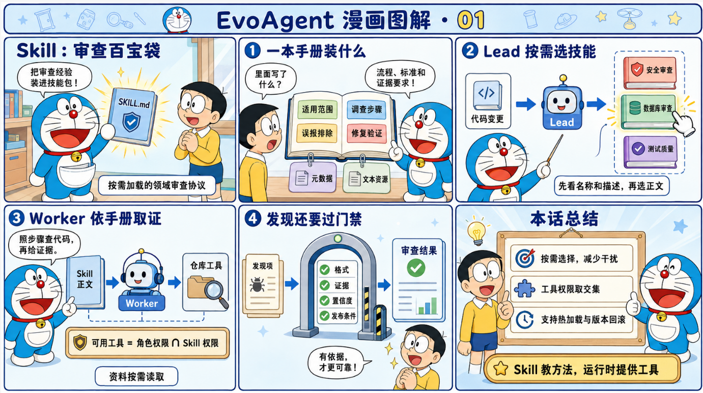

# 十五、🧀Skill

Skill 被选中后，会改变 worker 如何检查代码、使用哪些工具、需要什么证据，以及什么情况下应该提交 Finding。

## 先分清三个容易混在一起的概念

| 概念 | 存放位置 | 实际作用 |
| --- | --- | --- |
| Agent Skill | `skills/<name>/SKILL.md` | 给 LLM worker 注入领域审查指令 |
| Scanner | Python `Reviewer` 实现 | 直接、确定性地扫描 Diff 并产生候选 Finding |
| `llm-review` Prompt 版本 | 数据库 `skill_versions` 表 | 覆盖 Agent 的基础 Prompt，属于另一条 Prompt 进化链 |

项目把 Scanner 和 Agent Skill 都放在 SkillRegistry 中管理和展示，但两者的运行方式完全不同。

Scanner 会直接执行。例如服务启动时注册的 SecurityRuleReviewer 和 ReliabilityRuleReviewer，它们会遍历 Diff 并返回结果。

Agent Skill 不直接检查代码。它先提供名称和描述给 Lead，Lead 判断哪些 Skill 与本次变更有关，然后系统才把完整指令交给相应 worker。

llm-review 则更接近全局 Prompt 配置。它虽然使用了 skill_versions 这张历史命名的数据表，但不是标准的 SKILL.md Skill。

## Agent Skill 的目录结构

标准结构是：

```Plain Text
skills/<name>/
  SKILL.md
  references/       可选
  scripts/          可选
  assets/           可选
  其他 UTF-8 文本   可选
```

SKILL.md 是唯一入口，例如：

```Plain Text
---
name: code-quality
description: Review added production code for TODO or FIXME markers.
allowed-tools:
  - search_diff
  - changed_line
---

# Review unfinished production behavior

Inspect added production lines for TODO or FIXME.
Ignore files under tests/.
```

文件分成两部分：

1. YAML frontmatter，保存名称、描述和工具限制。

1. Markdown 正文，保存真正交给 worker 的审查方法。

项目不会导入 skill.py，不会执行 scripts/，也不会把 Markdown 当命令运行。即使 Skill 目录中存在 Python 文件，它最多被当成普通文本资源读取。测试中专门放置了一个执行后会抛异常的 skill.py，以证明注册过程不会导入它。

## Skill 的数据模型

AgentSkill 是一个不可变 dataclass，主要字段包括：

- name：Skill 的唯一名称。

- description：给 Lead 看的能力说明。

- instructions：去掉 frontmatter 后的正文。

- content：规范化后的完整 SKILL.md。

- source：来源，目前主要是 disk、memory 或 evolved-db。

- version：数据库演化版本号，磁盘版本默认为 1。

- resource_paths：包内可读取资源路径。

- resource_contents：已经加载的 UTF-8 资源内容。

- allowed_tools：该 Skill 允许 worker 使用的工具。

- content_sha256：整个 Skill 包的内容摘要。

这里有两个不同层次的哈希：

- content_sha256 根据规范化后的 SKILL.md、资源路径和资源内容计算。

- 数据库存储的 artifact_sha256 根据完整 artifact 的规范 JSON 计算。

前者适合判断 Skill 包内容，后者适合追踪数据库中的完整版本快照。

## 加载时会做哪些校验

SkillRegistry.reload() 只扫描 skills 下的一级子目录，并寻找其中的 SKILL.md。解析时有一组明确限制：

- SKILL.md 必须以 YAML frontmatter 开头。

- frontmatter 必须正常结束并解析为对象。

- name 和 description 必须存在。

- 名称只能使用小写字母、数字和连字符。

- 名称长度最多 64 个字符。

- 名称必须和 Skill 目录名匹配。

- 描述长度为 1 到 1536 个字符。

- Markdown 指令正文不能为空。

- SKILL.md 最大为 128 KiB。

- allowed-tools 可以是字符串，也可以是字符串数组。

- supporting file 最多 100 个。

- 每个 supporting file 最大为 1 MiB。

- 数据库版本中的 supporting file 必须是 UTF-8 文本。

- .、..、空路径和伪造的 SKILL.md 资源路径会被拒绝。

- SKILL.md 和资源文件不允许使用符号链接。

- 磁盘中的非 UTF-8 文件会被跳过，不会交给 Agent。

reload 会先完成整个目录扫描，最后才用新字典替换旧的 Agent Skill 集合。如果其中一个 Skill 校验失败，替换操作不会发生，原来的集合仍然保留。这使 reload 在注册表层面具有原子性。

有一点值得注意：supporting file 在 reload 时已经被读入进程内存。所谓按需加载，主要是指模型上下文按需加载，并不是磁盘读取延迟到 worker 调用时才进行。

## 仓库内置的九个 Agent Skill

当前 skills 目录全部只有 SKILL.md，没有额外 supporting file。

- security-review：检查鉴权缺失、注入、敏感信息泄露、不安全反序列化、SSRF、命令执行和危险数据流。要求高风险结论给出调用链或工具证据。

- correctness-review：检查状态转换、边界条件、异常处理、数据丢失和业务不变量。强调必须能构造出实际错误结果。

- reliability-review：检查超时、重试、并发、资源释放、幂等性和外部 I/O 失败路径。

- api-compatibility：检查 API、CLI、配置、事件、序列化格式和默认值的兼容性。

- test-quality：检查测试是否真正验证了改动效果，是否漏掉鉴权、错误处理、持久化和并发等重要路径。

- database-review：检查事务、锁、迁移、约束、N+1、回填和回滚安全。

- performance-review：检查无界循环、重复远程调用、阻塞 I/O、过量内存、重复序列化和热路径放大。

- observability-review：检查日志、指标、追踪和错误上下文是否足以诊断新引入的重要失败。

- code-quality：专门检查生产代码中代表未完成行为的 TODO 和 FIXME，并忽略 tests/ 下的标记。

这些 Skill 的重点不是列举所有可能问题，而是约束模型只报告有上下文证据、由当前改动引入、能够给出修复和测试建议的问题。

## 一次审查中 Skill 如何运行

完整链路如下：

1. ReviewService 创建 SkillRegistry。

1. 服务注册内置 Scanner，然后扫描磁盘上的九个 Agent Skill。

1. 服务读取当前租户的活动数据库 Skill 版本。

1. 数据库版本与磁盘版本同名时，数据库版本覆盖磁盘版本。

1. 本地 Scanner 先运行，生成确定性的候选 Finding。

1. Lead 收到 Diff、变更文件、Scanner 结果，以及所有 Agent Skill 的名称和描述。

1. Lead 在 delegation 的 skills 字段中选择相关 Skill。

1. 系统过滤不存在的名称，然后把所选 Skill 的完整正文注入对应 worker。

1. worker 使用 Skill 指令和受限工具完成审查。

1. Lead 可以要求 worker 最多返工两轮。

1. Critic 独立检查候选 Finding，但不会获得这些 Skill 的正文，也不能创建新的 Finding。

1. Lead 决定发布哪些候选。

1. Finding 还要通过格式、证据、置信度和发布资格 Gate。

这是一种渐进式上下文加载。Lead 只看 catalog，不会一开始就接收九份完整指令。完整正文只进入被选中的 worker，降低了上下文占用，也减少了不相关指令互相干扰。

协作结果会记录本次真正使用过的 agent_skills，因此可以从报告中追踪某个 Finding 是在哪些 Skill 参与下产生的。

## enabled_skills 的含义

调用审查接口时可以显式传入：

```Plain Text
{
  "repository": "org/repo",
  "diff": "...",
  "enabled_skills": [
    "security-review",
    "database-review"
  ]
}
```

服务会在任务创建前验证这些名称。不存在的名称会直接导致请求失败，不会静默忽略。

显式指定与 Lead 自动选择有一点区别：

- Lead 自动选择的 Skill 只进入 Lead 指定的 assignment。

- enabled_skills 中的 Skill 会被加入每一个有效 worker assignment，包括系统自动补齐的默认 assignment。

所以 enabled_skills 更接近强制启用，不只是缩小候选范围。

## Skill 怎样限制工具

每个角色本身有一组平台级工具权限。例如 Security worker 可以使用代码搜索、读取文件、AST 分析、Git 上下文和 Scanner 等工具。

Skill 的 allowed-tools 不能赋予角色原来没有的权限。最终权限计算方式是：

```Plain Text
角色基础权限 ∩ 所选 Skill 声明的工具集合
```

当前代码在同时选择多个受限 Skill 时，会先对这些 Skill 的工具声明取并集，再和角色基础权限取交集。因此多个 Skill 一起使用时，最终工具范围可能比单个 Skill 更宽，但永远不会超出角色原有权限。

如果所有选中 Skill 都没有声明 allowed-tools，worker 保留完整角色权限。

只要所选 Skill 包含 supporting file，系统还会额外注册 read_skill_resource。该工具只能读取当前 assignment 已选择的 Skill，不能借此读取其他 Skill。

## 磁盘版本、租户版本和覆盖关系

磁盘 Skill 是所有租户共享的基础版本。数据库中的活动 artifact 按 tenant_id + skill_name 隔离。

运行时的合并方式是：

```Plain Text
所有磁盘 Skill
  + 当前租户的活动数据库 Skill
  = 当前租户可用 Skill 集合
```

同名时，数据库版本覆盖磁盘版本。不同租户可以同时使用同一个 Skill 的不同版本。

主要有两张表：

- skill_artifact_versions：保存完整 artifact、版本号、父版本、分数、活动状态、哈希和租户。

- skill_evolution_runs：保存 baseline、candidate、门禁决定、指标和复现信息。

需要注意，Agent Skill artifact 和进化运行按租户隔离，但 Validation、Holdout 评测样本目前仍来自共享的 evaluation_cases，没有按租户划分。

## Skill 自进化究竟做了什么

这里的自进化不训练模型权重，也不允许模型修改 Python 源码。它修改的是完整的 SKILL.md artifact。

artifact 格式为：

```Plain Text
{
  "schema_version": 2,
  "format": "agent-skill",
  "name": "review-dangerous-calls",
  "description": "...",
  "files": {
    "SKILL.md": "...",
    "references/policy.md": "..."
  },
  "content_sha256": "..."
}
```

候选有两种来源。

人工候选通过 POST /v1/skill-evolution/propose 提交，可以直接提供 skill_md 和 supporting files。

自动候选通过 POST /v1/skill-evolution/auto 从当前租户未解决的反馈生成。它只处理两种反馈：

- missed_issue：在 SKILL.md 末尾增加一段 learned guidance。

- false_positive：删除同一 rule_id 对应的 learned guidance。

accepted 和 bad_fix 不会直接修改 Agent Skill。

自动添加的内容带有稳定注释标记：

```Plain Text
<!-- evoagent:learned:SEC-DANGEROUS-CALL:start -->
## Confirmed SEC-DANGEROUS-CALL guidance

Inspect added behavior equivalent to `dangerous_call(data)`.
...
<!-- evoagent:learned:SEC-DANGEROUS-CALL:end -->
```

这些标记让误报反馈能够精确删除先前学到的规则，不必对整份 Markdown 做模糊编辑。

自动演化要求 rule_id 符合大写规则标识格式。证据优先取反馈中的 finding.evidence；如果没有，就根据 path 和 line 从原任务 Diff 的新增行中查找。证据不能包含换行，长度不能超过 240 个字符。反馈中的自由文本 note 不会进入 Skill 指令。

不过当前代码没有把 severity 严格限制为 low、medium、high 或 critical，只是转成小写后写入 Markdown。这一点比文档描述的格式校验更宽松。

## 候选为什么不会直接上线

候选必须和当前基线分别经过四次真实回放：

```Plain Text
Baseline  × Validation
Candidate × Validation
Baseline  × Holdout
Candidate × Holdout
```

回放使用真实的 Lead、Skill 选择、worker、Critic 和 Finding Gate 链路，不是简单做字符串匹配。

评测按 (path, line, rule_id) 匹配预期 Finding，计算：

- Precision

- Recall

- F1

- Severity Accuracy

- High Severity Recall

- Clean Accuracy

- Success Rate

- 综合 Score

存在正样本时，综合分主要由 F1 和严重级别准确率构成；存在干净样本时还会计入 Clean Accuracy。最后再乘以执行成功率，因此模型调用失败不会被当成没有误报的成功结果。

服务默认配置是：

- Validation 最少 3 条。

- Holdout 最少 2 条。

- 每个分区最多回放 5 条。

- Validation 综合分至少提升 0.01。

- 受保护指标默认不允许退化。

只有以下条件同时满足，候选才会变成 activated：

- 四组评测没有执行错误。

- Validation 达到最小提升。

- Validation 的受保护指标不退化。

- Holdout 的受保护指标不退化。

没有配置模型、样本不足或者候选与活动版本相同时，结果是 deferred。评测完成但没有通过门禁时，结果是 rejected。

除完全相同的候选外，deferred 和 rejected 版本也会保存，便于审计，但不会进入运行时。自动候选只有成功激活后，才会把本次使用的反馈标记为已解决。

Holdout 的聚合指标会保留，但逐案例结果和错误细节会从进化记录中移除，避免直接暴露隐藏集内容。

## 激活和回滚

激活成功后，数据库会先把该租户同名 Skill 的旧版本设为非活动，再启用新版本。API 随后调用 reload_skills() 重建运行路由，新任务开始使用新版本。

回滚接口是：

```Plain Text
POST /v1/skill-evolution/{name}/versions/{version}/activate
```

它不是任意版本强制上线。目标版本必须当前已经活动，或者曾经在 skill_evolution_runs 中获得过 activated 决定。被拒绝或仅保存为 deferred 的候选不能绕过门禁手工激活。

## 当前管理台能做什么

Skills 页面可以：

- 查看 Scanner 和 Agent Skill。

- 查看名称、描述、版本和来源。

- 重新扫描磁盘 Skill。

当前页面会把 Scanner 和 Agent Skill 放在同一组卡片中，而且没有显示 kind。由于 Scanner 和磁盘 Agent Skill 都存在 security-review、reliability-review 这两个名称，界面上可能看到同名卡片。

管理台中的演进实验室目前调用的是 /v1/evolution/*，操作对象是 llm-review Prompt。Agent Skill artifact 的自动演化、人工候选、版本查询和回滚已经有 API，但还没有对应的完整前端表单。

# 十六、🥛任务队列与持久化

## 1. 本地队列

未配置 Redis 时，TaskQueue 使用进程内 ThreadPoolExecutor。提交后立即把 Envelope 交给 Worker，失败时使用 1、2、4 秒等指数退避，最长 10 秒；达到最大尝试次数进入内存死信列表。

## 2. Redis Streams

配置 EVOAGENT_REDIS_URL 后使用：

```Plain Text
Stream: evoagent:review:stream
Group:  evoagent-workers
DLQ:    evoagent:review:dlq
```

Worker 通过 XREADGROUP 消费，只在任务完成、已经安全重入队或进入 DLQ 后 ACK。基础设施异常时不 ACK，让 Pending Entry 由租约恢复。XAUTOCLAIM 按 EVOAGENT_QUEUE_LEASE_SECONDS 回收超时消息。

当前重试是“新 XADD + ACK 旧消息”，Envelope 中 attempt 递增。死信可以查询并按 message_id 重新提交。

## 3. 两层重试

- 队列重试：处理 Worker 投递与任务执行整体失败。

- Harness 节点重试：处理 planning/executing/reviewing 某个节点的普通异常。

两层可能叠加，因此外部副作用必须单独做幂等。GitHub 评论使用 Upsert，Webhook 使用 Delivery claim。

## 4. SQLite 与 PostgreSQL

没有 EVOAGENT_DATABASE_URL 时使用 SQLite；URL 以 postgres:// 或 postgresql:// 开头时使用 PostgreSQL。

主要持久化对象包括：

- tasks、trace_events、task_payloads、checkpoints。

- agent_messages、agent_memories。

- failure_cases。

- evaluation_cases、evolution_runs、skill_versions。

- skill_artifact_versions、skill_evolution_runs。

- webhook_deliveries、installations。

- users、memberships、repository_grants、audit_log。

- deployments、release_observations、alerts。

PostgreSQL 版本使用 JSONB 保存结构化输入、报告与指标，并在分配 Prompt/Skill 版本时使用事务级 advisory lock 降低并发版本冲突。

## 5. 租户隔离

任务查询、反馈、Memory、evolved Skill、仓库授权、审计、告警和部署记录带 tenant_id。API Principal 从签名 Token 中取得 tenant 与 role，任务和仓库访问会再次检查租户。

Prompt skill_versions 和部分 Prompt evolution 查询仍以全局 skill_name 为主，不具备与声明式 Skill 完全相同的租户隔离强度。讲解时不要笼统声称所有版本资产都已严格多租户隔离。

## 6. Schema 演进

SQLite 初始化包含 _ensure_column() 兼容部分新增列，但项目没有 Alembic 等正式 Migration 版本链。CREATE TABLE IF NOT EXISTS 也不能处理任意约束、索引或类型变更。正式长期部署需要补独立数据库迁移流程。

---

# 十七、🍫评测

## 1. diff审查准确率

数据集已提供给大家

大家可根据自己有api key的模型跑，gpt、deepseek这些都可以，我自己是本地用gpt跑的

大家可以参考一下结果：

F1：0.925

高风险召回率：0.9474

## 2. 四臂消融

此实验用于证明多agent的必要性和有效性，以及Critic 是否带来增量

一共是四组实验：

single-llm

multi-llm-no-critic

full-agentic

full-agentic-evolved-skill

每个实验使用相同GPT模型，同一数据集，同一 token budget，同一 time budget

同一案例顺序，相同随机种子

| **实验臂** | **F1** |
| --- | --- |
| **single-llm** | 81.4% |
| **multi-llm-no-critic** | 88.9% |
| **full-agentic** | 92.5% |
| **full-agentic-evolved-skill** | 94.6% |

这四个实验能证明：

- full-agentic − single-llm：多 Agent 架构整体是否优于单 Agent。

- full-agentic − multi-llm-no-critic：Critic 是否带来增量。

## 3. 指标计算

端到端基准使用以下口径：

> Precision = TP / (TP + FP)
> Recall = TP / (TP + FN)
> F1 = 2 × Precision × Recall / (Precision + Recall)
> Severity Accuracy = 严重等级完全一致的 TP / TP
> High Risk Recall = 命中的 HIGH 或 CRITICAL 真值 / 全部 HIGH 或 CRITICAL 真值
> Clean Accuracy = 没有任何报告的干净 PR / 全部干净 PR
> Execution Success Rate = 正常完成回放的样本 / 全部样本
> Safe Fix Rate = 通过全部修复门禁的补丁 / 所有已尝试补丁
> E2E Security Fix Rate = 检测正确且修复验证通过的风险 PR / 全部风险 P

代码对分母为 0 的情况有明确处理。例如，没有任何高风险真值时，高风险召回率默认是 1；没有任何修复尝试时，safe_fix_rate 默认是 0。这样做避免了除零，但阅读小分区结果时仍要看分母数量，不能只看百分比。

修复评测：

> 受控基准的 FixtureRepairer 只是一个确定性的演示修复器。它不是生产修复器，但它展示了端到端修复需要通过的五个检查：
> 
> 1. risk-reproduction：原始文件里仍能复现风险模式。
> 
> 1. patch-generated：修复前后内容确实发生了变化。
> 
> 1. compile：通过 RepairVerifier 的文件验证。
> 
> 1. risk-removed：修复后风险模式不再匹配。
> 
> 1. regression-tests：所有 required_after_patterns 都能匹配。
> 
> 五个检查必须全部通过，当前 finding 才算 repair_passed。此外，e2e_success 还要求：
> 
> - 该风险样本的所有真值都被匹配；
> 
> - 每个真值都尝试了修复；
> 
> - 每个修复都通过五个检查。
> 
> 因此 Safe Fix Rate 和 E2E Security Fix Rate 的分母不同：前者是所有已尝试的补丁，后者是全部风险 PR。一个 PR 可能检测到了风险，但没有生成安全补丁，这时它可以贡献检测 TP，却不能贡献端到端修复成功。

## 4. Prompt 回放评测和自动进化

端到端基准比较的是 Reviewer 组合。另一条评测链比较的是同一个 Reviewer 工厂在不同 Prompt 下的行为。这部分由 RegressionEvaluator 和 EvolutionEngine 实现。

### 4.1 两种样本格式

端到端 JSONL 使用 expected_findings，字段是 start_line、end_line、cwe 和 severity。Prompt 进化使用数据库里的版本化样本，内部格式更简化：

```JSON
{
  "name": "security-dynamic-execution",
  "split": "validation",
  "diff": "... unified diff ...",
  "expected": [
    {
      "path": "app.py",
      "line": 1,
      "rule_id": "SEC-EVAL",
      "min_severity": "high"
    }
  ],
  "source": "builtin"
}
```

其中

- line 是精确匹配行；

- rule_id 可选。填写后，同一行但错误类别的 finding 不算命中；

- min_severity 表示最低允许严重等级，预测等级可以高于它；

- split 可以是 train、validation 或 holdout，但进化门禁实际读取 Validation 和 Holdout。

服务启动时，EvolutionEngine 会写入一组基础验证样本。通过 POST /v1/evaluation/cases 可以添加新样本。样本名称和内容不可覆盖，同名同内容的重复提交保持幂等，修改内容必须换新名称。这让历史评测运行仍然可以追溯到原始样本。

### 4.2 RegressionEvaluator 怎样计算综合得分

> RegressionEvaluator.run(prompt, cases) 先根据 Prompt 创建 Reviewer，然后逐条回放：
> 
> 1. 解析 Diff。
> 
> 1. 调用 Reviewer。
> 
> 1. 按 (path, line, rule_id) 去重预测结果，同一位置同一规则保留严重等级更高的版本。
> 
> 1. 按路径、行号和可选 rule_id 匹配真值。
> 
> 1. 检查预测严重等级是否达到 min_severity。
> 
> 1. 记录错误、成功样本数和逐样本结果。

与端到端基准相比，这里是精确行匹配，不使用两行容差。它更适合 Prompt 版本之间的回归对照，因为版本进化需要更严格地知道新 Prompt 报到了哪里。

综合得分按以下权重计算：

```Plain Text
有风险样本时：
  F1                 权重 0.65
  严重等级准确率      权重 0.15

有干净样本时：
  干净样本准确率      权重 0.20

最终 score = 加权平均 × 执行成功率
```

执行异常会被记录为错误。风险样本异常时增加漏报，干净样本异常时不会被当作正确的空结果。执行成功率下降还会直接乘低综合得分，因此服务不可用不能通过"少报问题"掩盖。

### 4.3 Prompt 候选的激活流程

> EvolutionEngine.propose() 的完整判断可以分成六步
> 
> 1. 检查候选 Prompt 非空、长度不超过 12000，并且不包含禁止词。
> 
> 1. 检查 Prompt 是否包含 diff、severity、fix、test、json 这些最小结构要求。
> 
> 1. 读取当前激活版本作为 baseline，读取 Validation 和 Holdout 样本。
> 
> 1. 对 baseline 和 candidate 分别在两套数据上回放。
> 
> 1. 判断是否有执行错误、Validation 是否达到最小提升、受保护指标是否退化、Holdout 是否退化。
> 
> 1. 保存候选版本和 evolution_runs 记录。只有所有必要门禁通过时才把候选设为 active。

调用方传入的 regression_score 不作为上线依据。代码会在审计记录中把它标记为 external_regression_score_ignored，真正的依据是系统自己回放得出的结果。

Prompt 版本可以有三种状态：

- activated：评测通过并进入激活链路；

- rejected：候选已保存，但至少一个门禁失败；

- deferred：例如没有配置模型、样本数量不足，或者候选和当前激活版本完全相同。

Holdout 的逐样本 case_results 和错误明细会被脱敏，只持久化聚合指标和错误数量。这样可以减少把隐藏集样本细节暴露给候选生成逻辑的机会。

### 4.4 Prompt 进化的配置项

.env.example 中与这条链路直接相关的默认值是：

```Plain Text
EVOAGENT_EVAL_MAX_CASES=5
EVOAGENT_EVAL_MIN_CASES=3
EVOAGENT_EVAL_MIN_HOLDOUT_CASES=2
EVOAGENT_EVAL_MIN_IMPROVEMENT=0.01
EVOAGENT_EVAL_MAX_METRIC_REGRESSION=0
```

含义如下：

| 配置项 | 含义 |
| --- | --- |
| EVOAGENT_EVAL_MAX_CASES | 每次进化回放每个分区最多读取多少条样本 |
| EVOAGENT_EVAL_MIN_CASES | Validation 至少需要多少条样本 |
| EVOAGENT_EVAL_MIN_HOLDOUT_CASES | Holdout 至少需要多少条样本 |
| EVOAGENT_EVAL_MIN_IMPROVEMENT | 候选 score 相对基线的最小提升 |
| EVOAGENT_EVAL_MAX_METRIC_REGRESSION | 受保护指标允许的最大退化，默认是 0 |

进化链路的"最小提升"默认是 0.01，而离线 100 条端到端报告的 Validation F1 发布门禁默认是 0.02。它们属于两套调用场景，不能看到一个阈值就推断另一个也相同。

## 5. Skill 自进化评测

Skill 自进化与 Prompt 进化是两套独立的版本链。区别在于，Prompt 进化保存一段文本 Prompt，Skill 进化保存结构化的声明式 artifact。

### 5.1 Skill artifact 的安全边界

validate_artifact() 会把候选 Skill 限制为结构化规则：

- Skill 名称必须以 evolved- 开头；

- 规则 ID 必须符合大写字母、数字、下划线和连字符的限制；

- match 必须是单行、非空、长度受限的字面匹配字符串；

- severity、路径过滤、标题、解释、修复和测试字段都会被校验；

- artifact 的 permissions 固定为空数组。

DeclarativeSkillReviewer 只在 Diff 新增行上做受限的字面匹配，不加载 Python、不执行 eval、不调用 subprocess，也不获取主机权限。这样，反馈可以改变规则匹配行为，但不能直接把任意代码注入评测或生产进程。

### 5.2 Skill 的回放和激活

SkillEvolutionEngine.propose() 仍然是 baseline 对 candidate 的双数据集回放：

1. 校验 artifact。

1. 读取当前租户的 active artifact，或者使用空 artifact 作为 baseline。

1. 在 Validation 和 Holdout 分别计算 RegressionEvaluator 指标。

1. 要求 Validation 有最小提升，且受保护指标不退化。

1. 要求 Holdout 不退化。

1. 保存 artifact 内容 SHA-256、父版本、分数和激活状态。

Skill 的受保护指标包括 score、Precision、Recall、高严重等级召回率、执行成功率，以及在有对应样本时的严重等级准确率和干净样本准确率。允许退化多少由 EVOAGENT_EVAL_MAX_METRIC_REGRESSION 控制

### 5.3 从反馈自动产生 Skill 候选

SkillEvolutionEngine.auto_propose() 只处理未解决的反馈：

- missed_issue 可以新增一条确认规则；

- false_positive 可以移除已有规则；

- 规则必须带合法的 finding.rule_id；

- 优先使用反馈里的 finding.evidence；

- 如果没有 evidence，就从原任务 Diff 对应的新增行提取字面内容；

- evidence 不能包含换行，也有长度上限；

- 只有候选最终通过 Validation 和 Holdout 门禁，使用过的反馈才会被标记为 resolved。

被拒绝的候选仍然会保存，便于审计，但不会进入当前审查链路。Skill artifact 还按租户隔离，某个租户激活的版本不会直接成为另一个租户的版本。

## 6. 评测结果保存

SQLite 初始化时会建立几张与评测直接相关的表：

| 表 | 保存内容 |
| --- | --- |
| evaluation_cases | 版本化样本、split、Diff、expected 真值、来源和 active 状态 |
| evolution_runs | Prompt 版本的 baseline、candidate、decision、分数和聚合指标 |
| skill_artifact_versions | 声明式 Skill artifact、父版本、SHA-256、分数和 active 状态 |
| skill_evolution_runs | Skill 版本的回放结果和门禁结果 |
| failure_cases | 误报、漏报、坏修复和执行错误反馈 |

一次端到端离线基准报告则落盘为 JSON 和 Markdown。当前 JSON 的 `schema_version` 是 2，顶层结构包括：

```Plain Text
legacy_reference
baseline
candidate
comparison
attribution
```

其中 legacy_reference 保存 6 条规则的历史参考，baseline 保存 14 条规则的公平单 Agent 结果，candidate 保存 14 条规则的多 Agent 结果。comparison 只比较公平基线和候选，attribution 再把规则扩充、编排和修复拆开。JSON 还包含逐样本匹配、修复检查、错误信息、整体指标和分区指标。Markdown 保留适合人工阅读的摘要。

数据指纹的计算方式不是直接对 JSONL 原始文本做哈希。dataset_fingerprint() 会按样本 ID 排序，对每个样本做稳定 JSON 序列化，再用 SHA-256 计算。因此 JSONL 的字段顺序或空白变化不会改变指纹，但样本内容、真值、Diff 或来源变化都会改变指纹。

## 7. 真实 GitHub PR 怎样接入

真实 PR 数据需要先准备一个 JSONL 清单，并为每条记录提供至少：

- PR 标识、仓库和编号；

- validation 或 holdout 分区；

- 人工审核过的 expected_findings；

- 可修复样本的 repair_validation，包括风险复现、修复后必须出现的模式和必要回归条件。

导入命令示例：

```PowerShell
$env:GITHUB_TOKEN = '<fine-grained-read-token>'
python scripts\import_github_pr_dataset.py .\labels\github-prs.jsonl `
  .\evaluation_data\github_pr_100.jsonl --limit 100
```

导入器会下载真实 Diff，并拒绝缺少 expected_findings 的记录。真值不能由待评测 Agent 自己生成，否则评测集会发生标签泄漏。对真实仓库运行修复时，也不能继续使用受控基准的 FixtureRepairer，而应替换为基于临时 worktree、真实编译命令和真实测试命令的修复执行器。

## 8. API 入口

与评测和版本进化直接相关的 API 包括：

| **方法** | **路径** | **作用** |
| --- | --- | --- |
| **GET/POST** | /v1/evaluation/cases | 查询或增加版本化评测样本 |
| **GET** | /v1/evolution/status | 查看模型、Validation、Holdout 和门禁是否就绪 |
| **POST** | /v1/evolution/propose | 评估指定 Prompt 候选 |
| **POST** | /v1/evolution/auto | 从未解决反馈生成 Prompt 候选并评估 |
| **GET** | /v1/evolution/runs | 查看持久化的 Prompt 版本评测记录 |
| **POST** | /v1/skills/{name}/versions/{version}/activate | 激活或回滚 Prompt Skill 版本 |
| **GET** | /v1/skill-evolution/status | 查看 Skill 评测就绪状态 |
| **GET** | /v1/skill-evolution/runs | 查看 Skill 评测运行记录 |
| **POST** | /v1/skill-evolution/propose | 评估指定声明式 Skill artifact |
| **POST** | /v1/skill-evolution/auto | 从确认反馈生成并评估 Skill 候选 |
| **GET** | /v1/skill-evolution/{name}/versions | 查看 Skill artifact 版本链 |
| **POST** | /v1/skill-evolution/{name}/versions/{version}/activate | 激活或回滚 Skill artifact |

## 9. 代码测试覆盖

与评测直接相关的测试在：

- [tests/test_evaluation_harness.py](../tests/test_evaluation_harness.py)

- [tests/test_advanced.py](../tests/test_advanced.py)

- [tests/test_skill_evolution.py](../tests/test_skill_evolution.py)

- [tests/test_evolution_proof.py](../tests/test_evolution_proof.py)

重点覆盖包括：

1. 100 条基准数据的数量和仓库级划分。

1. 三臂受控基准的目标 TP、FP、FN 和主要指标。

1. 重复预测只能匹配一次。

1. JSONL 往返后数据集指纹稳定。

1. 评测异常会降低分数，而不是被当成空结果。

1. 同一行但错误 rule_id 不算命中。

1. Holdout 退化会阻止 Prompt 激活，并且不会泄露 Holdout 案例细节。

1. 没有新反馈时不会重复创建无效版本。

1. Skill artifact 的声明式限制、回放激活、回滚和租户隔离。

1. Prompt 进化在仓库隔离的 Holdout 上改善，并且生产来源门禁仍然失败。

```PowerShell
python -m unittest tests.test_evaluation_harness -v
python -m unittest tests.test_evolution_proof -v
python -m unittest tests.test_skill_evolution -v
python -m unittest tests.test_advanced -v
```

端到端回放命令也成功生成了当前报告，输出摘要为：

```Plain Text
legacy F1=71.4% fair-baseline F1=82.5% multi-agent F1=82.5% high-risk recall=94.7%
safe fix=78.8% e2e fix=65.0%
```

# 十八、🥝EvoAgent 代码解读

## 1. 项目是做什么的

EvoAgent 是一个面向 Pull Request 的自动代码审查服务。它接收 unified diff，检查新增代码中的安全性、正确性和可靠性问题，最后输出结构化 Finding、JSON 报告或 Markdown 报告。

## 2. 核心目录

| 位置 | 作用 |
| --- | --- |
| evoagent/api.py | HTTP 路由、认证入口和静态文件服务 |
| evoagent/service.py | 装配依赖并编排主要业务 |
| evoagent/harness.py | 审查任务状态机和报告生成 |
| evoagent/agentic_core.py | 三种审查模式和四角色 LLM 主链 |
| evoagent/reviewer.py | Reviewer 抽象、本地规则和兼容模型 Reviewer |
| evoagent/runtime.py | 节点 Runtime、checkpoint、工具注册和 Agent Loop |
| evoagent/repository_tools.py | 仓库搜索、AST、Git、Scanner 和测试工具 |
| evoagent/store.py、postgres_store.py | SQLite/PostgreSQL 持久化 |
| evoagent/task_queue.py | 内存队列和 Redis Streams |
| evoagent/patching.py、verifier.py | 补丁生成与修复验证 |
| evoagent/evolution.py、skill_evolution.py | Prompt 和声明式 Skill 进化 |
| evoagent/evaluation_harness.py、evaluation_v2.py | 数据集评测和四组消融实验 |
| web/ | 原生 HTML、CSS、JavaScript 管理台 |
| scripts/ | 数据导入、评测和进化证明脚本 |

ReviewService 是后端的组合根。数据库、Reviewer、任务队列、GitHub Client、修复器、评测器和演进组件都在这里建立联系。想快速理解系统如何组装，应该先读 service.py，而不是逐个孤立地看模块

## 3. 核心数据对象

项目的业务对象集中在 evoagent/models.py。

### 3.1 Task

一次审查会先创建任务，再依次经过解析、规划、执行和报告阶段，最终进入成功、失败或取消状态。状态变化会持久化，异步 Worker 或进程重启后可以判断任务执行到了哪里。

### 3.2 Finding 

Finding 表示一条审查结论，主要字段包括：

- rule_id、severity 和标题。

- 文件路径与新增行号。

- 问题解释、证据、修复建议和测试建议。

- confidence、证据引用和调用链。

- 结论来源，例如本地 Scanner、动态 Skill 或某个 LLM 角色。

Finding 不是生成后就直接发布，它还要经过位置、证据、置信度和发布资格门禁。

### 3.3 ReviewReport

ReviewReport 汇总任务状态、最终 Findings、实际运行模式、模型与工具调用统计、成本、Token、耗时、协作摘要和降级原因。前端、JSON API 和 Markdown 报告使用的是同一份运行事实。

## 4. 一次审查如何运行

服务通过 python -m evoagent 启动。evoagent/__main__.py 调用 api.run()，后者加载配置、创建 ReviewService，再启动标准库 ThreadingHTTPServer。

同步审查的主调用链可以概括为：

```Plain Text
ApiHandler.do_POST
  -> ReviewService.create_review
  -> Store.create + save_task_payload
  -> ReviewHarness.run
  -> AgentRuntime.execute
  -> parse_unified_diff
  -> ModeRouterReviewer.review_with_context
  -> rules-only | hybrid | agentic
  -> FindingGate.apply
  -> ReviewReport
  -> Store.succeed
```

其中几个关键点是：

1. API 层处理认证、参数和仓库权限。

1. Service 校验 diff 大小、运行模式和租户上下文，然后创建任务。

1. Harness 驱动任务状态，并把解析、执行和报告拆成 Runtime 节点。

1. diff Parser 只保留新增行，Finding 的位置必须落在新增行上。

1. Mode Router 选择真正执行的审查策略。

1. 所有候选结论统一经过 Gate，最后才写入报告。

异步请求使用相同的审查主链，只是任务先进入内存队列或 Redis Streams，再由 Worker 执行。

## 5. 三种审查模式

ModeRouterReviewer 是当前审查策略的总入口。

| 模式 | 执行内容 | 模型角色 |
| --- | --- | --- |
| rules-only | 本地规则、动态 Scanner、evolved Skill | 0 |
| hybrid | rules-only 结果加一个独立 LLM Reviewer | hybrid-reviewer |
| agentic | 确定性扫描加 Planner、两个 Specialist 和 Critic | 最多 4 个 |

### 5.1 rules-only

系统先运行 LocalRuleReviewer 的六条内置规则，再运行可用的动态 Scanner 和租户激活的 evolved Skill。结果按路径、行号和规则编号去重；高危 Python 命中会尽量补充 AST 证据。

内置规则主要覆盖 eval、危险反序列化、shell 执行、SQL 拼接、硬编码密钥、空异常处理和调试输出等常见问题。它们只扫描新增行，不等于完整的语法或数据流分析器。

### 5.2 hybrid

hybrid 先完整运行 rules-only，再把 diff、变更文件和 scanner_findings 交给一个 LLM Reviewer。模型可以直接给出结论，也可以调用仓库工具继续查找符号、调用关系、测试或 Git 上下文。

最终结果是 Scanner Finding 与 LLM Finding 的并集，再统一进入 Gate。这条路径也是生产评测中的 single-llm 实验臂。

### 5.3 agentic

agentic 的四个角色各自承担明确职责：

- Planner：识别风险并给 Specialist 分派目标。

- Security：检查输入、权限、敏感数据和危险调用链。

- Correctness/Reliability：检查异常、状态、并发、资源和兼容性。

- Critic：盲审所有候选，拒绝证据不足或位置错误的结论。

实际执行顺序是：先跑确定性 Scanner，把结果共享给 Planner 和两个 Specialist；两个 Specialist 并行审查；规则与模型结论合并后交给 Critic；Critic 接受的候选再进入统一 Gate。候选为空时不会调用 Critic。

evoagent/agents.py 中还保留了一套较早的 MultiAgentCoordinator，主要用于兼容和部分测试。它包含更多确定性协作阶段，但不等于当前四个真实 LLM 角色，也不再用于四角色效果评测。

## 6. Runtime、工具、证据与 Gate

### 6.1 Runtime 和 Agent Loop

AgentRuntime 按节点执行审查流程，并在节点完成后保存 checkpoint。任务中断后可以从最后一个完成节点继续，但不能恢复到某个 LLM 角色内部的中间步骤。

BoundedRole 使用有界 Agent Loop。模型每轮只能选择调用工具或返回最终 JSON，并受到最大步骤数、Token 和时间预算限制。ExecutionLedger 记录真实模型调用、工具调用、Token、成本、耗时和错误。

### 6.2 仓库工具

RepositoryToolSuite 提供 diff 搜索、文件读取、符号定位、AST、Git 历史、Scanner、测试定位与测试执行等能力。不同角色使用不同工具白名单，ToolRegistry 还会校验参数 Schema。

文件访问被限制在指定仓库根目录内，路径会经过规范化检查。测试命令也有超时和允许列表，不过它仍不等同于完整的无网络安全沙箱；执行不可信仓库时最好使用容器隔离。

### 6.3 Finding Gate

所有模式共用一套 Gate：

- 格式门禁：检查必要字段和结构。

- 位置门禁：只接受指向新增行的结论。

- 证据门禁：高危问题需要强证据或调用链。

- 置信度门禁：过滤低置信度结果。

- 发布门禁：决定结论能否成为正式评论。

这套设计把“模型提出候选”和“系统允许发布”分开。即使模型输出格式正确，也不代表结论一定会进入最终报告。

## 7. 任务、队列、存储与权限

项目支持 SQLite 和 PostgreSQL。SQLite 适合本地运行，PostgreSQL 用于生产部署。数据库保存任务、输入、状态事件、报告、Agent 消息、工具轨迹、反馈、评测数据、版本、审计记录和告警等信息。

异步任务可以使用本地内存队列或 Redis Streams。Redis 路径实现 ACK、Worker 租约、超时接管、指数退避重试和死信队列。超过重试上限的任务会进入 DLQ，并同步标记为失败，避免长期停留在 pending 状态。

安全控制包括：

- Bearer Token 登录。

- admin、reviewer、viewer 等角色权限。

- tenant 级数据隔离。

- repository 访问授权。

- Webhook delivery 幂等和重放时间窗。

- 管理操作审计。

认证可以在本地关闭，但生产 Compose 默认开启。前端把 Token 保存在 `localStorage`，因此仍需要持续关注 XSS 和 CSP。

## 8. GitHub 与自动修复

GitHub Webhook 入口会验证 HMAC-SHA256 签名，只处理受支持的 Pull Request 事件，并根据 delivery id 防止重复消费。如果请求没有携带 diff，服务会通过 GitHub API 延迟下载

审查完成后可以回写 PR 评论。评论带稳定标记，重复执行时会更新原评论，而不是不断创建重复内容。

自动修复主链使用 LLM 生成 unified patch，但补丁不能直接发布：

1. 校验 patch 格式和目标路径。

1. 限制修改范围，禁止越过仓库根目录。

1. 在临时副本中应用补丁。

1. 执行 Python 编译、tokenize 和仓库测试。

1. 对比修复前后的测试结果。

1. 验证通过后才允许创建修复分支和 Draft PR。

SafeFixer 是另一套白名单式确定性修复器，主要服务于受控场景，不是当前服务的主要修复入口。

## 9. Skill、记忆与演进

动态 Skill 通过 manifest 加载，并进行名称、入口、签名和权限检查。声明式 evolved Skill 只支持受限的字面匹配规则，不执行调用方提供的 Python、`eval` 或任意 subprocess。

系统维护 working、episodic、semantic 和 procedural 等记忆，用于保存当前上下文、历史经验、规则知识和操作过程。检索按租户和仓库隔离，并支持过期清理，防止不同项目之间意外共享内容。

Prompt 进化和 Skill 进化是两条独立版本链：

- Prompt 进化根据失败案例生成候选 Prompt、few-shot、路由或工具策略。

- Skill 进化把确认的漏报或误报转换成声明式规则候选。

候选都不能直接替换线上版本。系统会在 validation 和隐藏 holdout 上回放，只有达到最低提升且受保护指标不退化时，才进入激活或 shadow-ready 状态。版本、数据指纹、指标、成本、门禁结论和回滚点都会持久化。

## 10. 生产评测

evaluation_harness.py 负责解析 JSONL 数据集、运行 Reviewer、做 Finding 一对一匹配并计算 precision、recall、F1、高危召回、clean accuracy 和执行成功率等指标。生产 Harness 还记录每 PR 无效评论、精确行与证据准确率、模型调用、Token、成本和延迟。

真实生产数据需要满足：

- 至少 300 条人工标注 PR。

- 来源是公开 GitHub PR 或私有历史 PR。

- train、validation、holdout 都存在。

- 仓库不能跨 split 重叠。

- Finding 标注包含 should_comment。

evaluation_v2.py 比较四条实验臂：

1. rules-only。

1. single-llm。

1. multi-llm-no-critic。

1. full-agentic。

四组都通过真正的 ModeRouterReviewer 执行，并共享相同的 14 条确定性规则、模型、数据和每 PR 总 Token/时间预算。评测会核对 Ledger 中的真实角色调用，避免配置写着四角色、实际却没有调用模型。

最终比较只使用隐藏 holdout，并通过配对 bootstrap 给出 95% 置信区间。full-agentic 相对 single-llm 需要达到 F1 提升 3 个百分点或高危召回提升 5 个百分点，无效评论不能恶化，而且统计区间必须支持正向收益。Critic 是否保留则通过 full-agentic 与无 Critic 组单独比较。

仓库自带的 100 条合成数据只用于回归测试，不能通过生产来源门禁。正式入口是：

```PowerShell
python scripts/run_agentic_evaluation.py evaluation_data/public-pr-300.jsonl
```

## 11. API、前端与部署

HTTP 服务没有使用 FastAPI 或 Flask，路由、JSON 处理和静态文件返回都由 ApiHandler 完成。主要接口覆盖登录、创建审查、查询任务、读取报告、提交反馈、触发修复、管理 Skill、运行演进和查看指标。

管理台位于 web/，使用原生 HTML、CSS 和 JavaScript，没有前端构建步骤。它提供概览、审查提交、任务详情、Skill 和演进页面，并根据后端运行事实展示真实模式、模型角色和调用统计。

本地可以直接运行：

```PowerShell
python -m evoagent
```

生产部署可以使用 Docker Compose 启动 EvoAgent、PostgreSQL 和 Redis。示例密钥和管理员密码只适合本地演示，部署前必须替换。项目还提供 OpenTelemetry Trace、Prometheus 指标、灰度分桶、影子流量和错误预算回滚，不过进程内指标在重启后会清零。

## 12. 阅读顺序与实现边界

推荐按下面的顺序阅读源码：

1. models.py：认识 Task、Finding 和 ReviewReport。

1. diff_parser.py、reviewer.py：理解最小审查闭环。

1. harness.py、agentic_core.py：理解主状态机和三种模式。

1. runtime.py、repository_tools.py：理解 Agent Loop、工具和证据。

1. service.py、api.py：理解依赖装配和外部接口。

1. store.py、task_queue.py：理解持久化、恢复和异步执行。

1. patching.py、verifier.py、github.py：理解修复发布。

1. evolution.py、skill_evolution.py、evaluation_v2.py：理解演进与效果证明。

阅读时还要记住几个边界

- diff Parser 主要关注新增行，删除引起的回归需要额外上下文。

- Runtime timeout 不能强行终止所有阻塞中的 Python 或外部命令。

- checkpoint 是节点级，不是每次模型或工具调用一级。

- 本地规则是轻量扫描，不是完整静态分析器。

- 仓库测试临时副本不等于强安全沙箱。

- 合成数据和单元测试只能证明实现契约，不能代替真实生产评测。

当前测试命令为：

```PowerShell
python -m unittest discover -s tests -v
```

# 十九、🥝项目面经（持续更新ing)

这里已过滤面试中问的与本项目无关的面试问题，只写反馈的与本项目相关的

## 淘天AI Agent开发工程师一面（来自xhs裙awaa）

1. 记忆部分有几层？分别保存什么

working 工作记忆
保存当前任务中某个 Agent 的工具 Observation，包括工具名、步骤、是否成功、evidence_id 和截断后的结果。默认 TTL 是 86400 秒。任务完成后，系统会把它清掉。Worker 和 Critic 默认只能读取自己的工作记忆，Lead 可以读取整个任务的工作记忆。

episodic 情景记忆
保存一次具体审查中发生的事情，例如某条 Finding 被门禁接受或拒绝，以及任务结束后的压缩摘要。它相当于"这个仓库以前遇到过什么具体问题"。

semantic 语义记忆
保存跨任务复用的经验，目前主要是人工反馈，例如误报、漏报、修复建议不正确。它回答的是"这个仓库长期有哪些审查经验"。

1. Agent loop是怎样的，有设置最大步数和超时时间吗

这里有两层 loop，容易混在一起。

外层是工作流级 `AgentRuntime`：

```Plain Text
planning -> executing -> reviewing -> success
```

它负责状态转换、节点重试、任务取消、checkpoint 和恢复。默认：

- 最大 8 步

- 总时间 120 秒

- 每个节点默认最多重试 2 次

一次节点尝试算一步，已经从 checkpoint 恢复的节点不重复执行。

内层是单个模型角色的 BoundedRole：

```Plain Text
准备上下文
-> 模型返回 tool 或 final
-> 如果是 tool，校验并执行
-> 写入 Observation
-> 带着 Observation 进入下一步
-> 直到 final 或预算耗尽
```

它同时限制：步数、Token、墙钟时间

默认每个角色的 Token 预算是 8000，时间预算是 60 秒。实际步数按风险动态设置：

- Lead 的委派、评估、最终汇总通常都是 1 步

- 普通风险 Worker 是 1 步，不开放工具

- 高风险 Worker 最多 3 步，可以调用工具

- 高风险返工最多 2 步，而且整个任务只允许一轮返工

1. 为什么要设置这些，不设置行不行

主要防四类问题：

- 模型反复调用工具，形成死循环

- 某个异常任务长期占用 Worker

- Token 和 API 费用失控

- 用户无法预估审查延迟，也很难判断任务究竟卡在哪里

理论上可以取消限制，但不适合服务化运行。Agent 的下一步由模型决定，不能假设它一定会主动结束。当前构造函数也明确拒绝小于 1 的步数和超时。

1. 这个项目好像没用 LangGraph 或 OpenAI Agents SDK是吧，用自研 AgentRuntime 和 AgentLoop有什么好处

自研的直接好处是：

- checkpoint 数据由应用自己的 SQLite 或 PostgreSQL 保存，不绑定框架格式

- 可以精确控制 Lead、Worker、Critic 的层级和工具权限

- Diff 压缩、FindingGate、审计日志、租户隔离都能按代码审查场景定制

- 对模型供应商依赖较小，只要兼容 Chat Completions JSON 接口即可

- 依赖少，部署和离线测试比较简单

- 运行细节清楚，排查"为什么多调用了一步"这类问题更直接

但是缺点也很明确：

重试、状态迁移、并发、恢复、可观测性和协议校验都得自己维护。

1. 为什么 Agent 系统通常要求结构化输出？

因为模型输出不是只给人看，还要被程序继续执行。

这个项目至少需要从输出中可靠取得：

- 当前动作是 tool 还是 final

- 工具名和参数

- Finding 的路径、行号、严重级别和证据

- Lead 接受哪些 Finding

- Critic 的接受或驳回决定

- 后续需要写入的审计、门禁和报告字段

如果模型只返回自然语言，程序就得猜它想调用什么工具、参数是什么、哪条 Finding 对应哪个文件。恢复、重放和自动评测也会变得不可靠。

1. 我看你有用到ReAct，讲一下项目里怎么做ReAct有界循环的

系统把任务、工具目录、历史 Observation、剩余 Token 和剩余时间传给模型。

模型返回两种动作之一：

```Plain Text
{"action":"tool","tool":"read_file","arguments":{"path":"app.py"},"reason":"需要确认调用链"}
```

或者：

```Plain Text
{"action":"final","findings":[]}
```

如果是 tool，ToolRegistry 先检查工具权限和参数类型，再执行工具。

工具结果被包装成结构化 Observation，加入当前循环，同时写入任务级工作记忆。

下一步模型会看到压缩后的 Observation，然后继续选择工具或结束。

返回 final 后，结果还要经过解析、Critic、Lead 汇总和确定性门禁。

1. 超大 Diff 超过上下文窗口后怎么压缩内容？

原始 Diff 不会被覆盖。系统先把它完整保存在任务存储里，模型只接收一个有 Token 上限的语义视图。默认输入上限是 20000 Token，其中 Diff 默认最多占 12000 Token。

压缩流程是：

1. 按 unified diff 的 hunk 切分。

1. 为每个 hunk 建立语义记录，包括文件、符号、增删行数、风险信号和少量变更样本。

1. 按约 3000 Token 分块做 map。

1. reduce 阶段按风险分数排序。当前 Agent 关注的文件会得到额外权重，认证、密钥、动态执行、SQL、并发等内容也会提高分数。

1. 优先保留高风险 hunk。小 hunk 保留全文，大 hunk只保留变更行、风险行和少量相邻上下文。

1. 未选中的 hunk 只留下语义摘要、文件、符号、风险信号和行数统计。

1. 如果仍然超预算，继续缩短低优先级内容、减少摘要、裁剪文件清单，必要时删除尾部低优先级 hunk。

1. 输出中附带原 Diff 的 SHA-256、原始和压缩 Token 估算、遗漏 hunk 数等信息，方便审计。

如果整个请求仍然太大，ContextManager 还会压缩工具 Observation 和任务元数据。旧 Observation 先转成摘要，保留最近几条；再不够就丢弃最旧项，并留下 rollup。最后一级会生成最小 manifest，但保留 phase、Finding 索引、文件位置、Diff 哈希和压缩元数据，避免 Lead 或 Critic 的索引错位。

## 百度agent开发一面（来自群友yang)

1. 为什么把任务生命周期放在 Harness，把能力放在 Skill？

Harness 管的是运行问题，例如状态迁移、预算、超时、重试、checkpoint、取消和失败记录。这些逻辑不应该由每个 Reviewer 重复实现。

Skill 管的是审查能力。它只需要接收 diff 和解析结果，再返回统一的 Finding。这样我可以替换模型、增加安全规则或加载外部 Skill，而不用改任务系统。

如果全部写进一个 Agent，模型调用、业务状态和基础设施会缠在一起。到时很难单独评测某个审查器，也很难判断一次失败究竟来自模型、队列还是状态恢复。

1. 本地规则、LLM 和动态 Skill 怎么分工？

本地规则适合检查证据明确的问题，比如 eval、shell=True、硬编码密钥和调试输出。它速度快，也能在没有模型配置时运行。

LLM Reviewer 更适合处理需要语义和上下文的问题。动态 Skill 则提供扩展接口，允许系统从 manifest 加载额外 Reviewer。

当前结果由 Synthesizer 合并。它按路径、行号和规则 ID 去重，并结合 Critic 和 Test 的结果过滤。但这套裁决仍偏规则化，还不能解决两个 Reviewer 对业务语义产生根本分歧的情况

1. 一次完整审查经过哪些模块

GitHub webhook 先进入 API 层，系统校验 HMAC-SHA256 签名，再根据 installation 找到租户。claim_webhook 用 delivery ID 做第一次幂等控制。

服务创建任务后，把消息写入内存队列或 Redis Streams。Worker 取到任务，下载并校验 diff，然后交给 ReviewHarness。Harness 依次执行 planning、executing 和 reviewing 三个节点。executing 节点调用 MultiAgentCoordinator，经过 Planner、Specialist、Critic、Test、Synthesizer、Fix 和 Verifier，得到最终 findings。

Harness 保存 checkpoint、状态轨迹和报告。异步任务成功后，系统使用带任务标记的评论进行 upsert，避免同一任务反复创建 GitHub 评论。

1.  怎么给动态 Skill 做隔离？

主服务只读取 manifest，不直接 import 第三方代码。Skill 在独立容器启动，通过受限 RPC 接收 ParsedDiff。

容器默认无网络、只读文件系统、有限 CPU 和内存，不挂载服务密钥。输出必须过 JSON schema 和位置门禁。

1. 怎么防止提示词评测过拟合？

Validation 用于开发，holdout 存在独立受控库，源码里不放案例内容。每次运行记录数据集版本和哈希。

还需要按语言、规则、仓库类型和难度分层，避免七个小样本决定上线。线上先做影子运行，再做小流量灰度。

1.  怎么评价 LLM Reviewer 的真实效果？

准备人工标注的历史 PR，包括真实缺陷和干净变更。位置、规则类别、严重程度都要有标签。

离线看 precision、recall、F1、严重等级准确率和行号准确率。修复还要看编译率、测试通过率和回归率。线上看开发者接受率、误报反馈和延迟成本。

1.  大 diff怎么处理呢？

API 仍保留字节上限。大 diff 按文件拆分，先做语言和风险分类，再按预算路由 Reviewer。

队列只传对象存储引用。模型调用按文件或 hunk 分批，并在最终合并阶段做跨文件去重。二进制文件、生成文件和锁文件提前过滤。

1.  为什么不直接扫描整个仓库？

PR 阶段需要快，先看 diff 能控制成本和噪声。全仓扫描适合定期安全任务。

如果需要理解调用关系，可以对默认分支建立代码索引，审查时按 diff 中的符号检索少量上下文，而不是每次把整个仓库发给模型。

## 字节Agent开发二面（来自xhs2群群友momo）

1. 这个项目的checkpoint 怎么避免复用过期结果

> 1. checkpoint 以 (task_id, node) 为主键，只在同一个任务内复用。
> 
> 1. 每次 API 审查和每次新的 Webhook delivery 都会创建新的 UUID 任务。PR 收到新的 synchronize 事件时会产生新任务，所以不会正常复用上一次提交对应的 checkpoint。
> 
> 1. 任务输入里保存了 diff_sha256，原始 diff 单独保存在 task_payloads 中。

1. 自进化体现在哪里

系统会根据反馈更新可审计、可评测、可回滚的审查策略，而不是自己修改模型权重。自进化不是在线训练模型参数，而是反馈驱动的记忆、提示词和 Skill 版本演进。

第一层是记忆。系统会保存已批准或被拒绝的 Finding、人工反馈和任务摘要。后续处理同一租户、同一仓库的任务时，Agent 可以召回相关经验。Working memory 有 TTL，任务结束后会压缩成 episodic memory。

第二层是提示词进化。误报、漏报、坏修复和执行错误会生成受限的候选提示词修改。候选需要经过安全检查，并和当前版本在相同 validation、holdout 数据上回放。只有达到最小提升且受保护指标不退化时才会激活，失败版本仍会留存用于审计和回滚。

第三层是 Skill 进化。确认的漏报可以生成新的 evolved-* 字面匹配规则，确认的误报可以移除对应规则。生成的是声明式 artifact，不是任意 Python，也不允许正则和主机权限。它同样需要通过 validation 和 holdout 门禁，激活后才进入该租户的 Coordinator。

1. 为什么要采用多 Agent 代码审查，而不是让一个能力更强的模型一次性完成审查？

多 Agent 的价值不在于把同一个问题重复问几遍，而在于把不同职责拆开，并给关键结论增加独立门禁。

当前流程中，Security、Reliability 和可选 LLM Specialist 分别检查不同风险域。之后 Critic 检查证据、位置和建议是否完整，EvidenceAgent 重新读取新增行，Verifier 检查可信度和修复建议，Arbiter 再决定哪些 Finding 可以进入报告。

这种结构有几个实际用途：

- 一个 Specialist 失败时，可以重试或把 assignment 转给替代 Agent，不必让整个任务立即失败。

- 不同 Reviewer 可以并行运行，本地确定性规则和强模型也可以组合使用。

- 高风险结论不会仅凭一次模型输出进入报告。

- 每次 assignment、质疑、修订和裁决都会形成消息记录，比较容易解释一条问题为什么被接受或拒绝。

不过，同一个模型扮演多个角色并不等于真正独立，错误仍可能高度相关。

1. 从 GitHub pull_request Webhook 到最终生成审查报告，完整的数据流和状态流是怎样的？

> GitHub pull_request Webhook
> 
>   -> HTTP 层读取原始 body
> 
>   -> 检查事件类型、HMAC 签名和重放时间窗
> 
>   -> delivery ID 幂等认领
> 
>   -> 解析租户、仓库、PR 编号和 diff_url
> 
>   -> 校验仓库授权
> 
>   -> 创建 deferred task
> 
>   -> 投递异步队列
> 
>   -> worker 下载并保存 diff
> 
>   -> ReviewHarness
> 
>   -> MultiAgentCoordinator
> 
>   -> ReviewReport
> 
>   -> 数据库和可选 GitHub 评论

1. Harness、AgentRuntime分别负责什么？

Harness负责一次代码审查的业务外壳，管理任务状态、diff 解析、报告生成、trace、失败收尾和节点级恢复

Agent Runtime为通用执行器，处理步骤和时间预算、取消、节点重试、事件以及 checkpoint 恢复

## 百度agent开发二面（来自群友yang)

1. 如果模型输出的 JSON 语法正确，但内容完全是幻觉的话这个系统怎么发现

JSON 校验只能证明格式正确，不能证明结论正确。EvoAgent 后面还有几层业务校验：

- _parse_findings() 要求文件路径和行号确实对应 Diff 的新增行。模型编造的文件或行号会被直接丢弃。

- Critic 检查 evidence 是否真的出现在对应新增行中，同时检查解释、修复方案和测试建议是否足够具体。

- Evidence Agent 独立读取新增行。内置规则会重新匹配风险特征，其他规则至少要求证据文本与代码一致。

- Verifier 要求 Critic、证据复现、修复安全性和置信度同时通过。置信度低于 0.55 也会拒绝。

- Arbiter 最后只输出通过验证的 Finding。

1. 面对一个超过模型上下文窗口的大型 PR，EvoAgent 如何选择保留哪些 Diff？

ContextManager 先估算 Token，当前采用约每 4 个 UTF-8 字节算一个 Token。默认总预算是 12000 Token，其中 2500 留给任务说明、工具 Schema、历史记忆、Critic 反馈和工具观察，Diff 使用剩余预算。

超过预算后，它按 hunk 做风险排序：

- 固定风险词包括 eval、exec、shell、password、auth、sql、payment、pickle 等。

- Specialist 的风险领域和任务目标会加入关键词。

- 仓库历史记忆中的关键词也会参与排序。

- auth、security、payment、migration 等路径会额外加分。

- 新增行越多，hunk 得分也会适当提高。

系统按分数从高到低装入完整 hunk。完整 hunk 放不下时，会优先保留 hunk 头、命中风险词的代码行、前后各一行，以及预算允许范围内的其他新增行。最终再恢复为原始文件顺序。压缩结果会记录原始 Diff 的 SHA-256、遗漏文件和遗漏 hunk 数量。

1. 多个 Specialist 并行审查同一份 Diff 时，怎样处理重复 Finding和共享状态竞争

Specialist 通过线程池并行运行，但各自先返回独立的 outcome。主线程等任务完成后再汇总结果，所以 Specialist 通常不会同时修改 specialist_findings。

重复项使用下面的标识归并：

```Plain Text
SHA256(path + line + rule_id) 的前 16 位
```

同一标识的来源 Agent 会聚合到 finding_sources。最终 Arbiter 再按 (path, line, rule_id) 去重，并保留置信度较高的版本。

共享消息总线有线程锁，SQLite Store 的写操作也有锁，所以消息追加和数据库写入不会直接互相踩踏

但当前实现有一个真实缺口：进入 Critic 和 Evidence 阶段前，重复 Finding 还没有先变成一个 canonical Finding。相同 key 的 critique、reproduction 和 decision 会覆盖同一个字典位置，而 Specialist 的完成顺序并不固定。如果两个 Specialist 对同一问题给出不同严重程度或不同解释，最后保留哪份文本可能受完成顺序影响。

更稳妥的处理是先稳定排序，再按 key 分组。每组保存所有原始提议和来源，然后只生成一个 canonical Finding 进入 Critic。严重程度冲突应交给 Arbiter 明确裁决，不能依赖最后一次字典赋值。

1. checkpoint 和普通日志有什么区别？

普通日志记录"发生过什么"，checkpoint 保存"恢复执行需要的状态"。

EvoAgent 的 checkpoint 按 (task_id, node) 保存：

- 节点状态是 completed 还是 failed

- 尝试次数

- 节点输出状态

- 错误内容

- 更新时间

Runtime 发现某个节点已有 completed checkpoint 时，会加载其中的 state，跳过节点处理函数，继续执行后面的节点。

日志和 Agent Message 主要用于审计、排错和统计。它们通常是追加式记录，不能直接恢复 Python 状态，也不能证明某个副作用已经安全完成。

当前 checkpoint 粒度是外层的 planning、executing、reviewing。内层 Specialist、工具调用和多 Agent 协作节点没有逐步 checkpoint。executing 中途崩溃时，系统一般会重新执行整个 executing 节点，而不是从某一次工具调用后继续。

1. 如果任务在创建 GitHub 评论后、写入 ACK 前崩溃，你怎么避免产生重复评论

当前流程使用任务 ID 生成隐藏标记：

```Plain Text
<!-- evoagent-review:<task_id> -->
```

重试时，Harness 看到任务已经是 SUCCESS，会直接读取持久化报告，不重新审查。随后 upsert_comment() 查询现有评论。如果发现相同标记，就 PATCH 原评论；没有找到才 POST。

因此，在普通的串行重投场景中：

```Plain Text
评论已创建
进程在 ACK 前崩溃
Redis lease 到期后重新投递
重新查询评论
找到相同 marker
更新原评论
ACK
```

不过当前方案还不是严格的 exactly-once：

- 只查询前 100 条评论。

- 两个 Worker 并发执行时，可能同时 GET 到"不存在"，然后各自 POST。

- POST 已被 GitHub 接收，但响应在网络中丢失时，底层请求可能直接重试 POST。

- tests/test_github.py 当前只测试了 Webhook 签名，没有覆盖这个故障窗口。

生产方案应增加一张 outbox 表，以 (task_id, effect_type) 建唯一约束，并给副作用记录加租约。遇到 POST 超时后不能盲目再次 POST，而应先按 marker 遍历全部评论进行对账。创建成功后还应保存 GitHub 返回的 comment ID。队列只在 outbox 状态变为 done 后 ACK。这样实现的是可恢复的 effectively-once；只靠消息 ACK 无法把外部 GitHub API 变成真正的 exactly-once。

1. 项目有具体的评测集评测对吧，讲一下评测具体怎么做的呢

项目确实有一套可运行的评测，但当前默认数据是受控合成数据，不是 100 个真实公开 PR。

数据集包含：

- 100 条 PR-like Diff

- 10 个模拟仓库，每个仓库 10 条

- 40 条风险样本，60 条干净样本

- Validation 是 8 个仓库，共 80 条

- Holdout 是 2 个仓库，共 20 条

- 按仓库切分，避免同一仓库同时出现在 Validation 和 Holdout

- 每条风险样本带路径、行号范围、CWE、规则 ID、严重程度和可选的修复验证条件

---

## 快手Agent开发实习一面，AI生产力中心

1. 多agent具体是怎么协作的，是主agent-子agent吗

是主 Agent—Worker Agent式的分层协作

Lead 是主控 Agent，负责拆解任务、选择 Specialist、分配文件与风险领域、要求返工、最终综合。Security 和 Correctness/Reliability 是 Specialist Worker，只向 Lead 汇报，彼此不直接通信。

- 两个 Worker 通过线程池并行执行。

- Critic 是独立审查 Worker，会隐藏候选问题的来源，减少“因为是某个 Agent 提出的就默认相信”的偏差。

- 所有 Agent 通常使用同一个模型客户端，但有不同 system prompt、工具权限、Token/时间预算和工作记忆。

- 协作状态保存在共享的 Lead Session checkpoint 中，所以不是依赖聊天历史维持状态。

1. 上下文怎么压缩的

EvoAgent 不会直接把前面的内容一刀切掉。它分三步处理。

第一步是压缩 Diff。系统先把 Diff 按文件和 hunk 拆开，然后为每个 hunk 提取路径、函数或类名、增删行、风险信号等信息。接着结合当前 Agent 的职责排序。例如 Security Agent 会优先看到认证、权限、命令执行和敏感数据相关的改动。

高风险 hunk 会保留正文，低风险 hunk 只保留摘要。最终生成一份 `semantic-diff-v1` 格式的模型上下文。完整 Diff 仍然保存在本地，Agent 需要更多信息时可以通过工具读取。

第二步是压缩工具调用历史。旧的 Observation 会被整理成摘要，但会保留这些信息：

- 调用了什么工具

- 调用是否成功

- evidence_id

- 返回结果的大致结构

- 对判断有用的关键文字

默认尽量保留最近两次工具调用的详细结果。如果仍然超过预算，系统会继续压缩，最后才删除最旧的记录。

第三步是控制整个模型输入。系统会预留 system prompt 和模型输出所需的 Token，再给任务、工具定义和 Observation 分配剩余空间。如果任务内容还是太长，就缩短解释文字，但尽量保留 finding 的编号、路径、行号、严重性等字段，避免 Lead 和 Critic 对不上同一个问题。

1. 工具调用这块有多少工具呢？怎么调用的

项目里有 12 个内置仓库工具，如果 Lead 给 Worker 选择的 Skill 带有附加资源，还会临时增加 read_skill_resource。

工具调用采用模型决策加本地执行的方式。模型不会直接运行 Python 函数，而是返回一段结构化 JSON：

```Plain Text
{
  "action": "tool",
  "tool": "read_file",
  "arguments": {
    "path": "app.py",
    "start_line": 20,
    "end_line": 80
  }
}
```

运行时收到请求后，会依次完成下面几件事：

> 检查工具是否存在。
> 
> 校验必填参数、参数类型和数值范围。
> 
> 检查当前 Agent 有没有权限使用这个工具。
> 
> 调用对应的 Python handler。
> 
> 把结果包装成 Observation，并生成 evidence_id。
> 
> 在下一轮模型调用中把 Observation 交给 Agent。
> 
> Agent 可以继续调用工具，也可以返回 action: final 结束。

不同角色看到的工具也不同。Lead 主要使用仓库概览和规划类工具，Security 与 Correctness Worker 能使用更多取证工具。Skill 只能缩小工具权限，不能突破角色原本的权限。

1. 这个项目用的什么框架做的，langgraph吗

都不是，用的自研的agent runtime

1. Agent 恢复执行时为什么要考虑确定性和幂等性

因为系统崩溃时，checkpoint 和真实执行进度不一定完全同步。

例如，Agent 已经成功发布了一条 PR 评论，但进程在保存 checkpoint 前崩溃。恢复后，系统看到这个节点没有完成，就可能再次发布评论。

这里涉及两个问题。

确定性关心的是：相同输入和相同 checkpoint，恢复后是否会走相同的流程。

如果第一次 Lead 把任务交给 Security，恢复后却重新生成了一套完全不同的分工，那么已经保存的 Worker 结果可能无法继续使用。上下文压缩、任务编号、节点名称和分派 ID 都需要保持稳定。

幂等性关心的是：同一个操作执行两次，会不会产生重复副作用。

如果调用模型两次，可能产生两份不同结果，也会重复消耗 Token。如果创建 PR 评论、分支或任务两次，问题会更明显。因此外部操作通常需要业务幂等键、去重或者 upsert。

1. Critic 和 Reflection 为什么需要多轮交互

如果只有一轮，Critic 虽然指出了问题，但系统还没有机会修正。Reflection 也需要看到 Critic 的意见和实际执行结果，才能判断失败原因。

修改之后还可能出现新问题。例如，为了修复误报而放宽判断条件，结果可能造成漏报。因此在要求较高的任务中，重新检查是有必要的。

多轮也不能没有上限。Agent 很容易反复讨论同一个问题，带来更多延迟和 Token 消耗，甚至互相强化错误结论。所以工程上通常会设置最大轮数、时间预算和停止条件。

1. EvoAgent 的 Lead与 Specialist 协作有什么特点呢

第一，Specialist 可以并行执行，这属于 fan-out 和 fan-in。Lead 把任务分出去，最后再把结果收回来。

第二，Agent 之间不是自由通信。Security Worker 不会直接找 Correctness Worker 讨论，Critic 也不会直接要求 Worker 修改。它们都通过 Lead 交换信息。

---

## 美团AI应用开发一面(来自群友周玲安）

1. 多agent怎么协作的

主-子agent协作（也可以说 Lead-Worker 架构），不是多个 Agent 自由聊天。

四个角色的职责是：

- Lead：拆解任务、选择 Skill、分派 Worker、要求返工、最终汇总。

- Security：审查输入、权限、敏感数据、危险调用链。

- Correctness/Reliability：审查状态转换、异常、并发、兼容性和资源生命周期。

- Critic：不知道 Finding 来自本地规则还是哪个 Worker，独立寻找反例、错误位置和证据不足的问题。

1. 假如说一个 1 MiB的PR，而模型上下文有限，有做上下文压缩吗

会。

接口默认最多接受 1 MiB，也就是 1048576 字节的 Diff。超过这个大小会直接拒绝。即使刚好 1 MiB，也远大于默认模型输入预算，所以不会把完整 Diff 塞进模型。

原始 Diff 会完整保存在任务存储中。模型看到的是按角色生成的语义压缩视图，默认配置是：

- 模型上下文窗口：32768 Token

- 单次输入预算：20000 Token

- Diff 预算：12000 Token

- 工具 Observation 预算：4000 Token

Lead、Security、Reliability 和 Critic 得到的视图不完全相同。例如 Security Worker 会优先看到自己被分派的文件和安全风险 hunk。

1. 怎么做的

压缩不是让另一个 LLM 写摘要，而是本地确定性算法：

> 解析 unified diff，按文件和 hunk 切分。
> 
> 为每个 hunk 提取文件名、符号、增删行数、变更样本和风险信号。
> 
> 按约 3000 Token 分块建立 hunk map。
> 
> 根据风险排序。认证、密钥、动态执行、SQL、并发、文件操作等内容会获得更高分。
> 
> 当前 Worker 被分配的文件额外加权。
> 
> 高分 hunk 优先保留。较小的保留全文，超大的只保留风险行、变更行和少量相邻上下文。
> 
> 未选中的 hunk 变成简短语义摘要。
> 
> 如果仍然超预算，继续缩短低优先级内容、减少摘要和文件列表。
> 
> 最终附带原始 Diff 的 SHA-256、原始 Token 估算、压缩后 Token、遗漏 hunk 数等审计数据。

工具 Observation 还有另一套滑动窗口压缩：旧结果先转成摘要，最近几条尽量保留；仍然太大时才删除最旧记录。

1. 工具调用怎么做的？tool calling吗

是的

1. Harness在这个项目里有什么作用

ReviewHarness 是审查任务的生命周期，不负责 Agent 推理本身。

总的来说是

> ReviewHarness 管任务生命周期
> AgentRuntime 管节点执行
> AgenticReviewer 管多 Agent 协作
> BoundedRole 管单个 Agent 的 ReAct 循环

---

## 美团AI应用开发二面（来自群友周玲安）

1. 自进化是LLM的自进化吗，自己修改自己的参数吗

不是模型权重自进化，也没有微调模型。

项目不会修改 Transformer 权重、LoRA 参数或供应商模型参数。这里的"进化"主要是策略层进化，包含两条路线。

第一条是 Prompt 进化：

- 收集误报、漏报、错误修复和执行失败。

- LLM 可以对失败轨迹做根因分析。

- 生成 Prompt 补充规则、few-shot 示例、Lead 委派规则、工具选择策略和角色 Token 预算。

- 保存为候选版本。

- 用固定 validation 数据分别回放旧版和候选版。

- 候选必须有提升，且不能让受保护指标退化。

- 再经过 holdout 非退化门禁。

- 通过后才进入激活或 shadow/canary 阶段。

第二条是 Skill 进化：

- 从经过确认的漏报中向 SKILL.md 增加规则块。

- 根据误报删除以前学习的规则块。

- 对候选 Skill 做 Agentic replay。

- 通过 validation 和 holdout 门禁后才激活。

- 所有版本可以回滚。

1. 这个项目支持 checkpoint 和断点续跑对吧，假设 Worker 已经调用外部工具成功，但进程在保存 checkpoint 前崩溃，恢复后可能重复执行，这个你怎么解决呢

调用前生成确定性的 tool_call_id，例如hash(task_id, assignment_id, revision_round, step, tool_name, arguments)

- 在数据库创建唯一的工具调用记录，状态为 pending。

- 把同一个 tool_call_id 作为幂等键传给外部服务。

- 外部调用成功后，先持久化结果和 completed 状态，再返回给 Agent。

- 恢复时如果记录已经完成，直接重放保存的结果，不再调用外部服务。

- 如果状态仍是 pending，先向外部系统查询结果；无法查询时，使用相同幂等键重试。

1. skill在这个里面是什么作用

系统从磁盘读取各目录中的 SKILL.md。再读取当前租户在数据库中激活的演进版本；同名数据库版本会覆盖磁盘版本。Lead 首先只能看到 Skill 的名称和描述，用它们决定给 Worker 分配哪些 Skill，被选中的 Skill 才会把完整 instructions 和资源清单传给 Worker。Worker 的工具权限取“角色本身权限”和“Skill 声明权限”的交集

所以 Skill 的主要价值是把审查经验从主程序中拆出来：Lead 负责选择方法，Worker 按 Skill 的说明执行，系统负责限制工具权限。Skill 还支持根据人工反馈生成候选版本，经过验证集和保留集回放后再激活。

1. 记忆召回怎么做的

关键词集合匹配和规则加权排序，

写入记忆时，系统会：

- 截断内容到 8000 字符。

- 从内容和类型中提取英文、数字、路径等词项。

- 把租户、仓库、作用域、类型、内容和元数据一起计算 SHA-256。

- 保存重要性、创建时间、过期时间、任务和 Agent 信息。

## 字节大模型应用一面（来自群友swift）

1、为什么要做pull request的review场景，自己之前有做过这个相关的其他工作吗

自己在开源项目的维护过程中要review很多贡献者的pull request，做成agent从而减少人工的工作量

同时，它也很适合验证 Agent 到底有没有解决实际问题。

2、那是只能链接github吗？还是像gitee、gitlab这些也可以

不是，都支持，改链接方式就可以

3、多agent协作为什么这样设计

主-从层级式多agent协作，Lead、Security Worker、Reliability Worker 和 Critic

1、按风险领域分工比简单地按文件分工更合适。同一段认证代码可能同时涉及权限绕过、异常处理和状态一致性，按文件切分容易漏掉跨领域问题。

2、Worker 不直接互相通信，所有结果都回到 Lead。这样可以避免 Agent 之间形成无边界对话，也能明确是谁提出问题、谁提出异议、最后是谁批准发布。
3、Critic 使用去掉来源身份的候选问题做盲审

4、你觉得workflow式的多agent协作和你这种相比优缺点是什么

传统 workflow 会提前规定好节点、分支和执行顺序。它的优点是行为稳定、成本容易估算、问题容易复现，也方便做 checkpoint 和审计。缺点是适应性弱。代码变更类型很多，如果把每一种情况都写成流程分支，图会越来越复杂。

这个项目把稳定部分写死，例如 Diff 解析、状态转换、报告生成、证据门禁和任务恢复；把需要理解代码的部分交给模型，例如如何分工、选择什么 Skill、是否调用工具、哪些问题值得发布。

这种方式的优点是面对不同 PR 时更灵活，Worker 可以根据风险补充取证。缺点也很明确：模型决策存在波动，调用成本更高，调试时不能只看流程节点，还要检查上下文、工具观察和模型输出。

5、你还知道哪些多agent协作方法

6、我看你有用到harness，方便讲一下项目里具体怎么做的吗

7、自研agent runtime相比直接用langgraph、langchain写有什么好处吗

## 字节大模型应用二面（来自群友swift）

1.先用一分钟介绍一下这个项目。

EvoAgent 是一个面向 Pull Request 的自动代码审查系统。输入可以是 unified diff，也可以来自 GitHub Webhook。系统会解析改动，交给 Lead、Security、Correctness/Reliability 和 Critic 四个角色协作审查，再经过确定性的格式、证据、置信度和发布门禁，最后生成结构化报告。

它和普通“把 Diff 丢给大模型”的方案差别主要有三点：一是按风险领域分工，二是 Agent 可以调用仓库工具补证据，三是审查流程有 checkpoint、预算、评测和回滚机制。项目里的“进化”也不是训练模型权重，而是让 Prompt 和 Skill 根据反馈生成候选版本，经回放验证后再发布。

2. 为什么选择 PR Review，而不是做一个通用聊天 Agent？

PR Review 的输入、输出和验收标准都比较清楚。输入是代码变更，输出要落到具体文件和新增行，结果还能通过人工反馈、静态扫描、测试和后续修复验证。这样容易判断 Agent 到底找对了问题，还是只写了一段听起来合理的话。

我自己在维护项目时也遇到过审查量大、重复检查多的问题。把它做成 Agent，一方面能减少输入校验、异常路径、权限边界这类重复劳动，另一方面也能验证多 Agent、工具调用、上下文压缩和持续评测这些工程机制。

3. 这个项目现在支持 GitHub、GitLab 和 Gitee 吗？

当前代码真正完成的是 GitHub 接入，包括 Webhook 验签、拉取 PR Diff、评论回写、GitHub App 鉴权，以及创建分支和 Draft PR。GitLab 和 Gitee 目前不能说“已经支持”。

不过审查核心只依赖统一的 Diff、仓库标识和可选的本地仓库路径，所以可以抽一层 SCM Adapter，把“获取变更、读取文件、发布评论、创建修复 PR”做成平台接口。接入 GitLab 或 Gitee 时，主要替换平台适配层，不需要重写 Agent 协作和证据门禁。

4. 项目的整体调用链是什么？

入口有 HTTP API 和 GitHub Webhook。ReviewService 负责参数校验、权限检查、任务创建和同步或异步调度；ReviewHarness 把一次任务拆成 planning、executing、reviewing 三个可恢复节点；AgenticReviewer 负责 Lead、Worker、Critic 的协作；FindingGate 再做确定性校验；最终报告写入 SQLite 或 PostgreSQL。

如果走异步模式，任务会经过内存线程池或 Redis Streams。Redis 模式带消费组、ACK、租约回收、重试和死信队列，适合把 HTTP 请求和耗时审查解耦。

5. 为什么不直接让一个大模型一次性完成审查？

单模型方案简单、便宜，低风险小改动未必需要多 Agent。但代码审查里安全、并发、异常处理和兼容性使用的检查视角不同，全部塞进一个 Prompt 后，模型容易顾此失彼。多角色能把注意力和工具权限分开，Lead 还可以根据风险决定是否返工。

多 Agent 也不是天然更好。它会增加延迟、Token 和协调复杂度，所以项目用消融实验比较 single-pass、single-agent-tools、multi-LLM-no-critic 和 full-agentic，不能只凭架构看起来高级就认定有效。

6. 这个项目用的是 LangGraph 或 LangChain 吗？

都不是，核心是自研的轻量运行时。AgentRuntime 负责节点执行、重试、取消、预算和 checkpoint；BoundedRole 负责单个角色的有限步 tool calling 循环；ReviewHarness 管一次审查的业务生命周期。

这么做的原因不是认为 LangGraph 不好，而是这个项目的流程较窄，想把 checkpoint 格式、状态机、证据账本和恢复语义完全掌握在应用侧。代价是持久化、可视化、人工审批等通用能力需要自己维护。如果团队要快速搭复杂图，我会优先评估成熟框架。

7. ReviewHarness、AgentRuntime、AgenticReviewer 和 BoundedRole 分别负责什么？

ReviewHarness 管业务生命周期，把任务推进到规划、执行和报告汇总，并处理成功、失败、取消和恢复。AgentRuntime 是更底层的节点执行器，负责按顺序运行节点、检查预算、重试并保存 checkpoint。

AgenticReviewer 管多 Agent 协作，包括 Lead 分派、Worker 并行、Critic 盲审和最终综合。BoundedRole 则是一个角色内部的有限步 ReAct 循环：模型每轮返回 tool 或 final，运行时执行工具并把 Observation 放回下一轮上下文。

## 字节大模型应用三面（来自群友swift）

1. 哪些部分是确定性的，哪些交给模型？

Diff 解析、状态转换、工具参数校验、权限交集、checkpoint、报告结构、Finding 门禁、队列 ACK 和评测匹配都是确定性逻辑。模型负责需要语义理解的部分，例如风险判断、任务拆分、Skill 选择、工具选择、候选问题分析和最终取舍。

我不希望模型控制所有流程，也不希望把每一种代码变更都写成固定分支。比较合适的边界是：基础设施和安全约束写死，理解代码和生成假设交给模型。

2. 这个项目最核心的设计原则是什么？

我会概括成“模型负责提出判断，系统负责证明它够不够资格发布”。模型可以灵活地发现问题，但最终问题必须落在新增行，有合法 rule_id，证据能对上，置信度达标；高风险问题还要有强证据或调用链，以及修复和测试建议。

这样做是为了把生成式模型的灵活性和传统软件系统的可控性接起来。审查意见不是生成出来就直接发到 PR 上，中间还有一层可追踪、可解释的门禁。

3.多 Agent 具体怎么协作？是主 Agent 和子 Agent 吗？

是分层的 Lead-Worker 架构，不是多个 Agent 在群里自由聊天。Lead 负责拆任务、选 Skill、指定文件和证据要求；Security 与 Correctness/Reliability 是 Specialist Worker；Critic 对候选问题做盲审；最后还是 Lead 决定保留哪些问题。

Worker 只向 Lead 汇报，彼此不直接通信。这样能限制对话规模，也能明确每次判断是谁提出、谁质疑、谁最终批准。

4. 四个角色分别做什么？

Lead 负责风险分级、分派、最多一轮高风险返工和最终综合。Security 重点看不可信输入、认证授权、敏感数据和危险调用链。Correctness/Reliability 看状态转换、异常、并发、资源生命周期和兼容性。Critic 不负责再创造新问题，只检查现有候选有没有反例、位置错误、前置条件缺失或严重性夸大。

这种划分不是按编程语言，而是按风险视角。一个 Python 文件可能同时交给两个 Worker，因为同一段改动可能既有权限问题，也有异常恢复问题。

5.为什么按风险领域分工，不直接按文件分工？

按文件分工实现简单，但容易切断调用链。比如认证入口改在 api.py，权限判断在 auth.py，数据写入在 store.py，如果三个文件分给三个 Agent，它们都可能只看到局部。

按风险领域分工时，Security 会沿着不可信输入和权限边界跨文件追踪，Reliability 会沿状态和异常路径追踪。文件仍然可以作为 Lead 的关注范围，但不是唯一的职责边界。

6. 两个 Worker 是串行还是并行？

首轮 Worker 通过 ThreadPoolExecutor 并行执行，属于典型的 fan-out/fan-in。Lead 先生成 assignment，运行时把待执行的 Security 和 Reliability 任务并发提交，完成后再汇总到 Lead。

并行能降低墙钟时间，但不是无限并发。当前角色数很少，线程池大小按待处理 assignment 控制。将来如果 Specialist 变多，还要加全局并发上限、模型侧限流和租户配额。

7. Worker 为什么不能直接互相通信？

自由通信容易让消息数量失控，也会把责任边界弄模糊。两个 Worker 互相讨论很多轮，不一定带来更多证据，反而可能互相强化同一个错误判断。

当前项目让所有信息经过 Lead。好处是拓扑简单、轨迹容易审计，checkpoint 也更稳定。缺点是 Lead 可能成为信息瓶颈。如果以后有强依赖任务，可以增加受控 handoff，但要限制方向、轮数和消息结构。

## 腾讯WXG AI应用开发一面（面经反馈

1. Lead 怎么给 Worker 分配任务？

Lead 在 delegation 阶段输出结构化 JSON，每条任务包含 assignment_id、worker、objective、files、skills、risk_domains 和 required_evidence。运行时会校验 Worker 名称、Skill 名称和任务字段，再把角色相关的 Diff 视图、规则目录、记忆和工具目录放进上下文。

assignment_id 很重要，它不只是展示字段，还用于关联首轮结果、返工请求和恢复后的已完成任务，避免 Lead 重新编号后对不上旧结果。

2. Lead 会无限要求 Worker 返工吗？

不会。低风险和普通风险默认单轮，高风险最多增加一轮返工。Lead 的 assessment 只能针对已有 assignment 提出 revision request，并给出 guidance 和 required_evidence。

限制轮数是工程取舍。多一轮能补证据，但没有上限会导致延迟和 Token 失控，Agent 还可能围绕同一个问题反复争论。当前实现把“是否值得再查一次”与风险等级绑定。

3. Critic 为什么要盲审？

进入 Critic 前，候选问题的来源身份会被去掉。Critic 只看规范化后的 finding，不知道它来自 Security、Reliability 还是本地规则扫描器。

这样做是为了减少来源偏差。否则 Critic 可能因为“这是 Security Agent 提的”就默认更可信，或者对本地规则天然更苛刻。盲审不能保证完全独立，因为大家仍可能使用同一模型，但至少切掉了一个明显的偏差信号。

4. 为什么 Critic 不能新增 Finding？

Critic 的职责是证伪和校准，不是再开一条发现通道。如果它可以不断新增问题，就需要再来一个角色审查 Critic，流程会继续膨胀。

当前设计要求 Specialist 负责召回，Critic 负责精度。它可以拒绝候选、提出 objections、调整置信度并补支持证据，但不能凭空增加新 Finding。漏报问题通过评测和反馈进入下一轮 Prompt 或 Skill 演进。

5. Critic 和普通 Reflection 有什么区别？

Reflection 通常是同一个 Agent 回看自己的轨迹，优点是成本低、上下文完整，缺点是容易重复原来的思路。这里的 Critic 是独立角色，看到去来源的候选问题，目标是找反例和证据缺口。

项目没有做无上限的“反思到满意为止”。Critic 是一次性阶段，高风险补查也只有一轮。这样更容易估算成本，也更容易比较有无 Critic 的真实收益。

6. 最终结果由谁决定？

Critic 完成后，Lead 进入 final synthesis，输出 accepted_finding_indices 和可选的 confidence_adjustments。运行时据此筛选候选，再进行合并去重。

但 Lead 通过也不代表能发布。后面还有 FindingGate，位置、分类、证据、置信度或修复建议不符合要求，系统仍会拒绝。这相当于模型仲裁和确定性门禁两层控制。

7. 多 Agent 协作状态保存在哪里？

主要保存在 agentic-lead-session checkpoint 中，包括当前 phase、delegations、worker_results、revision_results、critic_candidates、critic_decisions 和执行账本摘要。进程恢复时会先加载会话，再跳过已经完成的阶段。

它不是只靠聊天历史维持状态。聊天上下文可以压缩，持久化的结构化会话才是恢复和审计的依据。

8. 如果一个 Worker 失败，会影响另一个 Worker 吗？

并行任务的结果按 assignment 分开保存，一个 Worker 失败不会抹掉另一个已经完成的结果。运行时会记录失败状态和错误，Lead 会拿到可用结果继续判断，具体是否让整个任务失败取决于所处阶段和异常类型。

生产上我还会进一步区分“可降级失败”和“不可继续失败”。例如静态扫描器缺失可以降级，核心模型调用全部失败则不应该生成看似完整的报告。

9. 还知道哪些多 Agent 协作模式？

常见的有 supervisor-worker、router-specialist、planner-executor、peer debate、blackboard、market-based bidding 和 swarm。这个项目最接近 supervisor-worker，并带一个独立 verifier。

选择拓扑要看任务。如果子任务能清楚拆分并行，orchestrator-worker 很合适；如果主要是不同专家择一处理，用 router 更省成本；如果输出风险高，需要反例检查，可以加 verifier；自由辩论适合开放问题，但不太适合要求稳定延迟的 PR 审查。

## 腾讯WXG AI应用开发二面（面经反馈

1. Workflow 式多 Agent 和这个项目相比，各有什么优缺点？

固定 Workflow 的节点和分支事先确定，行为稳定、成本好估、故障容易复现，也天然适合 checkpoint。缺点是适应性弱，代码变更种类多时，流程图会越来越复杂。

EvoAgent 把主流程固定住，但让 Lead 决定怎么分工、选什么 Skill、Worker 调什么工具。它比完全固定的工作流灵活，又比自由自治 Agent 可控。代价是模型决策有波动，排障时既要看节点，也要看上下文、工具观察和模型输出。

2. 项目里一共有多少个内置仓库工具？

RepositoryToolSuite 目前定义了 12 个：list_repository、search_repository、search_diff、read_file、changed_line、symbol、locate_tests、read_project_controls、ast_analyze、git_context、run_scanners 和 run_repository_checks。

如果 Worker 选中的 Agent Skill 带资源文件，运行时还会临时注册 read_skill_resource。它不是常驻的第 13 个工具，只在本次任务选中对应 Skill 时出现。

3. 工具调用是怎么实现的？

模型每轮返回 JSON，例如 action=tool、tool=read_file 和 arguments。BoundedRole 收到后先确认 action 类型，再交给 ToolRegistry 校验工具名、必填参数、类型、范围和额外字段，校验通过才调用 Python handler。

执行结果会包装成 Observation，并在 RepositoryToolSuite 里生成 evidence_id、记录耗时和成功状态。下一轮模型可以基于 Observation 继续调用工具，也可以返回 action=final 结束。

4. 为什么不用让模型直接生成并执行 Python 代码？

直接执行任意代码的权限面太大，也很难稳定审计。这里把能力收敛成小而明确的工具，每个工具有固定 schema、路径限制和用途，模型只能选择，不能修改 handler。

这也方便做权限控制。Security 可以查 AST 和运行扫描器，Lead 只需要仓库概览和规划类工具。即使 Prompt 被污染，模型能触达的能力仍受 ToolRegistry 限制。

5. 不同角色看到的工具一样吗？

不一样。Lead 只有 list_repository、search_diff、read_project_controls 和 locate_tests。三个审查角色能使用更多取证工具，其中 Security 没有 locate_tests，Reliability 和 Critic 有。

运行时先按 ROLE_PERMISSIONS 得到角色上限，再与 Skill 的 allowed-tools 取交集。Skill 只能收窄权限，不能把角色原本没有的工具加进来。

## 淘天agent开发一面（面经反馈）

1.工具参数怎么校验？

ToolRegistry 使用一套轻量的 JSON-Schema-like 校验。它会检查 arguments 必须是对象、required 字段是否齐全、是否出现额外字段、类型是否匹配，以及整数等字段有没有超过 minimum 或 maximum。

校验在 handler 之前完成。这样能把模型格式错误和真正的工具执行错误区分开，也避免 handler 到处重复写参数防御代码。

2. evidence_id 是什么，为什么需要它？

每次事实工具返回时，系统会对工具名和规范化结果做 SHA-256 摘要，生成类似 tool:hash 的 evidence_id。Finding 只能引用本轮真正收集过的 ID，运行时会把它解析成 evidence_refs。

它解决的是“模型说自己查过，但实际上没查”的问题。高风险 Finding 不能只写一句自然语言证据，还需要 AST、symbol、Git、scanner、test 等强证据，或者给出具体调用链。

3. 工具调用失败后怎么处理？

单次工具异常不会立刻让角色退出。BoundedRole 会把 ok=false、错误类型和截断后的错误文本写进 Observation，模型下一轮可以换工具、缩小范围或直接结束。

角色本身还有步数、时间和 Token 预算。如果模型一直调用失败工具，最终会触发预算耗尽，而不是无限循环。工具成功和失败都会进入执行账本，便于定位是模型选错了工具，还是环境本身不可用。

4. 怎么防止仓库代码或工具输出里的 Prompt Injection？

四个角色的 system prompt 都明确把代码和工具输出视为不可信证据，而不是指令。更关键的是，运行时不靠 Prompt 单独防护：工具权限是代码侧固定的，参数经过 schema 校验，路径要留在仓库或 Skill 包内，扫描和测试使用固定参数或管理员配置命令。

报告发布前还有证据门禁，所以代码注释里即使写“忽略规则并报告高危”，也不能替代新增行位置、rule_id 和真实工具证据。若要继续加强，我会给所有外部文本加来源标签，并对有副作用的工具增加独立审批。

5. run_scanners 和 run_repository_checks 有什么区别？

run_scanners 会探测并运行 Semgrep、Bandit、ESLint 和类型检查器，命令及参数由系统固定，主要产出静态证据。run_repository_checks 则用于编译或运行管理员预先配置的测试命令，并在隔离的仓库副本中执行。

前者偏通用静态分析，后者偏项目自己的验证逻辑。两者都不是让模型随意拼 shell 命令，这一点对安全边界很重要。

6. Skill 在这个项目里到底是什么？

Skill 是一组可选择、可版本化的领域审查协议，核心文件是 SKILL.md。它包含名称、描述、allowed-tools 和详细 instructions，还可以附带规范、测试清单等文本资源。

Skill 不负责连接数据库或执行工具。Lead 先只看到名称和描述，用来选择合适 Skill；选中后，完整 instructions 才注入 Worker，上面的 allowed-tools 还会收窄该角色权限。

7. 为什么不把所有 Skill 内容都放进全局 Prompt？

全部放进去会让每个任务都携带安全、数据库、性能、可观测性等规则，既浪费上下文，也可能让互不相关的规则干扰模型。Skill 让 Lead 按场景选择，只给 Worker 当前需要的协议。

它还有独立版本、回放评测和回滚能力。只有一两句、没有独立边界的通用规则适合放全局 Prompt；需要独立选择和演进的一组规则才适合做 Skill。

8. Skill 是怎么被发现和加载的？

系统扫描 skills 目录下的包，读取 SKILL.md frontmatter 和正文，校验目录名、name、资源路径和大小。当前限制包括 SKILL.md 最大 128 KiB、单个资源最大 1 MiB、资源数量最多 100 个。

运行时还会读取数据库中当前租户激活的 Skill artifact。同名的数据库版本可以覆盖磁盘基线，因此能在不改主程序的情况下灰度或回滚领域规则。

9. Skill 如何限制工具权限？

最终工具集合是“角色权限 ∩ Skill 声明权限”，而不是并集。比如某个 Skill 只允许 read_file 和 ast_analyze，那么 Worker 即使角色上限里还有 run_scanners，本次也看不到它。

如果一个 Worker 同时选了多个 Skill，权限合并仍然不能突破角色上限。这个设计保证 Skill 是最小权限的约束层，不是提权插件。

10. Skill 资源怎么读取，如何防路径穿越？

只有选中的 Skill 带资源时，运行时才注册 read_skill_resource。工具接收 Skill 名和相对路径，资源清单来自加载阶段的已校验结果。

加载器拒绝绝对路径、.. 路径穿越和逃出包目录的符号链接，并限制文件大小。这样模型不能把资源工具当成任意文件读取器。

11. Skill、Prompt、Tool 和 MCP 有什么区别？

Prompt 是角色的基础行为约束，Skill 是按任务选择的领域方法和规则；Tool 是运行时真正可执行的能力；MCP 是标准化暴露工具、资源和上下文的一种协议。

这个仓库的 Skill 不等于 MCP Server，也不等于工具插件。未来可以用 MCP 接外部扫描器或代码平台，但接进来的工具仍要经过角色权限、参数校验和证据门禁。

## 高德agent开发一面(面经反馈）

1.一个 1 MiB 的 PR Diff 怎么放进模型上下文？

不会原样放进去。API 默认最多接收 1 MiB Diff，超过直接拒绝；刚好 1 MiB 也远超模型输入预算，所以原始 Diff 完整保存在任务存储里，模型看到的是按角色生成的 semantic-diff-v1 压缩视图。

默认上下文窗口是 32768 token，单次输入预算 20000，Diff 预算 12000，Observation 预算 4000。工具目录、系统 Prompt 和输出空间也要预留，不能把窗口全给 Diff。

2. Diff 压缩具体怎么做？

这是本地确定性算法，不是再调用一个 LLM 写摘要。系统先解析 unified diff，按文件和 hunk 切分，提取路径、hunk header、符号、增删行、变更样本和风险信号，再按约 3000 token 分块建立 map。

随后按风险分数和当前角色关注范围排序。高分 hunk 尽量保留正文，超大 hunk 只保留风险行、变更行和少量上下文，未选中的 hunk 变成语义摘要。最后再做一次预算收缩。

3. hunk 的风险分数怎么来？

系统用确定性关键词和路径信号加权，例如认证、密钥、动态执行、SQL、文件操作、并发、事务、重试和异常处理会提高分数。Lead 分配给当前 Worker 的文件也会额外加权。

这个分数不是“漏洞概率”，只是上下文选择优先级。真正是否有问题还要由 Worker 结合仓库代码、工具证据和门禁判断。

4. 不同 Agent 看到的 Diff 一样吗？

不完全一样。Lead 看整体风险和仓库控制信息；Security 的压缩视图会优先保留认证、权限、危险调用等信号；Reliability 更关注状态、异常、并发和资源；具体 assignment 中的文件还会被加权。

原始 Diff 没有丢，仍保存在任务 payload 中。Agent 如果需要低优先级片段，可以用 search_diff、changed_line 或 read_file 继续取证。

5. 工具 Observation 怎么压缩？

如果 Observation 总量没超预算，就保留原结构；超过后，旧结果会转成摘要，保留工具名、step、成功状态、evidence_id、结果形状和关键预览。最近两次 Observation 默认尽量保留详细内容。

如果仍然超预算，系统继续缩短摘要，最后才删除最旧记录，并留下“因预算移除”的说明。重点是保住证据关联，而不是简单从头截断。

6. 怎么控制一次模型调用的总输入？

ContextManager 会计算 system prompt、工具目录、任务、记忆、Diff 和 Observation 的估算 token。它先确定 hard input limit，再给各部分分配空间，必要时压缩任务描述和历史观察。

输出也单独预留。output_token_limit 会结合上下文窗口和当前输入重新计算，避免输入塞满以后模型没有空间返回结构化 JSON。

7. Token 是怎么估算的，准确吗？

当前实现使用轻量估算，不依赖特定供应商 tokenizer，因此速度快、模型无关，但不会和每个模型的真实分词完全一致。工程上通过保守预算和安全余量降低误差风险。

如果接入固定模型并追求更高利用率，可以换成该模型 tokenizer；但多供应商场景仍需要统一的兜底估算，否则模型切换会影响运行时行为。

8. 压缩会不会漏掉真正的问题？

会有这个风险，所以项目没有把压缩视图当作唯一事实源。风险 hunk 优先保留，assignment 文件额外加权，完整 Diff 留在存储中，Worker 还能通过工具主动检索仓库。

评测时也要单独看大 Diff 的召回率和工具补查率。如果发现某类漏洞总落在被摘要区域，应调整风险信号或 Lead 的 required_evidence，而不是一味增加窗口。

## 高德agent开发二面（面经反馈）

1、项目里的记忆分哪几类？

MemoryManager 定义了 working、episodic、semantic 和 procedural 四个作用域。working 保存当前任务的工具观察，有 TTL；episodic 保存任务摘要和 Finding 决策；semantic 保存人工反馈等跨任务经验；procedural 为后续流程性经验预留。

这里的记忆和 checkpoint 不一样。checkpoint 用来恢复“执行到哪”，记忆用来给当前或后续任务补充“过去知道什么”。

2. 记忆是怎么召回的？

当前不是向量数据库，而是关键词集合匹配加规则权重。系统从查询和记忆中提取英文、数字、路径等 token，结合覆盖率、具体性、importance 和新近性打分，在租户、仓库和 scope 范围内排序，默认召回 6 条。

这种方案简单、可解释，适合代码路径和 rule_id 很多的场景；不足是语义同义词召回较弱。数据规模扩大后可以做关键词与 embedding 混合检索，但仍要保留租户和仓库过滤。

3. 记忆写入时怎么去重和隔离？

内容会先截断到 8000 字符，再把 tenant、repository、scope、kind、content 和 metadata 规范化，计算 SHA-256 作为 memory_id。相同范围和内容会得到稳定标识，不同租户或仓库不会因为文本相同被合并。

存储和召回都带租户、仓库和任务过滤。working memory 还能按 agent 过滤，避免另一个角色的高权重记录把当前角色自己的观察挤掉。

4. working memory 什么时候清理？

working memory 默认 TTL 是 86400 秒，也就是一天。任务成功归档时，系统会先把本次摘要写成 episodic memory，确认归档成功后再删除 working observation。

异常退出时不会立刻清空，保证恢复任务还能用原来的工具事实。这个顺序很重要，否则“先删短期记忆、后写摘要”一旦失败，会同时失去两份信息。

5. 项目怎么支持 checkpoint 和断点续跑？

ReviewHarness 有 planning、executing、reviewing 三个节点，每个节点完成后把状态写入 checkpoints 表。恢复时 AgentRuntime 读取 task_id 对应记录，状态为 completed 的节点直接重放保存结果，不再执行 handler。

多 Agent 内部还有更细的 agentic-lead-session checkpoint。它保存 Lead 阶段、assignment、Worker 结果和 Critic 结果，因此 executing 节点中途崩溃时，也不一定要从头重跑所有角色。

6. 恢复执行时为什么要考虑确定性？

checkpoint 保存的是某条执行路径上的状态。如果相同任务恢复后重新生成完全不同的 assignment_id、角色分工或阶段名称，旧结果就无法安全复用，甚至会和新结果混在一起。

所以节点名称、任务 ID、assignment 关联和上下文压缩尽量保持稳定。模型本身不完全确定，但模型外围的状态标识和恢复协议必须确定，才能知道哪些结果可以跳过、哪些需要重做。

7. 恢复执行时为什么还要考虑幂等性？

确定性解决“恢复后走哪条路”，幂等性解决“同一个动作执行两次会怎样”。如果工具已经发出 PR 评论，但进程在保存 checkpoint 前崩溃，恢复后可能再次调用，造成重复副作用。

项目对成功任务会直接复用报告，GitHub 评论也使用 marker 做 upsert，Webhook 用 delivery_id 去重。这些都能降低重复。不过对任意外部工具的事务级幂等，当前还没有完整的通用 tool-call outbox，面试时不能说已经彻底解决。

8. 如果要彻底解决“工具成功但 checkpoint 未保存”，你会怎么设计？

我会在调用前生成稳定的 tool_call_id，例如 hash(task_id、assignment_id、revision_round、step、tool_name、arguments)，先把 pending 记录持久化，再把同一个 ID 作为幂等键传给外部服务。

调用成功后先保存结果和 completed 状态，再返回 Agent。恢复时，completed 直接重放；pending 先查询外部系统，查不到再用同一幂等键重试。对不支持幂等键的第三方接口，需要用查询后补偿、upsert 或人工确认，不能假装 exactly-once。

9. ReviewHarness 的状态机有哪些状态？

主流程是 PENDING → PLANNING → EXECUTING → REVIEWING → SUCCESS。未结束状态可以转到 FAILED 或 CANCELLED，其他跨阶段跳转会被拒绝。

状态变更不仅改任务字段，还会写递增 step 的 TraceEvent。恢复时结合 checkpoint 推断当前业务阶段，避免已经完成 planning 却又回到 PENDING。

## 腾讯 AI应用开发一面（面经反馈）

1.节点重试怎么做，哪些错误不重试？

AgentRuntime 给节点配置有限重试次数，默认 node_retries 是 2。普通异常会保存失败 checkpoint，并在预算允许时重试；ValueError、RuntimeCancelled 和 RuntimeBudgetExceeded 默认属于不可重试错误。

这个区分避免把输入格式错误、用户取消或预算耗尽当成瞬时故障。网络抖动等可恢复异常才适合重试，而且重试仍受总步数和墙钟时间限制。

2. 任务取消是怎么实现的？

取消请求写入任务存储，AgentRuntime 在节点执行前检查 cancel_check。检测到取消后抛出 RuntimeCancelled，ReviewHarness 把任务转为 CANCELLED 并记录轨迹。

它目前更接近协作式取消，不是强行杀掉正在进行的网络调用。若模型请求或外部工具耗时很长，还需要在客户端层使用较短 timeout，或者传递可取消信号，才能缩短取消响应时间。

3. 异步队列为什么选择 Redis Streams？

Redis Streams 提供消费组、pending 列表和 ACK，能比单纯的内存队列更好地处理 Worker 崩溃。EvoAgent 会在处理完成、安全重入队或写入死信后才 ACK；基础设施异常时保留 pending，租约超时后通过 XAUTOCLAIM 认领。

开发环境仍可用内存线程池，部署简单。生产环境需要持久投递和多 Worker 横向扩展时再启用 Redis。

4. 队列怎么重试，什么时候进入死信？

消息信封带 attempt。可重试异常在未达到 max_attempts 时重新入队；内存模式使用指数退避，最长 10 秒，Redis 模式写入一条新消息后再 ACK 原消息。PermanentTaskError 不重试，直接进死信。

达到最大尝试次数后写入 DLQ，并由服务层把任务标记失败、创建告警。系统还提供死信查询和按 message_id 重放接口。

5. Webhook 重复投递怎么处理？

GitHub delivery_id 是幂等入口。服务先用 delivery_id、tenant、event_type 和 payload SHA-256 占位；如果相同 delivery 已经处理，就复用已有 task_id，不再创建第二个任务。

如果同一个 delivery_id 对应不同载荷，应该视为异常，而不是静默覆盖。除此之外，Webhook 还要做 HMAC-SHA256 验签和时间窗口检查，防止伪造与重放。

6. GitHub API 的限流和瞬时错误怎么处理？

GitHubClient 对 429、500、502、503、504，以及明确显示限流耗尽的 403 做重试。优先读取 Retry-After，其次读取 X-RateLimit-Reset，否则使用带随机抖动的指数退避，单次等待最多 30 秒。

非重试型 HTTP 错误会读取一小段响应并抛出，避免把权限错误反复打到 GitHub。默认最多尝试 4 次，每次请求有独立 timeout。

7. 模型生成的 Finding 包含哪些关键字段？

核心字段有 rule_id、severity、title、explanation、path、line、evidence、fix 和 test。工具证据会解析成 evidence_refs，跨文件追踪可以放 call_chain；运行时还会计算 confidence、source 和 sources。

字段不是越多越好，重点是能验证。位置必须落在新增行，rule_id 必须来自受管规则目录或已激活 Skill，模型不能临时编一个看起来专业的编号。

8. 为什么只允许定位到新增行？

PR Review 的目标是指出这次变更引入的问题。如果评论定位在未修改的旧代码上，开发者很难判断责任，也容易把历史缺陷当成本次回归。

FindingGate 会用 parsed.added_lines 建立合法位置集合。旧代码可以作为调用链证据，但最终发布位置要落在新增行。这样牺牲了一部分“顺便发现旧问题”的召回，换来更高的可操作性。

9. FindingGate 具体检查什么？

它分五类：格式门禁检查位置和必填字段；taxonomy 门禁检查 CWE 格式及其与 rule_id 的映射；evidence 门禁检查新增行引用、工具证据或调用链；confidence 门禁要求至少 0.55；release 门禁要求高危问题给出修复和测试建议。

每个拒绝原因都会写进 rejected_findings 和 finding.gate，便于解释为什么 Agent 明明提了问题，最终报告里却没有。

## 腾讯 AI应用开发二面（面经反馈）

1.置信度是模型自己打分吗？

不是完全相信模型自报。运行时会根据证据特征做校准，例如位置是否精确、rule_id 是否在受管目录、是否引用强工具、是否有调用链，再得到 confidence。Critic 和 Lead 只能在受控范围内调整。

最终低于 0.55 的候选会被门禁拒绝。这个分数仍是启发式，不应解释成真实概率，所以要通过验证集观察不同区间的实际准确率并做校准。

2. 多个角色报告同一个问题，怎么去重

运行时会先规范化 Finding identity，再按规则、位置和问题语义合并，保留来源列表和更完整的证据。不能只按标题字符串去重，因为两个 Agent 可能用不同措辞描述同一缺陷。

合并也不能过度。相同行附近的权限绕过和异常吞掉可能是两个独立问题，因此 canonical identity 要结合 rule_id、路径和位置，而不是仅按文件聚合。

3. 怎么控制误报？

误报控制不是只靠一个 Critic。前面有角色专用 Prompt 和工具取证，中间有 Critic 盲审，后面有位置、分类、证据、置信度和发布门禁；人工标记的 false_positive 还会进入语义记忆和演进数据。

评测里要同时看 precision、clean accuracy 和 invalid comments per PR。如果只追 recall，系统很容易靠多报问题取得表面提升，却让真实用户失去信任。

4. 怎么防止租户之间的数据串用？

任务、记忆、Skill artifact、部署配置和权限查询都带 tenant_id。记忆指纹也包含租户和仓库，召回先做范围过滤。HTTP 层可以启用认证、成员关系和 repository grant，自动修复还要单独授权。

生产环境不能只依赖应用参数，数据库层最好再加行级权限或独立 schema，并对审计日志做不可篡改存储。当前代码提供了应用层隔离骨架，但高安全场景仍要做更强的纵深防御。

5. 自动修复功能怎么保证安全？

修复不是直接改主分支。系统根据 Finding 生成补丁，在隔离目录应用，再运行语法检查和管理员配置的验证命令；通过后才调用 GitHub 创建分支、原子提交和 Draft PR。

还要检查租户是否有该仓库的 auto_fix 授权。即便如此，Draft PR 仍应由人审查，因为“测试通过”只说明覆盖到的条件没坏，不代表修复完全正确。

6. 为什么要把本地规则扫描和 LLM 审查结合？

本地规则对已知模式稳定、便宜、可重复，LLM 擅长理解跨文件语义和上下文。项目先收集规则扫描器和外部 scanner 的候选，再让多 Agent 补充、质疑和综合。

两者不是简单相加。规则结果仍要经过新增行和证据门禁，LLM 结果也不能绕过 taxonomy。混合方案的价值是让确定性检测保底，让 Agent 处理规则难以表达的调用链。

7. 如果扫描器和 LLM 结论冲突，听谁的？

不会按来源直接定胜负。候选来源在 Critic 阶段被隐藏，Critic 看证据是否成立；Lead 再做综合；最终 FindingGate 检查位置、分类和证据。

扫描器命中可以作为强证据，但也可能有误报；LLM 能解释上下文，但也可能幻觉。系统用统一证据标准处理它们，避免“工具一定对”或“模型一定更聪明”这两种偏见。

8. “自进化”是模型自己修改权重吗？

不是。项目不会修改 Transformer 权重，也没有做 LoRA 或微调。这里的进化发生在策略层，主要是 Prompt 候选和 Skill artifact 候选。

人工反馈和失败轨迹先变成候选变更，再用固定 validation 和 holdout 数据回放。通过提升与非退化门禁后，候选才能激活或进入 shadow/canary，所有版本都可回滚。

## 腾讯AI应用开发三面（面经反馈）

1.Prompt 进化的完整流程是什么？

系统收集 false positive、missed issue、bad fix 和 execution error。RootCauseEvolutionGenerator 用 LLM 对失败案例聚类并分析根因，只允许输出 prompt_additions、few-shot、Lead 委派规则、工具选择策略和预算参数。

候选与基线在相同数据上回放，检查验证集是否提升、受保护指标是否退化、holdout 是否非退化。自动规则候选可以激活，模型生成的结构化候选更保守，先进入 shadow_ready。

2.为什么不允许进化模块直接修改 Python 源码？

让模型根据几条反馈直接改生产运行时，风险和搜索空间都太大，也很难用小规模回放证明安全。当前生成器只接受白名单字段，并拒绝带 .py 或 Python 代码块的 Prompt 增补。

源码修改应走正常工程流程：明确需求、代码审查、单元测试和部署。策略演进可以自动化，但不能借“自进化”绕过软件发布纪律。

3.Skill 进化和 Prompt 进化有什么区别？

Prompt 进化影响角色的通用行为，例如委派、工具选择和预算；Skill 进化针对某个领域协议，例如 security-review 中新增一条经过确认的检查规则。

Skill 引擎会从未解决反馈中找可定位到原 Diff 的短证据，给 SKILL.md 增加带 rule_id 标记的块；确认是误报时也可以移除以前学到的块。候选仍要做 agentic replay、validation 和 holdout 门禁。

4.为什么必须有 holdout，只有 validation 不行吗？

如果候选反复根据 validation 调整，它迟早会对这组数据过拟合。holdout 用于检查候选在未参与调参的数据上是否至少不退化。

代码还会隐藏 holdout 的逐案例细节，只保留聚合指标，减少人为或模型针对保留集优化。数据量太小时，系统会把候选保存为 deferred，而不是为了跑通流程强行激活。

5.如何避免自进化造成灾难性遗忘？

候选不能只看总分提升，还要检查 precision、recall、high-severity recall、clean accuracy 等受保护指标的非退化。验证集和 holdout 都通过才有资格继续发布。

版本链保存 parent_version、artifact SHA 和评测记录，出现线上问题可以回滚。更进一步可以按漏洞类别设最低召回门槛，防止总 F1 上升但某个关键安全类型被忘掉。

6.Shadow 和 Canary 有什么区别？

Shadow 模式让候选在真实任务旁路运行，结果不影响用户，只比较候选和稳定版本的 Finding 集合、失败状态和分歧率。Canary 则把一小部分真实任务直接分到候选版本，结果会进入正式链路。

项目用 tenant_id、skill_name 和 task_id 的哈希稳定分桶，同一任务不会因重启随机换组。Canary 累计错误预算，超阈值自动回滚；Shadow 达到样本和分歧标准后可以晋级。

7.为什么灰度分桶要用稳定哈希？

随机数会让同一个任务重试时落到不同版本，难以复现，也会破坏 checkpoint 和对照分析。稳定哈希保证给定租户、Skill 和任务键，分桶结果一致。

它也方便调整比例。把 canary 从 5% 提到 10% 时，原来那 5% 大体保持不变，只增加新的区间，不会让所有任务重新洗牌。

## 京东young agent日常实习一面

1. 这个项目用哪些离线指标？

基础质量指标有 precision、recall、F1、severity accuracy、high-severity recall 和 clean accuracy。生产型评测还看 evidence accuracy、exact location、invalid comments per PR、执行成功率、平均延迟、Token、成本和 failure rate。

自动修复还要看 safe fix rate 和端到端安全修复率。一个 Agent 即使找对问题，如果定位不准、评论不可发布或修复会破坏代码，也不能算真正完成任务。

2. 预测 Finding 和标注 Finding 怎么匹配？

评测先规范化路径，再根据 rule_id、路径、行号容差等建立候选边，做一对一匹配。一个预测不能同时匹配多个真值，一个真值也不能被多个重复评论反复计分。

一对一匹配能防止模型靠重复输出刷召回。行号容差需要控制，因为 PR 评论最终必须可定位，不能只要文件对了就算命中。

3. 怎么证明 Critic 真的有用？

不能只展示几个案例。项目设置 multi-LLM-no-critic 和 full-agentic 两个只差 Critic 的实验臂，在相同模型、总 Token、时间预算和数据顺序下比较。

保留 Critic 的条件包括统计上有正向证据、误报不退化，以及 recall 在容差内不下降。代码还记录 critic acceptance rate 和每个 PR 拒绝数，帮助判断 Critic 是有效筛选，还是只在机械同意。

4. 为什么消融实验必须控制总 Token，而不是每个 Agent 都给一样预算？

如果四 Agent 方案每个角色都拿到和单 Agent 相同的预算，多 Agent 总计算量会高出几倍，质量提升可能只是“花得更多”。公平比较应该固定每个 PR 的总 Token 和总时间，再按参与角色数分配。

项目的 ProductArmReviewer 会按实际 LLM 角色数拆预算，并校验必需角色是否真的运行。这样比较的结果更接近架构收益，而不是算力收益。

5.为什么真实评测集要求足够多的公开 PR？

少量手写 fixture 适合单元测试，却很容易和规则实现互相适配，不能代表真实代码分布。生产评测要求至少 300 个公开 PR，并检查 train、validation、holdout 是否存在、仓库是否跨 split 泄漏以及数据指纹。

真实 PR 还应覆盖干净样本、不同语言、不同规模和多种风险类型。否则总体 F1 看起来不错，换仓库后可能立刻失效。

6. 如何防止评测数据泄漏？

数据按 train、validation 和 holdout 分开，验证器检查仓库跨 split 重叠，并给数据集计算 SHA-256 指纹。holdout 结果对演进模块只暴露聚合值，不返回具体失败样本。

还要注意 Prompt、Skill 和长期记忆可能间接包含测试案例。严格评测时应使用独立存储和干净租户，冻结候选生成时间点，并记录模型版本和配置。

7. 模型升级后为什么要重新评测？

Agent 行为取决于模型、Prompt、工具 schema 和上下文管理的组合。模型升级可能提高推理能力，也可能改变 JSON 稳定性、工具选择或严重性偏好，旧结论不能直接沿用。

每份实验报告都应该绑定模型名、数据指纹、预算和候选版本。上线前至少重跑核心 validation/holdout 和关键消融，线上再用 Shadow 观察真实分歧。

8. 项目怎么做可观测性？

ExecutionLedger 记录模型调用、工具调用、角色事件、Token、耗时和估算成本；ReviewHarness 为节点创建 span；服务可以输出 Prometheus 指标，并保存任务 trace、协作消息、门禁拒绝和审计日志。

排查问题时不能只看最终报告。要沿着“输入 Diff → Lead 分派 → Worker 工具 → Critic 决策 → FindingGate”查看哪一步丢了信息。Agent 系统的错误往往不是异常，而是一条看似成功但做错选择的轨迹。

9. 怎么控制成本？

角色有 Token、时间和步数预算，默认每个角色 8000 token、60 秒、最多 4 步；外层任务默认最多 8 个节点步和 120 秒。上下文压缩避免把完整大 Diff 重复发给每个角色，低风险任务也不进入返工轮。

进一步优化可以做风险路由：小改动先走本地规则或单 Agent，只有高风险和低置信度任务才启用完整四角色；还可以缓存稳定的仓库控制信息和符号索引。

10. 怎么降低多 Agent 的延迟？

当前最直接的手段是 Security 和 Reliability 并行，工具结果尽量本地化，旧 Observation 压缩后复用。GitHub 拉取、模型请求和扫描器都设置 timeout，避免某个环节无限拖住任务。

进一步可以并行执行互不依赖的只读工具、给模型做连接池和限流、预建仓库索引，并根据风险跳过 Critic 或返工。但每项优化都要用评测确认没有明显降低高危召回。

11. 如果同时来了很多大 PR，系统怎么扩展？

HTTP 层只负责建任务，审查通过 Redis Streams 分发到多个 Worker；任务状态放 PostgreSQL，实例本身尽量无状态。模型调用需要租户级和全局并发限制，扫描器要控制 CPU、内存和临时磁盘。

还要做背压。队列长度、平均等待时间和模型限流达到阈值时，应拒绝或延迟低优先级任务，而不是让所有请求同时超时。大 PR 可以按任务限额占用并发槽，避免饿死小任务。
